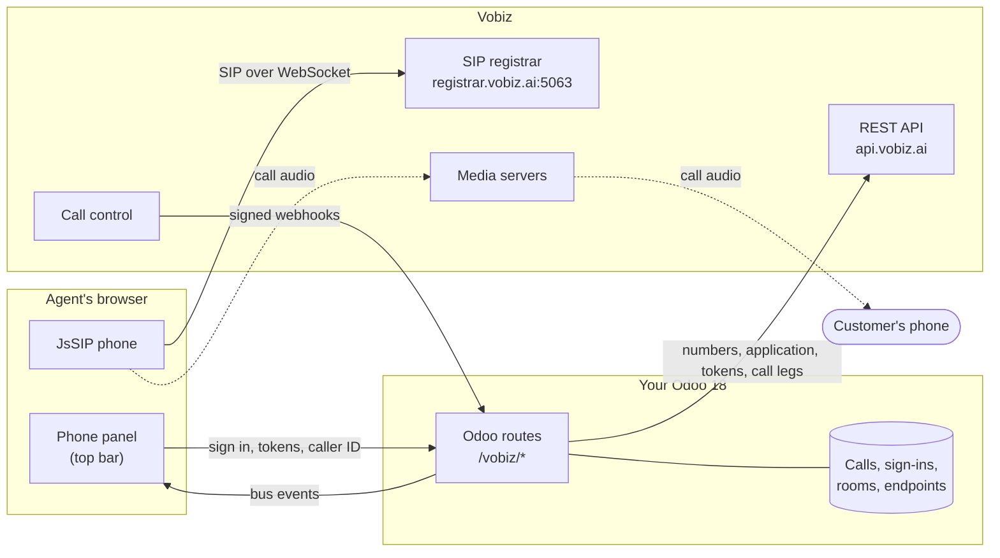
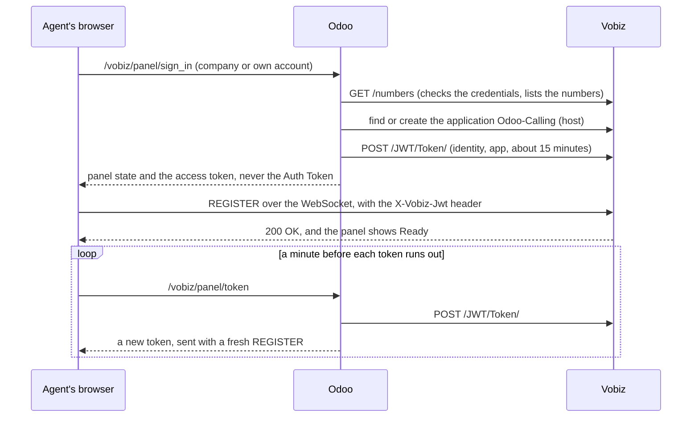
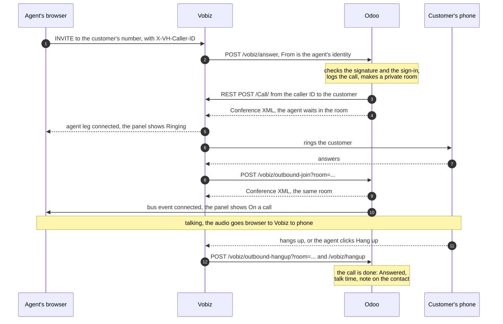
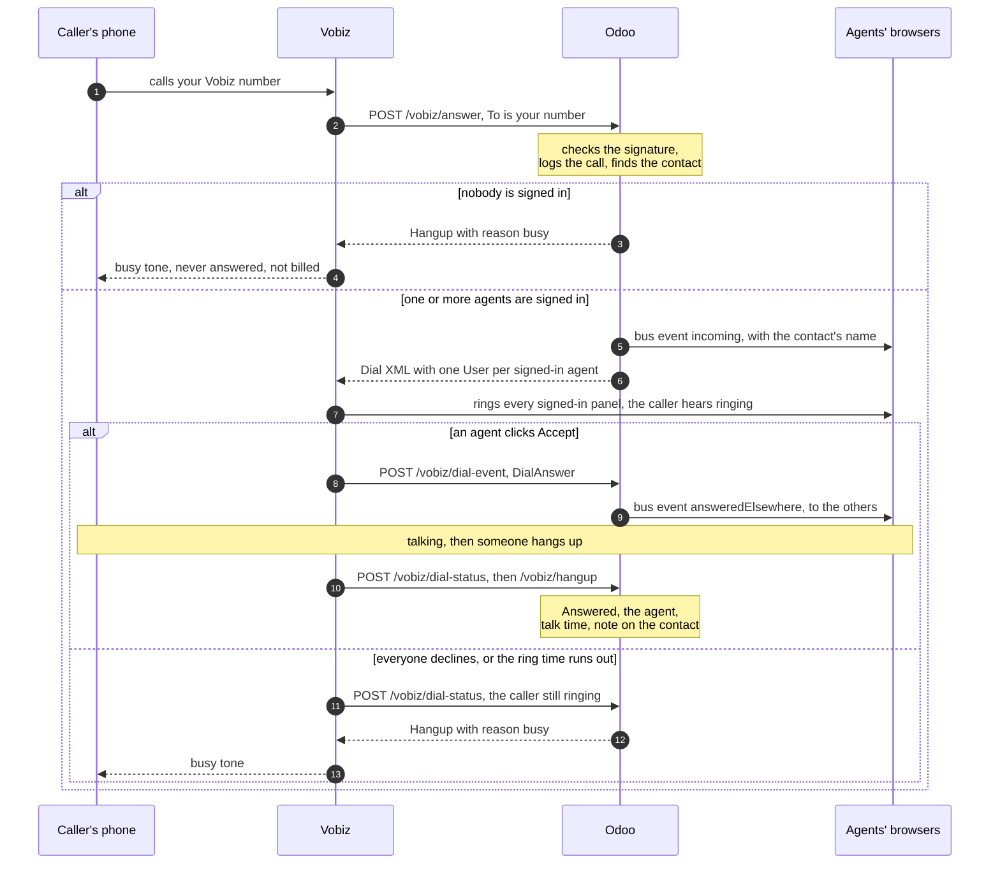
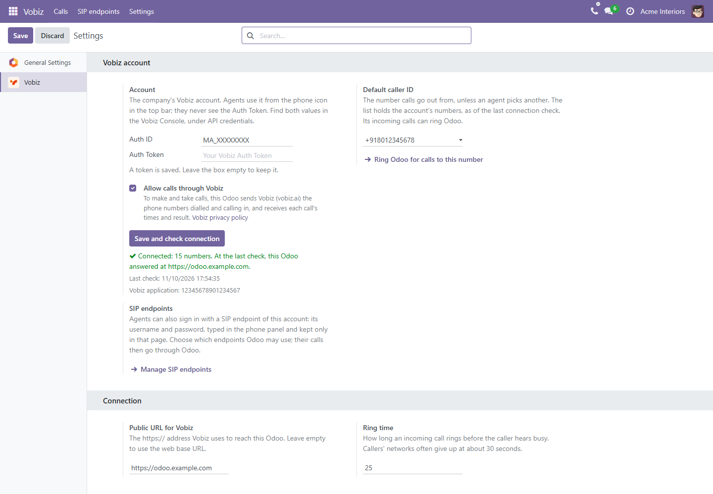
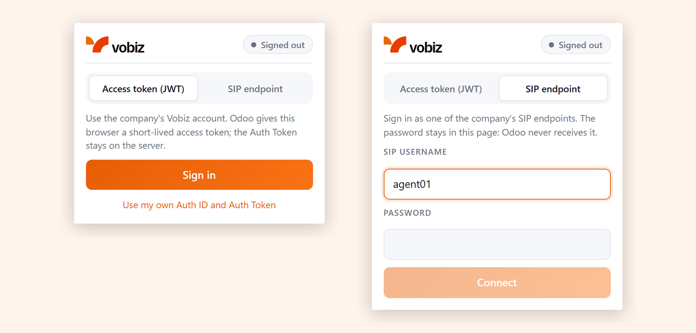

# Vobiz Calling for Odoo

Make and take [Vobiz](https://www.vobiz.ai) phone calls inside Odoo 18: a phone in the top bar, click-to-call on every phone number, incoming calls with **Accept** and **Decline**, and every call logged on the contact and under **Vobiz → Calls**.

This repository holds one Odoo module, [`vobiz_calling`](vobiz_calling), published free on the Odoo Apps Store at <https://apps.odoo.com/apps/modules/18.0/vobiz_calling>. There is one branch per Odoo version. This branch, `18.0`, is for Odoo 18.

**Who this is for.** Developers and testers who want to run the module on their own computer, understand how it works, test it and change it. To put it on a company's Odoo, read [Install on an existing Odoo](#install-on-an-existing-odoo) and then [step 4](#step-4-connect-odoo-to-vobiz). Administrators and agents also have a short guide that ships inside the module: [`vobiz_calling/README.md`](vobiz_calling/README.md).

**Tested with** Odoo 18.0 (Docker image `odoo:18`, build 18.0-20261015, Python 3.12) and PostgreSQL 16.

## Contents

1. [What it does](#what-it-does)
2. [How it works](#how-it-works)
3. [Repository layout](#repository-layout)
4. [Requirements](#requirements)
5. [Quick start](#quick-start)
6. [Local setup, step by step](#local-setup-step-by-step)
7. [Testing](#testing)
8. [Troubleshooting](#troubleshooting)
9. [Install on an existing Odoo](#install-on-an-existing-odoo)
10. [Running it in production](#running-it-in-production)
11. [Reference](#reference)
12. [Security model](#security-model)
13. [Development guide](#development-guide)
14. [Limitations](#limitations)
15. [Support and license](#support-and-license)

## What it does

| Feature | What people see |
|---|---|
| **A phone in the top bar** | The phone icon opens the Vobiz panel: a number box and keypad, **Calling from** (which of the account's numbers the call shows), and **Call**. During a call: **Mute**, **Hold**, **Keypad** (tones for phone menus) and **Hang up**. A dot on the icon shows the state: grey when signed out or still connecting, green when ready, orange during a call, pulsing red while a call rings. |
| **Click-to-call** | While the agent is signed in to the phone, every phone field in Odoo dials through it: the **Call** link next to a number on a form, or the number itself in a list. Signed out, the link does what it always did (the browser's `tel:` handler). |
| **Incoming calls** | A call to the account's number rings every agent signed in to that account. The panel opens and rings, showing the caller's number and, when it belongs to a contact, their name. The first agent to click **Accept** takes the call; the others see "Another agent answered the call." The caller isn't answered, or billed, until someone accepts. |
| **A log of every call** | Each call, in or out, is a record under **Vobiz → Calls**: direction, outcome, number, contact, agent, times and talk time. When the number belongs to a contact, the call is also noted in the contact's chatter. |
| **Two ways to sign in** | **Access token (JWT)**, on the company's Vobiz account or the agent's own: the browser gets short-lived tokens and never sees an Auth Token. **SIP endpoint**: an endpoint's username and password; the password stays in the browser and never reaches Odoo. |
| **Set up in Settings** | **Settings → Vobiz**: the account's credentials (the token is stored encrypted), an explicit data opt-in, a connection check that also tests whether Vobiz can reach this Odoo, the default caller ID, one button that sends a number's incoming calls to Odoo, and the SIP endpoints agents may use. |

<p align="center">
  
</p>

## How it works

### The three parts



- **The agent's browser runs the phone.** The panel is an OWL component in Odoo's top bar (`static/src/softphone_systray.*`). The phone itself is a service (`static/src/softphone_service.js`) that drives [JsSIP](https://jssip.net) 3.10.1, bundled in `static/lib/jssip/`. It registers with Vobiz over SIP-over-WebSocket at `wss://registrar.vobiz.ai:5063/`, and the call's audio (WebRTC) goes straight between the browser and Vobiz.
- **Your Odoo server is the calling backend.** There is no other server. Vobiz sends each call's webhooks to `/vobiz/*` on this Odoo, which answers with VobizXML, places and ends call legs over the REST API, writes the call log, and tells the browser what happened over Odoo's bus.
- **Vobiz** provides the numbers, the SIP registrar, the media servers and the REST API (`https://api.vobiz.ai`).

What travels where:

| From → to | What | How |
|---|---|---|
| Browser → Odoo | Sign in and out, a fresh access token, the caller ID, "can Vobiz reach this Odoo?" | JSON-RPC to `/vobiz/panel/*`, with the user's Odoo session |
| Odoo → Vobiz | Check the credentials, list the numbers, create or update the application, link numbers and endpoints, mint access tokens, place and end call legs | REST, with `X-Auth-ID` and `X-Auth-Token` |
| Browser ⇄ Vobiz | SIP signalling (REGISTER, INVITE, BYE) and the call's audio | WebSocket (WSS) and WebRTC (UDP) |
| Vobiz → Odoo | Call events: answer, hang-up, dial status, conference events | HTTPS POST, form-encoded, signed |
| Odoo → browser | The caller's name, "the customer answered", "another agent answered", "you were signed out" | Odoo bus, channel `vobiz/event` |

Audio never passes through Odoo.

### Signing in

**Access token (JWT).** Mode `company` uses the account saved in Settings. Mode `own` uses an Auth ID and Auth Token the agent types in the panel.



1. Odoo checks the credentials and lists the account's active voice numbers (`GET /numbers`).
2. It finds this Odoo's application in the account, matched on its answer URL, or creates it: named `Odoo-Calling (<host of the Public URL>)`, with answer URL `<Public URL>/vobiz/answer` and hang-up URL `<Public URL>/vobiz/hangup`, both POST.
3. It has Vobiz mint an access token (`POST /JWT/Token/`) for a fresh identity, `odoo-<12 hex>-<6 hex>_<Auth ID>`. The `app` claim is that application, which is how Vobiz knows to send this identity's calls to Odoo. The token is valid for about 15 minutes.
4. The browser registers with the token in an `X-Vobiz-Jwt` header, and renews it by itself a minute before it runs out (about every 13 minutes).

An `own` sign-in keeps the agent's Auth Token, encrypted, on the sign-in record until sign-out or expiry, then forgets it. Its application is created in the agent's own account. Incoming calls to that account's numbers reach Odoo only if those numbers are linked to that application in that account's Console: the **Ring Odoo for calls to this number** button in Settings works on the company account.

**SIP endpoint.** Mode `sip`. The agent types an endpoint's username and password. Only the username goes to Odoo, which checks that:

- an administrator allowed the endpoint (**Vobiz → SIP endpoints**);
- it isn't kept for another user, or in use by someone else right now;
- Vobiz still sends its calls to Odoo's application (`GET /Endpoint/{id}/`).

The browser then registers as the endpoint, with the password, using SIP digest authentication. The endpoint's calls are placed, and their webhooks checked, with the company's credentials.

Rules for both:

- Only internal users, meaning employees, can use the phone. Portal and public users are refused. A sign-in stops working as soon as its user is archived, is no longer an internal user, or is removed from the company.
- One sign-in per Odoo user. Signing in again, in another tab or browser, ends the previous sign-in.
- A sign-in lasts 12 hours. An hourly scheduled action ends the expired ones.
- After a page reload, an access-token sign-in picks up again by itself. A SIP sign-in asks for the password again, because it was never stored.

### An outbound call



The agent's browser leg and the customer's phone leg are two calls joined in a private conference room, not one `<Dial><Number>` from the browser leg. That lets Odoo place the customer's leg from the agent's chosen caller ID, cancel it if the agent hangs up while it rings, and know exactly when the customer answered. In tests it also kept both sides' audio reliable.

- The room's name is random (`odoo` followed by 24 hex characters). It's the only value the customer leg's webhooks carry in their query string, and everything else is looked up on the server.
- While the customer's phone rings, the agent hears silence (the room's wait sound is `<Wait length="10"/>`, repeated) and the panel shows **Ringing…**.
- If the agent hangs up while the customer's phone rings, Odoo cancels the customer's leg (`DELETE /Call/{uuid}/`) and logs **Caller hung up**.
- If the customer declines, is busy or doesn't answer, Odoo ends the agent's leg too, and logs **Busy** or **Not answered**.
- If Vobiz refuses the call before it starts (the panel says "The call failed: Busy", for example), the panel asks Odoo to call itself at its Public URL. When that fails, the panel says Vobiz couldn't reach this Odoo.

### An incoming call



- Odoo finds the account from the webhook's `ParentAuthID` or, failing that, from the number called. It rings every live sign-in of that account: company, own-account and SIP-endpoint agents alike.
- The caller isn't answered while it rings, so nothing is billed. If nobody is signed in, if everyone declines, or if the **Ring time** (25 seconds by default) runs out, Odoo answers with `<Hangup reason="busy"/>` and the caller hears a busy tone.
- An agent already on a call isn't interrupted. Their panel turns the new call away (`486 Busy Here`) while the others keep ringing.

### What gets logged

Each call is logged once, by the server, so the log doesn't depend on any browser staying open. When a call ends and its number belongs to a contact, a **Vobiz call** note is posted in the contact's chatter, as the agent.

| Outcome (`vobiz.call.outcome`) | Shown as | When |
|---|---|---|
| `answered` | Answered | Someone answered. Talk time is from the answer to the end. |
| `missed` | Missed | Incoming, with nobody signed in, or it ended without a clearer reason. |
| `declined` | Declined | Incoming, and the agents declined it. |
| `no_answer` | Not answered | Incoming, and the ring time ran out. Outgoing, and the customer didn't answer (`NO_ANSWER`). |
| `busy` | Busy | Outgoing, and the customer declined or was busy (`USER_BUSY`, `CALL_REJECTED`). |
| `failed` | Failed | Outgoing, and Vobiz refused the customer's leg, or it ended for another reason before anyone answered. |
| `canceled` | Caller hung up | Incoming, and the caller hung up while it rang (`ORIGINATOR_CANCEL`). Outgoing, and the agent hung up before the customer answered. |

The contact is found from its **Phone** and **Mobile** fields. If the `res.partner.phone_sanitized` field exists (it comes with Odoo's phone validation), that stored E.164 form is tried first. Otherwise the module searches on the last six digits and normalises each candidate, so `+91 98765 43210` and `098765 43210` match the same number.

### Live updates in the panel

The server sends these on the bus channel `vobiz/event` to the agent's user:

| Event | Sent when | The panel |
|---|---|---|
| `incoming` | An incoming call starts ringing | Shows the contact's name next to the number |
| `answeredElsewhere` | Another agent accepted the call | Ends with "Another agent answered the call." |
| `outbound`, state `connected` | The customer answered | Shows **On a call**, starts the timer, and shows Mute, Hold and Keypad |
| `outbound`, state `ended` | The customer's leg ended before anyone answered | Says "No answer.", "Busy." or "The call could not be connected." |
| `signedOut` | The company account or the Public URL changed, or an administrator stopped the agent's SIP endpoint | Stops the phone and says why |

If the bus doesn't reach the browser (for example behind a proxy that doesn't forward `/websocket`), calls still ring and connect. But the panel stays on **Ringing…** after the customer answers, without Mute, Hold and Keypad, and caller names don't show.

## Repository layout

```text
odoo-vobiz-calling/
├── README.md                      this file
├── LICENSE                        LGPL-3
├── .gitattributes                 LF line endings; keeps the JsSIP bundle byte for byte
└── vobiz_calling/                 the Odoo module
    ├── __manifest__.py            name, version (18.0.x.y.z), dependencies, data files, assets
    ├── __init__.py
    ├── README.md                  the short guide for administrators and agents (ships with the module)
    ├── LICENSE
    ├── controllers/
    │   └── main.py                every /vobiz/* route: the panel's JSON-RPC, the self-check, the webhooks
    ├── tools/
    │   └── vobiz.py               Vobiz REST client, webhook signatures, E.164, XML helpers, token encryption (no database access)
    ├── models/
    │   ├── res_company.py         the company's Vobiz account: Auth ID, encrypted Auth Token, application, numbers, consent, last check
    │   ├── res_config_settings.py Settings → Vobiz: fields, status line, "Save and check connection", "Ring Odoo for calls to this number"
    │   ├── vobiz_session.py       a sign-in: modes, identities, access tokens, the Public URL, the self-check, webhook tokens, expiry
    │   ├── vobiz_call.py          the call log: outcomes, talk time, contact matching, the chatter note
    │   ├── vobiz_room.py          the private conference room behind each outbound call
    │   └── vobiz_endpoint.py      SIP endpoints agents may use: Load from Vobiz, Use with Odoo, Stop using
    ├── views/
    │   ├── res_config_settings_views.xml   the Settings → Vobiz page, and the Vobiz → Settings action
    │   ├── vobiz_call_views.xml            Calls list, form and search, and the Vobiz menu
    │   └── vobiz_endpoint_views.xml        the SIP endpoints list and its buttons
    ├── security/
    │   ├── ir.model.access.csv    access rights per model
    │   └── vobiz_security.xml     multi-company record rules for calls and endpoints
    ├── data/
    │   ├── ir_cron.xml            scheduled actions: end expired sign-ins (hourly), remove old rooms (daily)
    │   └── neutralize.sql         what a neutralized copy of the database drops
    ├── static/
    │   ├── src/
    │   │   ├── softphone_service.js        the phone: JsSIP, sign-in, token renewal, calls, hold, mute, tones, bus events
    │   │   ├── softphone_systray.js        the panel component in the top bar (OWL)
    │   │   ├── softphone_systray.xml       the panel's templates: sign-in tabs, dialler, call card, keypad
    │   │   ├── softphone.scss              the panel's look
    │   │   ├── phone_field_patch.js        click-to-call on Odoo's phone fields
    │   │   └── phone_field_patch.xml       hooks the click into the phone field templates
    │   ├── lib/jssip/             JsSIP 3.10.1, minified (MIT), and its licence
    │   ├── img/vobiz_logo.png     the panel's logo
    │   └── description/           the Apps Store page: index.html, icon, banner, screenshots
    └── tests/
        ├── test_tools.py          9 unit tests of tools/vobiz.py
        └── test_webhooks.py       41 tests of the routes, sign-in, setup and endpoints, against a fake Vobiz
```

## Requirements

### To run it on your computer

| You need | Why | Check with |
|---|---|---|
| [Docker Desktop](https://www.docker.com/products/docker-desktop/) (Windows, macOS), or Docker Engine with the Compose plugin (Linux) | Runs Odoo 18 and PostgreSQL without installing them | `docker --version` and `docker compose version` |
| [git](https://git-scm.com/downloads) | Gets this repository | `git --version` |
| A tunnel: [`cloudflared`](https://developers.cloudflare.com/cloudflare-one/connections/connect-networks/downloads/) (no account needed) or [ngrok](https://ngrok.com/download) | Vobiz must reach your Odoo at a public `https://` address | `cloudflared --version` |
| Google Chrome or Microsoft Edge, a microphone and a headset | The phone runs in the browser | |
| About 4 GB of free disk | The `odoo:18` image is about 3 GB | |
| Python 3 (optional) | Only for the [webhook simulator](#simulated-webhooks-no-real-call) | `python --version` |

### A Vobiz account

| You need | Where |
|---|---|
| An account | Sign up at <https://console.vobiz.ai/app/register> |
| KYC done, and some balance | Numbers and calls are billed. Indian numbers need KYC. |
| At least one active voice number | Console → **DID** → filter by country → **Buy**. Wait about 2 minutes after buying before calling from it. |
| The Auth ID (`MA_XXXXXXXX`) and Auth Token | Console → **Dashboard** → **API credentials** card |
| Optional: a SIP endpoint, to try that way of signing in | Console → **Voice → Endpoints** → **+ Create New Endpoint** |

> [!IMPORTANT]
> Use a test account or a spare number if you can. Odoo creates an application in the account, and **Ring Odoo for calls to this number** moves that number's incoming calls to it, away from whatever it was linked to before.

### Network

| From | To | Port | For |
|---|---|---|---|
| The Odoo server | `api.vobiz.ai` | 443 (HTTPS) | The REST API |
| Vobiz | Odoo's Public URL | 443 (HTTPS) | Webhooks |
| The Odoo server | Its own Public URL | 443 (HTTPS) | The connection self-check |
| Agents' browsers | `registrar.vobiz.ai` | 5063 (WSS) | SIP signalling |
| Agents' browsers | `stun.l.google.com` | 19302 (UDP) | Finding the browser's public address (STUN) |
| Agents' browsers | Vobiz's media servers | UDP | The call's audio |

A network that blocks port 5063 stops the phone from connecting. One that blocks UDP leaves calls without audio.

### Odoo

- Odoo 18.0, Community or Enterprise, self-hosted or on Odoo.sh. **Not Odoo Online**, which can't install modules that contain Python.
- The module depends on `base_setup`, `mail` and `bus`, which are installed with it.
- It needs the Python libraries `cryptography` and `requests`. Both are Odoo requirements, and both are in the official Docker image.

## Quick start

For people who know Odoo and Docker. Every step is explained in the [next section](#local-setup-step-by-step). The commands work in PowerShell, macOS and Linux terminals, and Git Bash.

```bash
mkdir vobiz-odoo-local
cd vobiz-odoo-local
git clone https://github.com/vobiz-ai/odoo-vobiz-calling.git
# Save docker-compose.yml from step 1.3 in this folder, then:
docker compose up -d db
docker compose run --rm odoo odoo -d vobiz_dev -i vobiz_calling,contacts --without-demo=all --stop-after-init
docker compose up -d
# Open http://localhost:8069, log in as admin / admin, and change the password.
cloudflared tunnel --url http://127.0.0.1:8069
# Copy the https://....trycloudflare.com address it prints. Then in Odoo:
#   Settings → Vobiz: Auth ID, Auth Token, tick "Allow calls through Vobiz",
#   Public URL for Vobiz = the tunnel address → "Save and check connection"
#   Default caller ID → "Ring Odoo for calls to this number"
#   Phone icon in the top bar → Sign in → call your own mobile
```

## Local setup, step by step

Five steps:

1. Run Odoo with the module.
2. Give it a public `https://` address.
3. Prepare the Vobiz account.
4. Connect the two.
5. Make the first calls.

Allow about half an hour the first time, most of it downloading the Docker images. Every command below works the same in PowerShell, macOS and Linux terminals and Git Bash, unless the step says otherwise.

### Step 1: Run Odoo 18 with the module

**1.1 Install Docker and git.** Install [Docker Desktop](https://www.docker.com/products/docker-desktop/) (Windows, macOS), or Docker Engine with the Compose plugin (Linux), and [git](https://git-scm.com/downloads). Start Docker Desktop and wait until it says the engine is running.
*Why:* Odoo and PostgreSQL run in containers, so you don't have to install either of them.

```bash
docker --version
docker compose version
```

**1.2 Make a working folder and clone the repository into it.**
*Why:* the compose file goes in `vobiz-odoo-local/`, next to the clone, and mounts the clone into Odoo. Keeping the compose file outside the clone keeps `git status` clean.

```bash
mkdir vobiz-odoo-local
cd vobiz-odoo-local
git clone https://github.com/vobiz-ai/odoo-vobiz-calling.git
```

**1.3 Create `docker-compose.yml` in `vobiz-odoo-local/`** with exactly this content:

```yaml
# A local Odoo 18 with the Vobiz Calling module, for development and testing.
# Lives next to the clone:  ./docker-compose.yml  and  ./odoo-vobiz-calling/
services:
  db:
    image: postgres:16
    environment:
      POSTGRES_DB: postgres
      POSTGRES_USER: odoo
      POSTGRES_PASSWORD: odoo
    volumes:
      - db-data:/var/lib/postgresql/data

  odoo:
    image: odoo:18
    depends_on:
      - db
    environment:
      HOST: db
      USER: odoo
      PASSWORD: odoo
    ports:
      # Only this computer can open it; the tunnel reaches it from here.
      - "127.0.0.1:${ODOO_PORT:-8069}:8069"
    volumes:
      # The repository root holds the module folder vobiz_calling/.
      - ./odoo-vobiz-calling:/mnt/extra-addons:ro
      - odoo-data:/var/lib/odoo
    # One database, no database manager, and trust the tunnel's https headers.
    command: ["--db-filter=^vobiz_dev$$", "--no-database-list", "--proxy-mode"]

volumes:
  db-data:
  odoo-data:
```

What each part does:

| Part | What it does, and why |
|---|---|
| `image: odoo:18` | The official Odoo 18 image, with Python 3.12, `cryptography` and `requests`. To stop it changing under you, pin a dated tag such as `odoo:18.0-20261015`. |
| `127.0.0.1:${ODOO_PORT:-8069}:8069` | Opens Odoo at `http://localhost:8069`, for this computer only. If port 8069 is taken, create a file named `.env` next to `docker-compose.yml` containing `ODOO_PORT=8070`. Compose reads it on every command. |
| `./odoo-vobiz-calling:/mnt/extra-addons:ro` | Puts the repository on Odoo's add-ons path (`/mnt/extra-addons` in this image), so Odoo finds `vobiz_calling/`. Files you edit on your computer change in the container too. |
| `--db-filter=^vobiz_dev$$` | Odoo serves only the `vobiz_dev` database. Vobiz's webhooks arrive without an Odoo login, so Odoo must be able to tell which database they're for. With several databases and no filter, they get `404`. (`$$` is how a compose file writes a single `$`.) |
| `--no-database-list` | Turns off the database manager (create, copy, drop, back up), which the tunnel would otherwise expose to the internet. |
| `--proxy-mode` | Trusts the tunnel's `X-Forwarded-*` headers, so Odoo knows it's being reached over `https://`. |
| `db-data`, `odoo-data` | Named volumes that keep the database and Odoo's file store between restarts. |

**1.4 Start PostgreSQL.**
*Why:* the database server has to be running before Odoo can create a database in it. The first time, Docker downloads the image.

```bash
docker compose up -d db
```

**1.5 Create the `vobiz_dev` database and install the module.**
*Why:* this runs Odoo once, in a container that's removed afterwards, to create the database and install the module before the web server starts.

```bash
docker compose run --rm odoo odoo -d vobiz_dev -i vobiz_calling,contacts --without-demo=all --stop-after-init
```

| Part | Meaning |
|---|---|
| `-d vobiz_dev` | The database. It's created because it doesn't exist yet. Its name must match the `--db-filter`. |
| `-i vobiz_calling,contacts` | Install the module, which brings in `base_setup`, `mail` and `bus`. Also install **Contacts**, so you have contact forms to click-to-call from. |
| `--without-demo=all` | No demo data. Demo contacts have real-looking phone numbers you shouldn't call, and demo users have well-known passwords. |
| `--stop-after-init` | Exit when done, instead of serving web pages. |

It takes about a minute (the first run also downloads the Odoo image), and the log ends with `Modules loaded.`. If the log also shows two `docutils` notices ("Unexpected indentation", "Block quote ends without a blank line"), they come from a core module's description and are harmless.

**1.6 Start Odoo.**

```bash
docker compose up -d
docker compose ps
```

Both `db` and `odoo` should be `running`. Open <http://localhost:8069> and log in with email **admin** and password **admin**. A database created from the command line always starts with these.

**1.7 Change the admin password now.** Click your avatar (top right) → **Preferences** → **Account Security** tab → **Change Password**.
*Why:* step 2 makes this Odoo reachable from the internet, and `admin` / `admin` must not be.

**1.8 Optional: add a second agent.** To test ringing more than one person: **Settings → Users & Companies → Users → New**. Enter a name and an email address (the login), save, then use the gear menu → **Change Password** to give the user a password. Sign that user in from a second browser or a private window, because Odoo keeps one login per browser profile.

### Step 2: Give Odoo a public HTTPS address

Vobiz controls every call by calling this Odoo's webhooks, and it only calls `https://` addresses. On your computer, a tunnel gives Odoo such an address.

**2.1 Install cloudflared.**
*Why:* its "quick tunnel" needs no account. ngrok works too (`ngrok http 8069`).

| System | Command |
|---|---|
| Windows | `winget install --id Cloudflare.cloudflared` |
| macOS | `brew install cloudflared` |
| Linux | The package from <https://developers.cloudflare.com/cloudflare-one/connections/connect-networks/downloads/> |

**2.2 Start the tunnel and copy its address.**
*Why:* it forwards `https://<random words>.trycloudflare.com` to your Odoo.

```bash
cloudflared tunnel --url http://127.0.0.1:8069
```

Among its output is a box with an address like `https://some-random-words.trycloudflare.com`. Copy it, and **leave this window open**: closing it closes the tunnel.

On Windows, if the terminal doesn't find `cloudflared` yet, open a new terminal, or run it by its full path:

```powershell
& "C:\Program Files (x86)\cloudflared\cloudflared.exe" tunnel --url http://127.0.0.1:8069
```

**2.3 Check that the tunnel reaches this Odoo.**
*Why:* this is the same address Vobiz will use, so it should work before you go further.

```bash
curl "https://some-random-words.trycloudflare.com/vobiz/ping?nonce=0123456789abcdef0123456789abcdef"
```

A 64-character hex answer means the tunnel, Odoo and the module are all reachable. In Windows PowerShell, type `curl.exe`, because `curl` there means something else.

> [!WARNING]
> Quick tunnels are for testing only. The address changes every time cloudflared restarts, and an address can stop working while cloudflared still looks fine. Whenever that happens, put the new address in **Public URL for Vobiz** and click **Save and check connection** again ([step 4.3](#step-4-connect-odoo-to-vobiz)). Until you do, calls fail: outgoing calls end at once ("The call failed: Busy" or similar), and incoming calls don't reach Odoo.

### Step 3: Prepare the Vobiz account

Do this in the [Vobiz Console](https://console.vobiz.ai).

**3.1 The account, KYC and balance.** Sign in, or sign up at <https://console.vobiz.ai/app/register>. Complete KYC if the Console asks for it, and make sure there is some balance.
*Why:* numbers and calls are billed, and Indian numbers need KYC.

**3.2 A voice number.** Console → **DID** → filter by country → **Buy**. If the purchase dialog offers **Link to Voice App**, choose **No app — link later**: Odoo links the number in step 4.5.
*Why:* incoming calls ring this number, and outgoing calls show it as the caller ID. Wait about 2 minutes after buying before calling from it. Sooner, Vobiz answers "From number not owned by account".

**3.3 The API credentials.** Console → **Dashboard** → **API credentials** card. Copy the **Auth ID** (`MA_XXXXXXXX`), then the **Auth Token** (click the eye icon to reveal it).
*Why:* Odoo uses them, only on the server, to set up the account and to mint the browsers' access tokens. Treat the Auth Token like a password: it is not your Console password.

**3.4 Optional: a SIP endpoint.** Console → **Voice → Endpoints** → **+ Create New Endpoint**. Fill in:

- an **Alias**;
- a **Username** (letters and digits);
- a **Password**. Write it down now, because Vobiz doesn't show it again.

Leave **Application** on **None**.
*Why:* only needed to try the **SIP endpoint** way of signing in. Odoo links the endpoint to its application in step 4.6.

### Step 4: Connect Odoo to Vobiz

**4.1 Open Settings → Vobiz.** That's Odoo's **Settings** app, then **Vobiz** in the left column, or the **Vobiz** app → **Settings**. Only users with the *Administration: Settings* access right see it.

<p align="center">
  
</p>

**4.2 Fill in the account.**

| Field | Enter | Why |
|---|---|---|
| **Auth ID** | `MA_XXXXXXXX` | The company's Vobiz account. |
| **Auth Token** | The token | It's stored encrypted and never shown again. Later, leave the box empty to keep the saved one. |
| **Allow calls through Vobiz** | Ticked | The data opt-in. Until it's ticked, Odoo sends Vobiz nothing and nobody can sign in to the phone. |
| **Public URL for Vobiz** (under *Connection*) | The tunnel address, for example `https://some-random-words.trycloudflare.com` | Where Vobiz sends the webhooks. It must start with `https://`. Left empty, Odoo uses its web base URL, which follows whatever address an administrator last logged in from, so set it explicitly. |
| **Ring time** | 25 (the default) | How many seconds an incoming call rings before the caller hears busy (5 to 120). Many callers' networks give up at about 30. |

**4.3 Click Save and check connection.** That's the purple button under the consent box, **not** **Save** at the top of the page.
*Why:* only this button checks the account and sets it up. In order, it:

1. saves the form;
2. stops with a message if the consent box isn't ticked or the Public URL doesn't start with `https://`;
3. checks the Auth ID and Auth Token, and lists the account's active voice numbers (`GET /numbers`);
4. finds or creates the application `Odoo-Calling (<host>)`, and writes its answer URL `<Public URL>/vobiz/answer` and hang-up URL `<Public URL>/vobiz/hangup` again, even when they look right;
5. calls this Odoo at `<Public URL>/vobiz/ping`, the way Vobiz will, to prove the address reaches this very Odoo;
6. sets the **Default caller ID** to the first number, if none is set yet.

A notification sums it up, for example *"Connected to MA_XXXXXXXX: 2 numbers, application 12345678901234567. Default caller ID set to +91XXXXXXXXXX. Vobiz will reach this Odoo at https://…"*. The line under the button then says *"Connected: 2 numbers. At the last check, this Odoo answered at https://…"*, with **Last check** and the **Vobiz application** id below it.

That line isn't live. Check again whenever the address, the proxy or the tunnel changes.

**4.4 Choose the Default caller ID.** The list holds the account's numbers as of the last check. Calls go out from this number unless an agent picks another in the panel. Click **Save** at the top, or go straight to 4.5, which saves too.

**4.5 Click Ring Odoo for calls to this number**, and confirm.
*Why:* Vobiz sends incoming calls to whatever application a number is linked to. This links the Default caller ID's number to Odoo's application (`POST /numbers/%2B<number>/application`), moving it off any other application. The confirmation says so before anything changes, and the result names the application the number was on before.

**4.6 Optional: allow SIP endpoints.** Click **Manage SIP endpoints** (or open **Vobiz → SIP endpoints**) → **Load from Vobiz**. Then, on each endpoint agents may use, click **Use with Odoo** and confirm.
*Why:* Vobiz sends a call placed from an endpoint to the application linked to that endpoint, so Odoo links the endpoint to its own (`POST /Endpoint/{id}/`).

- **Calls go to Odoo** and **Used in Odoo** turn on.
- Set **Agent** to keep an endpoint for one user.
- **Stop using** signs out whoever is using the endpoint and blocks it in Odoo. Vobiz keeps it linked until you change that in the Console.

### Step 5: Make the first calls

**5.1 Sign in to the phone.** Click the **phone icon** in the top bar → **Access token (JWT)** tab → **Sign in**. The pill at the top of the panel goes from *Connecting* to *Ready*, and the dot on the icon turns green.

<p align="center">
  
</p>

Open Odoo at `http://localhost:8069` or at the tunnel's `https://` address. Browsers allow the microphone only on `https://` pages and on `localhost`, so a LAN address such as `http://192.168.1.20:8069` won't work. The browser asks for the microphone at your first call: allow it.

**5.2 Call your own mobile.** In the panel, check **Calling from**, type your mobile number as `+91XXXXXXXXXX`, and click **Call** (or press Enter). A 10-digit number, or one starting with `0`, is taken as an Indian number.

What to expect:

- The panel shows *Calling…*, then *Ringing…*. You hear silence while your mobile rings, which is normal.
- Your mobile shows the **Calling from** number. Answer it.
- The panel shows *On a call* with a timer, and **Mute**, **Hold**, **Keypad** and **Hang up**.
- Hang up from either side.

Then open **Vobiz → Calls**: *Call to +91XXXXXXXXXX*, Outgoing, **Answered**, with the talk time.

**5.3 Click-to-call.** **Contacts → New**: a name, and your mobile in **Phone**. Save, then click **Call** next to the number. The panel opens and dials. After the call, the contact's chatter has a *Vobiz call* note.

**5.4 An incoming call.** From your mobile, call the Vobiz number from step 4.5. The panel opens and rings, with **Accept** and **Decline**, and your contact's name (your mobile is a contact now). Accept, talk, and hang up. **Vobiz → Calls** shows *Call from …*, Incoming, **Answered**, with you as the agent.

<p align="center">
  
</p>

That's the whole loop. The [manual test plan](#manual-test-plan-live-calls) covers everything else.

### Everyday commands

Run these in `vobiz-odoo-local/`.

| To | Run |
|---|---|
| Follow Odoo's log | `docker compose logs -f odoo` |
| Stop, keeping everything | `docker compose stop` |
| Start again | `docker compose up -d`, then restart the tunnel if it stopped (step 2) |
| Load a Python change | `docker compose restart odoo` |
| Load a change to views, data, security or the manifest, or after `git pull` | `docker compose run --rm odoo odoo -d vobiz_dev -u vobiz_calling --stop-after-init`, then `docker compose restart odoo` |
| Open an Odoo shell on the database | `docker compose run --rm odoo odoo shell -d vobiz_dev` |
| Open `psql` on the database | `docker compose exec db psql -U odoo vobiz_dev` |
| Delete everything: database, files and containers | `docker compose down -v` (this can't be undone) |

## Testing

There are three levels:

1. **Automated tests.** 50 tests that need no Vobiz account and no network. Run them before every commit.
2. **Simulated webhooks.** A script sends this Odoo webhooks signed the way Vobiz signs them, to exercise the call handling without a real call.
3. **Live calls.** The manual test plan, on a real account through a tunnel.

### Automated tests

Run them on a throwaway database, `vobiz_test`, so the data in `vobiz_dev` is never touched:

```bash
docker compose run --rm odoo odoo -d vobiz_test -i vobiz_calling --test-enable --test-tags /vobiz_calling --stop-after-init --without-demo=all
```

> [!NOTE]
> In **Git Bash on Windows**, put `MSYS_NO_PATHCONV=1 ` in front of that command. Otherwise Git Bash rewrites `/vobiz_calling` into a Windows path (`C:/Program Files/Git/vobiz_calling`) and no test runs. PowerShell, Command Prompt, macOS and Linux don't need it.

It takes about a minute. The result is in the last lines (the times vary):

```text
... odoo.service.server: 50 post-tests in 43.01s, 11110 queries
... odoo.tests.result: 0 failed, 0 error(s) of 50 tests when loading database 'vobiz_test'
```

| To | Change the command like this |
|---|---|
| Run the tests again (faster) | `-u vobiz_calling` instead of `-i vobiz_calling` |
| Start from a fresh test database | Run `docker compose exec db dropdb -U odoo vobiz_test` first |
| Run one test class | `--test-tags /vobiz_calling:TestVobizWebhooks` |
| Run one test | `--test-tags /vobiz_calling:TestVobizWebhooks.test_outbound_runs_through_a_room_and_logs_the_call` |

**How they work.**

- `tests/test_tools.py` (9 tests) checks `tools/vobiz.py` directly.
- `tests/test_webhooks.py` (41 tests) is an `HttpCase`. It sends real HTTP requests to the module's routes on a test server, signs webhooks with `vobiz.sign()` exactly as Vobiz does, and signs test users in through `/vobiz/panel/sign_in`.
- Vobiz itself is faked. `FakeVobiz` replaces `VobizClient.request` and answers like the real API, including lists of 20 per page and a `request_uuid` for each placed call. It records every request, so a test can check what Odoo asked Vobiz for. Nothing leaves the computer. Where a test needs it, the self-check that calls the Public URL is patched too.
- All the data is made up: Auth IDs `MA_TEST0001` and `MA_TEST0002`, numbers from `+910000000001`, Public URL `https://odoo.test`.
- Each test runs in a transaction that's rolled back. Both files are tagged `post_install` and `-at_install`, so they run once every module is installed.

**What they cover.**

| Area | Tests | What is checked |
|---|---|---|
| Helpers | 9 | E.164 normalisation (`+91 98765-43210`, `0091…`, `0XXXXXXXXXX`, 10 digits, foreign numbers); SIP user parsing; V3 and V2 signatures, including that another URL or token fails; encryption round trip, and that another database's secret can't decrypt it; XML escaping; a malformed Auth ID is refused; the token never appears in `repr` or an error message; an endpoint's application id, whether Vobiz sends a URI or an object. |
| Webhook security | 4 | Unsigned webhooks, wrongly signed ones, and ones for an unknown account get `403` and log nothing. A webhook signed for one account (by an agent signed in with their own account) can't credit a call to an agent of another account, end another account's call, or reuse another account's call ID. |
| Incoming calls | 3 | Nobody signed in gives busy, **Missed** and a chatter note. Signed-in agents are rung with the right `<Dial>`, then answer, then hang-up gives **Answered** with the agent. Decline gives **Declined**, and running out of ring time gives **Not answered**, both with busy for the caller. |
| Outgoing calls | 6 | The room and the REST leg from the chosen caller ID, then join, give **Answered**. No answer releases the agent's leg. Hanging up while it rings cancels the customer's leg, once. A customer who answers after the agent left is hung up. A decline releases the agent and logs **Busy**. A caller ID not on the account falls back to the sign-in's number. |
| Signing in | 6 | The browser never receives the Auth Token, and the JWT's `app` claim is a string. Signing in again ends the previous sign-in. An own account is stored encrypted and forgotten at sign-out, and its webhooks verify with its own token. Refused credentials are explained without echoing them. Only administrators can read the stored token. Contacts match however the number was typed. |
| Who can use the phone | 2 | A portal user is refused by every `/vobiz/panel/*` route and by the sign-in itself, and Vobiz is never contacted for them. An agent who is archived, made a portal user, or removed from the company stops being rung at once, their calls are hung up, and the hourly clean-up ends the sign-in and forgets its token. |
| Setup safeguards | 9 | Consent comes before Vobiz is contacted at all. The Public URL must be `https://`. Vobiz refusing the address is explained. A new Public URL moves and renames the application and signs out own-account agents. A deleted application is made again. The caller ID is picked from the account's numbers. "Connected" shows only after a real check. The panel's reachability check works, and so does `/vobiz/ping`. |
| Paged lists | 1 | Applications are read page by page, since Vobiz returns 20 per page. |
| SIP endpoints | 9 | Only administrators can run the list's buttons, even by calling them directly over RPC: an employee or a portal user is refused before Vobiz is contacted. **Load from Vobiz** works the way the list button calls it. Endpoints load, then link. A SIP sign-in takes no access token. The endpoint must still be linked to Odoo. One person at a time can use an endpoint, and **Agent** keeps it for one user. A SIP agent makes and takes calls. Signing in again frees the endpoint's name. **Stop using** signs its agent out. |
| Test copies | 1 | `data/neutralize.sql` drops the token, the consent, the application link, the Public URL and every sign-in. It keeps the call history, and the copy refuses the live account's webhooks. |

**What they don't cover:** the browser side (the panel, JsSIP, audio) and Vobiz's real behaviour. That's what the next two levels are for.

### Simulated webhooks (no real call)

Odoo acts only on webhooks signed with the account's Auth Token. A script can sign requests the same way, so you can drive the call-handling code without placing a call. Nothing is billed.

Save this as `send_webhook.py` in `vobiz-odoo-local/`. It needs only Python 3.

```python
"""Send Odoo a webhook signed the way Vobiz signs it (V3), to test without a real call.

    python send_webhook.py vobiz/answer From=+910000000101 To=+910000000001 CallUUID=sim-1 ParentAuthID=MA_XXXXXXXX

The route is written without its leading slash: Git Bash on Windows rewrites an
argument that starts with "/" into a Windows path.

Environment: VOBIZ_AUTH_TOKEN (the Auth Token saved in Odoo), VOBIZ_PUBLIC_URL (Odoo's
Public URL for Vobiz, which the signature covers), and optionally ODOO_URL (where to send
it; default http://localhost:8069).
"""
import base64
import hashlib
import hmac
import os
import secrets
import sys
import urllib.error
import urllib.parse
import urllib.request

odoo = os.environ.get("ODOO_URL", "http://localhost:8069").rstrip("/")
public = os.environ["VOBIZ_PUBLIC_URL"].rstrip("/")
token = os.environ["VOBIZ_AUTH_TOKEN"]
path = "/" + sys.argv[1].lstrip("/")
fields = dict(arg.split("=", 1) for arg in sys.argv[2:])

# Vobiz signs the URL it calls without its query string, plus a nonce: never the body.
nonce = secrets.token_hex(8)
signed = f"{public}{path.split('?')[0]}.{nonce}"
signature = base64.b64encode(hmac.new(token.encode(), signed.encode(), hashlib.sha256).digest()).decode()

request = urllib.request.Request(
    odoo + path,
    data=urllib.parse.urlencode(fields).encode(),
    headers={"X-Vobiz-Signature-V3": signature, "X-Vobiz-Signature-V3-Nonce": nonce},
)
try:
    with urllib.request.urlopen(request) as response:
        print(response.status, response.read().decode())
except urllib.error.HTTPError as error:
    print(error.code, error.read().decode())
```

Set three values, then send events. Write the route without its leading slash (`vobiz/answer`).

PowerShell:

```powershell
$env:VOBIZ_AUTH_TOKEN = "<the Auth Token saved in Odoo>"
$env:VOBIZ_PUBLIC_URL = "<exactly the Public URL for Vobiz in Odoo>"
$env:ODOO_URL = "http://localhost:8069"
python send_webhook.py vobiz/answer From=+910000000101 To=+91XXXXXXXXXX CallUUID=sim-1 ParentAuthID=MA_XXXXXXXX
```

macOS, Linux or Git Bash:

```bash
export VOBIZ_AUTH_TOKEN='<the Auth Token saved in Odoo>'
export VOBIZ_PUBLIC_URL='<exactly the Public URL for Vobiz in Odoo>'
export ODOO_URL='http://localhost:8069'
python3 send_webhook.py vobiz/answer From=+910000000101 To=+91XXXXXXXXXX CallUUID=sim-1 ParentAuthID=MA_XXXXXXXX
```

What to expect:

| You send | Odoo answers | And |
|---|---|---|
| `vobiz/answer From=<caller> To=<your number> CallUUID=sim-1 ParentAuthID=<Auth ID>`, with nobody signed in to the phone | `200` and `<Hangup reason="busy"/>` | **Vobiz → Calls** shows *Call from …*, Incoming, **Missed** |
| The same with a new `CallUUID`, while an agent is signed in | `200` and `<Dial callerId="<your number>" timeout="25" …><User>sip:<identity>@registrar.vobiz.ai</User></Dial>` | The call is logged as ringing. The panel doesn't ring: real ringing comes over SIP, from Vobiz. |
| `vobiz/dial-status CallUUID=<that one> DialStatus=no-answer CallStatus=ringing` | `200` and `<Hangup reason="busy"/>` | That call becomes **Not answered** |
| `vobiz/hangup CallUUID=sim-1 HangupCause=NORMAL_CLEARING` | `200` and an empty `<Response>` | The call is settled |
| Any of these with a wrong token, or a different `VOBIZ_PUBLIC_URL` | `403` | Odoo's log says `Vobiz webhook /vobiz/answer rejected: signature mismatch` |

**Without a Vobiz account:** in **Settings → Vobiz**, enter a made-up Auth ID such as `MA_TEST0001` and Auth Token such as `dev-test-token`. Tick **Allow calls through Vobiz**, set **Public URL for Vobiz** to `https://odoo.example.test`, and click **Save** at the top, *not* **Save and check connection** (which would ask Vobiz). Then simulate with those same values. The phone can't sign in this way, but every webhook can be exercised.

**Why the script signs one address and sends to another.** Vobiz computes `base64(HMAC-SHA256(Auth Token, URL + "." + nonce))`. The URL is the address it called, without the query string. It sends the result in `X-Vobiz-Signature-V3`, with the nonce in `X-Vobiz-Signature-V3-Nonce`. Odoo rebuilds that URL from its **Public URL for Vobiz**, not from the request it received. So the script signs with the Public URL and sends to `localhost`. The body isn't signed, which is why Odoo takes as little from it as it can (see [Security model](#security-model)). Odoo also accepts the older V2 signature (`X-Vobiz-Signature-V2`, the same without the dot).

### Manual test plan (live calls)

> [!CAUTION]
> These are real calls on a real account, and they're billed. Use your own phones, and never call numbers you don't own.

Before you start, steps 1 to 5 should be done: Settings shows *Connected*, and the panel shows *Ready*. To test with more than one agent, use one browser profile, or a private window, per agent.

**Incoming calls**

| # | Scenario | Do | Expect in the panel | Expect in Vobiz → Calls |
|---|---|---|---|---|
| I1 | Nobody signed in | Sign out of the phone in every tab. Call the Vobiz number from your mobile. | Nothing | The caller hears busy at once. **Missed**. |
| I2 | Accept | Sign in. Call the number. Click **Accept**, talk, then hang up on the mobile. | Rings, with the number (and the contact's name). **Accept** leads to *On a call* with a timer, then "Call ended." | **Answered**, you as the agent, a talk time close to the call's length |
| I3 | Decline | Call. Click **Decline**. | "Declined." | The caller hears busy. **Declined**. |
| I4 | Nobody answers | Call. Leave the panel alone. | Rings for the ring time, then "Missed call." | The caller hears busy after the ring time. **Not answered**. |
| I5 | The caller gives up | Call, then hang up the mobile while it rings. | "Missed call." | **Caller hung up** |
| I6 | Two agents | Sign agent B in from a private window. Call. Agent A clicks **Accept**. | A shows *On a call*. B shows "Another agent answered the call." | **Answered**, agent A |
| I7 | Busy agent | While A is on a call and B is signed in, call again from a second phone. | A's panel doesn't ring. B's does. | The second call is logged separately |
| I8 | Unknown caller | Call from a number that isn't on any contact. | The number, with no name | Logged without a contact, and no chatter note |

**Outgoing calls**

| # | Scenario | Do | Expect in the panel | Expect in Vobiz → Calls |
|---|---|---|---|---|
| O1 | Answered | Call your mobile. Answer, talk, then click **Hang up**. | *Calling…*, then *Ringing…* (silence), then *On a call* with a timer, then "Call ended." | **Answered**, with the talk time |
| O2 | The customer declines | Call your mobile and reject the call on it. | *Ringing…* until the mobile network reports the rejection (often 20 to 30 seconds), then "Busy." | **Busy** |
| O3 | No answer | Call, and let it ring out. | "No answer." | **Not answered** |
| O4 | The agent hangs up first | Call, and click **Hang up** while the mobile rings. | "Call ended." | The mobile stops ringing within about a second. **Caller hung up**. |
| O5 | Caller ID | Pick another number in **Calling from**, then call. | | The mobile shows that number, and the call's **Vobiz number** is that number |
| O6 | Click-to-call | On a contact, click **Call** next to the phone number. | Opens and dials, with the contact's name | Linked to the contact, with a chatter note |
| O7 | In-call controls | During a call: **Mute** (the other side hears nothing), **Hold** (the button becomes **Resume**), **Keypad** (send tones to a phone menu you own). | Each button toggles | |
| O8 | Not a number | Type `12` and call. | "Call ended." | You hear "That number cannot be dialled." Nothing is logged. |
| O9 | Odoo unreachable | Open Odoo at `http://localhost:8069`, stop the tunnel (Ctrl+C in its window), then call. | "The call failed: …", then "Vobiz could not reach this Odoo at https://… (no answer: … or it answered HTTP 530), so the call could not start." | Nothing. Restart the tunnel, then update the Public URL and click **Save and check connection**. |

**Signing in**

| # | Scenario | Do | Expect |
|---|---|---|---|
| S1 | Own account | Panel → **Use my own Auth ID and Auth Token**, enter them, then **Sign in**. | The footer says "Your account · MA_…". **Calling from** lists that account's numbers. |
| S2 | SIP endpoint | After step 4.6: panel → **SIP endpoint** tab → username and password → **Connect**. Make a call and take one. | *Ready*. The footer says "SIP endpoint · <username>". |
| S3 | Wrong SIP password | Connect with a wrong password. | "Vobiz refused this SIP endpoint's username or password." You stay signed out. |
| S4 | Reload | Reload the page while signed in and not on a call. | Access token: back to *Ready* by itself. SIP endpoint: "Enter the SIP endpoint's password to use the phone in this tab." |
| S5 | A second tab | Sign in again in another tab. | The new tab works. The old one stops at its next check, within about 13 minutes (3 minutes for a SIP endpoint), saying "Signed out: you signed in again somewhere else…". |
| S6 | Endpoint stopped | An administrator clicks **Stop using** on the endpoint an agent is using. | The agent's panel says at once: "Signed out: an administrator stopped this SIP endpoint's use in Odoo." |
| S7 | Public URL changed | Restart the tunnel, put the new address in **Public URL for Vobiz**, and click **Save and check connection**. | Company and SIP-endpoint agents stay signed in. Own-account agents are signed out ("Signed out: this Odoo's address for Vobiz changed. Sign in again."). The Console shows the application renamed `Odoo-Calling (<new host>)`. |
| S8 | Consent removed | Untick **Allow calls through Vobiz**, **Save**, then try to sign in. | "Calls through Vobiz are not allowed yet for <company>…". Agents already signed in stay signed in until they sign out or the sign-in expires. |

**Settings**

| # | Scenario | Do | Expect |
|---|---|---|---|
| C1 | Wrong credentials | Enter a wrong Auth Token, then **Save and check connection**. | "Vobiz did not accept that Auth ID and Auth Token." |
| C2 | Not https | Set the Public URL to an `http://` address, then **Save and check connection**. | "Vobiz must reach this Odoo over HTTPS, and the Public URL for Vobiz is http://…" |
| C3 | Address doesn't reach Odoo | Stop the tunnel, then **Save and check connection**. | A warning, "…But this Odoo did not answer at https://… (no answer: …, or it answered HTTP 530)…", and the status line says "At the last check, this Odoo did not answer at…" |
| C4 | A neutralized copy | Run the commands below. | The copy has no token, no consent, no application link and no Public URL. The Auth ID and the calls are kept. `vobiz_dev` is unchanged. |

C4, step by step: copy the database, neutralize the copy the way Odoo.sh does for staging, and look inside.

```bash
docker compose stop odoo
docker compose exec db createdb -U odoo -T vobiz_dev vobiz_copy
docker compose start odoo
docker compose run --rm odoo odoo neutralize -d vobiz_copy
docker compose exec db psql -U odoo vobiz_copy -c "select vobiz_auth_id, vobiz_auth_token_enc is null as token_dropped, vobiz_data_consent from res_company"
docker compose exec db dropdb -U odoo vobiz_copy
```

### Where to look while testing

- **Odoo's log**, with `docker compose logs -f odoo`. The module's lines come from `odoo.addons.vobiz_calling…`:

  | Log line | Meaning |
  |---|---|
  | `Vobiz sign-in: user 2 on MA_XXXXXXXX (company), identity odoo-…` | An agent signed in |
  | `Vobiz application … now points at https://…` | The application was moved to a new Public URL |
  | `Vobiz webhook /vobiz/answer rejected: no signature` | Something other than Vobiz called the route |
  | `… rejected: signature mismatch` | The Public URL doesn't match the address Vobiz calls, or the token changed |
  | `… rejected: no account to check it against` | A webhook for an account this Odoo holds no token for |
  | `Vobiz outbound from <identity>, which no signed-in agent holds: hung up` | A browser that's no longer signed in placed a call |
  | `Vobiz refused the customer leg of odoo…: <reason>` | Vobiz wouldn't place the call to the customer |
  | `Vobiz outbound odoo…: the agent hung up first, so the customer's leg was cancelled` | Test O4 working |
  | `Vobiz sign-in refused for user … on …: …` | Why a sign-in failed |

  Each webhook's arrival also shows as a request line, such as `"POST /vobiz/answer HTTP/1.1" 200`.
- **The browser's console** (F12). The panel logs warnings that start with `[Vobiz]`. To see every SIP message, run `localStorage.debug = 'JsSIP:*'` in the console and reload. To stop, run `localStorage.removeItem('debug')`.
- **Vobiz → Calls** in Odoo. With developer mode on, each call's form also shows its **Vobiz call UUID**.
- **The Vobiz Console** → **Voice → Logs → Calls**: every call leg with its hang-up cause. Search there by the call UUID.
- **The contact's chatter**, for the *Vobiz call* notes.

## Troubleshooting

**Setting up**

| Symptom | Likely cause | Fix |
|---|---|---|
| "Calls through Vobiz are not allowed yet for <company>…" | **Allow calls through Vobiz** isn't ticked | Tick it, then **Save and check connection** |
| "Vobiz must reach this Odoo over HTTPS, and the Public URL for Vobiz is …" | The Public URL is empty, or starts with `http://` | Set it to the tunnel's or the server's `https://` address |
| "Vobiz did not accept that Auth ID and Auth Token." | A wrong value. The Auth Token is not your Console password. | Copy both again from Console → **Dashboard** → **API credentials** |
| "Could not reach Vobiz. Check this server's internet access and try again." | The Odoo server or container can't reach `api.vobiz.ai` | Check its internet access, DNS and any outbound proxy |
| "Vobiz cannot use this Odoo's address, …: answer_url is not a valid URL…" | Vobiz refused the Public URL, often a quick-tunnel address that has stopped working | Start the tunnel again and use its new address |
| "…this Odoo did not answer at https://… (no answer: ConnectTimeout)" or "(it answered HTTP 530)" | The tunnel is down, or its address has stopped working (`530` is Cloudflare failing to reach your computer) | Restart the tunnel, update the Public URL, then **Save and check connection** |
| "…(another server answered)" | The Public URL leads to a different Odoo, or to another database on the same server | Fix the URL, or the `--db-filter` |
| "Connected, but this Vobiz account has no active voice numbers to call from." | No active voice number on the account | Buy or activate one, then check again |
| "The default caller ID, +91…, is not on this account: pick another." | The saved number isn't on this account any more | Pick one from the list |
| **Default caller ID** list is empty | No successful check yet | Click **Save and check connection** |
| "Choose a number in Default caller ID first." or "… is not an active voice number on this Vobiz account." | No number chosen, or the number is inactive | Pick an active number |

**Webhooks**

| Symptom | Likely cause | Fix |
|---|---|---|
| The log shows `"POST /vobiz/answer HTTP/1.1" 404` | Odoo can't tell which database the webhook is for: several databases and no db-filter | Run one database, or set `--db-filter` (or `dbfilter` in `odoo.conf`) |
| `rejected: signature mismatch` | The Public URL isn't exactly the address Vobiz calls (http or https, `www`, a path, an old tunnel), or the Auth Token was changed in the Console | Set the Public URL exactly. After a token change, enter the new token. Then **Save and check connection**. |
| `rejected: no account to check it against` | A webhook for an account Odoo holds no token for: an own-account agent who signed out, or a neutralized copy | Expected after sign-out. In a copy, enter credentials on purpose. |
| `rejected: no signature` | A scanner or health check, not Vobiz | Nothing to do |

**The phone panel**

| Symptom | Likely cause | Fix |
|---|---|---|
| Stays on *Connecting*, or "The phone could not connect: …" | Port 5063 to `registrar.vobiz.ai` is blocked (corporate network, VPN), or the token was refused | Try another network. JWT error codes: `10001` invalid token (sign out and in again); `10005` not valid yet (retried by itself); `10006` expired (sign in again); `10007` bad signature; `10010` too many sign-ins on the account |
| "The browser refused the microphone." or "Could not answer: the browser refused the microphone." | Microphone blocked, or not a secure page | Allow it in the address bar's site settings, then reload. Open Odoo on `https://` or `localhost`. |
| Connected, but no audio | Microphone or speakers, or UDP blocked on the network | Check the devices, and allow UDP. Vobiz's call log shows `MEDIA_TIMEOUT` when no audio arrived. |
| "The call failed: Busy" right after **Call** | Vobiz couldn't get the call's instructions from Odoo: the tunnel is down, the Public URL is old, or the application points elsewhere | The panel adds "Vobiz could not reach this Odoo at …" when it can tell. Fix the tunnel, then **Save and check connection**. |
| You hear "That number cannot be dialled." | The number isn't valid E.164 | Type it with its country code |
| You hear "This account has no phone number to call from." | None of the sign-in's numbers can be the caller ID | **Save and check connection**, then sign in again |
| You hear "The call could not be placed." | Vobiz refused the call to the customer: balance, destination, KYC, or a number bought less than 2 minutes ago | Odoo's log line `Vobiz refused the customer leg of …` gives Vobiz's reason |
| Stays on *Ringing…* after the customer answers, with no Mute, Hold or Keypad | Odoo's bus doesn't reach the browser | Behind a proxy, forward `/websocket` (see [production](#running-it-in-production)) |
| Shows *Ringing…* for 20 to 30 seconds after the customer rejected the call | Mobile networks report a rejection late | Expected |
| Incoming calls don't ring | The number isn't linked to Odoo's application, nobody is signed in and *Ready*, the tab is closed, the agent is on another call, or the Public URL is old | **Ring Odoo for calls to this number**, then sign in. Keep the tab open. |
| "Sign in to the phone first." | Click-to-call while signed out, or not yet *Ready* | Sign in and wait for *Ready* |
| "Only internal users can use the Vobiz phone." | The user is a portal or public user, or has been archived | Use an employee's login, or make the user an internal user under **Settings → Users & Companies → Users** |
| "Finish the current call first." | One call at a time | Hang up first |
| "Enter the SIP endpoint's password to use the phone in this tab." | A SIP sign-in after a reload | Expected: the password isn't stored |
| "Vobiz refused this SIP endpoint's username or password." | A wrong password, or the endpoint changed in the Console | Check them in Console → **Voice → Endpoints** |
| "… is not a SIP endpoint this Odoo may use." | The endpoint isn't allowed | Administrator: **Load from Vobiz**, then **Use with Odoo** |
| "The SIP endpoint … is kept for another Odoo user." | The endpoint's **Agent** is someone else | Clear or change **Agent** |
| "… is signed in with the SIP endpoint …" | Someone else is using it | One person at a time |
| "Calls from the SIP endpoint … don't go to Odoo's Vobiz application any more." | Its application was changed in the Console | **Use with Odoo** again |
| "Signed out: you signed in again somewhere else, or the sign-in expired." | One sign-in per user, and 12 hours at most | Sign in again in the tab you use |
| "Could not load the phone. Reload the page and try again." | The JsSIP file didn't load | Reload. Check that `/vobiz_calling/static/lib/jssip/jssip.min.js` opens. |

**Running it locally**

| Symptom | Likely cause | Fix |
|---|---|---|
| `port is already allocated` | Port 8069 is taken | Put `ODOO_PORT=8070` in `.env`, and tunnel to that port |
| `-i vobiz_calling` says the module isn't found | The clone isn't where the volume expects it | `docker compose exec odoo ls /mnt/extra-addons` must list `vobiz_calling`. Fix the path in `docker-compose.yml`. |
| The login page asks for a database, or says it can't find one | The database name doesn't match `--db-filter` | Create `vobiz_dev` (step 1.5), or change the filter |
| In Git Bash, tests don't run, or the script posts to a strange path | Git Bash rewrites arguments that start with `/` | `MSYS_NO_PATHCONV=1` in front of the command. Give the script `vobiz/answer`, without the slash. |
| `curl` in PowerShell behaves oddly | In Windows PowerShell, `curl` is another command | Type `curl.exe` |

## Install on an existing Odoo

### Self-hosted

1. **Get the module.** Download the zip from the [Apps Store page](https://apps.odoo.com/apps/modules/18.0/vobiz_calling) (**Download for v 18.0**) and unzip it, which gives you `vobiz_calling/`. Or clone this branch: `git clone --branch 18.0 https://github.com/vobiz-ai/odoo-vobiz-calling.git`.
2. **Put it on the add-ons path.** Add the folder that *contains* `vobiz_calling/` to `addons_path` in `odoo.conf`, separated by commas, for example `addons_path = /opt/odoo/odoo/addons,/opt/odoo/custom-addons`. Then restart Odoo.
3. **Update the apps list.** Turn on developer mode: **Settings** → *Developer Tools* → **Activate the developer mode**, or add `?debug=1` to the address. Then **Apps** → **Update Apps List** → **Update**.
4. **Activate it.** In **Apps**, search for **Vobiz Calling** and click **Activate**.
5. **Configure it** as in [step 4](#step-4-connect-odoo-to-vobiz), with the server's real `https://` address as the Public URL.

### Odoo.sh

1. Add the module to your Odoo.sh project's repository: copy `vobiz_calling/` into it, or add this repository as a git submodule on branch `18.0`. Push.
2. Once the build is ready, install it from **Apps** (**Activate**).
3. Odoo.sh serves `https://` already. Use your project's address, or its custom domain, as the Public URL.
4. Staging and development builds are neutralized automatically, so they start without the Vobiz token (see [Security model](#security-model)). Use a test account there.

## Running it in production

- **A stable `https://` address**, not a quick tunnel. Set **Public URL for Vobiz** to exactly that address.
- **A reverse proxy** in front of Odoo, with `proxy_mode = True`.
- **Odoo's bus must reach the browsers.** With `workers` above 0, route `/websocket` to the gevent port (`gevent_port`, 8072 by default). With `workers = 0`, it's on the main port. Without the bus, the panel can't tell when an outgoing call's customer answers.
- **Webhooks arrive without an Odoo login**, so Odoo must pick the database on its own: one database per server, or a `dbfilter` (the exact name, or `^%h$` to match the host name).
- **`list_db = False`**, so the database manager is closed.
- **Firewall**: see the [Network table](#network).
- **Scheduled actions** must run. The default `max_cron_threads` is fine.
- **Moving or restoring the database.** A `pg_dump`/restore keeps `database.secret`, so the saved token still decrypts. Odoo's **Duplicate**, or a restore *as a copy*, makes a new secret: enter the Auth Token again. A copy that's neutralized drops it on purpose.
- **One Odoo per Public URL.** Two databases must not share an address, because the application is found by its answer URL.

An `odoo.conf` excerpt:

```ini
[options]
proxy_mode = True
dbfilter = ^odoo_prod$
list_db = False
workers = 4
gevent_port = 8072
```

A [Caddy](https://caddyserver.com) site, which gets its certificate by itself:

```caddyfile
odoo.example.com {
    reverse_proxy /websocket* 127.0.0.1:8072
    reverse_proxy 127.0.0.1:8069
}
```

For nginx, use the configuration in Odoo's [deployment guide](https://www.odoo.com/documentation/18.0/administration/on_premise/deploy.html), which already forwards `/websocket`.

## Reference

### Settings fields and buttons

| Field or button | Stored in | Notes |
|---|---|---|
| **Auth ID** | `res.company.vobiz_auth_id` | Administrators only. Changing it signs out the agents using the company account with an access token, and clears the list of numbers. |
| **Auth Token** | `res.company.vobiz_auth_token_enc`, encrypted | Write-only: the form's field is cleared on save and never reads back. A new token makes Odoo look up its application again. |
| **Allow calls through Vobiz** | `res.company.vobiz_data_consent` | Required before anything is sent to Vobiz |
| **Save and check connection** | | See [step 4.3](#step-4-connect-odoo-to-vobiz). If the Public URL is empty and the web base URL is `https://`, it pins that address as the Public URL. |
| **Default caller ID** | `res.company.vobiz_default_number` | Chosen from `vobiz_numbers`, the account's numbers at the last check. A new sign-in starts on it, unless the agent picked another number during their previous sign-in. |
| **Ring Odoo for calls to this number** | | Links the default number to Odoo's application, moving it off any other |
| **Manage SIP endpoints** | | Opens **Vobiz → SIP endpoints** |
| **Public URL for Vobiz** | System parameter `vobiz_calling.public_url` | `https://` only. When empty, `web.base.url` is used. Changing it moves the application (same id, new URLs and name) and signs out own-account agents. |
| **Ring time** | System parameter `vobiz_calling.ring_seconds` | 25 by default, kept between 5 and 120 |

The page also shows, read-only: the status line, **Last check** (`vobiz_checked_on`) and **Vobiz application** (`vobiz_app_id`). The company also stores `vobiz_app_url` (the address the application points at), `vobiz_numbers` (a JSON list), `vobiz_checked_url` and `vobiz_reach_ok`.

### What the module creates in your Vobiz account

- **One application per account**, named `Odoo-Calling (<host of the Public URL>)`, with answer URL `<Public URL>/vobiz/answer` and hang-up URL `<Public URL>/vobiz/hangup`, both POST. It's found again by its answer URL, so it's never duplicated, and the only application Odoo ever changes is the one it created or found this way.
- **Number links**, only when an administrator clicks **Ring Odoo for calls to this number**.
- **Endpoint links**, only when an administrator clicks **Use with Odoo**.
- **Access tokens**, one for each sign-in, renewed about every 13 minutes. They expire by themselves. Vobiz can't revoke them, which is why they're short.
- **Calls**: the customer's leg of each outgoing call, placed over the REST API from the chosen caller ID.

The module never deletes anything in the account. To stop using it, link the number and the endpoints elsewhere (or unlink them) in the Console, then delete the `Odoo-Calling (…)` application.

### HTTP routes

| Route | Type and access | Called by | What it does |
|---|---|---|---|
| `/vobiz/panel/state` | JSON-RPC, internal users only | The panel, when the page loads | Returns the sign-in state, minting a token if needed |
| `/vobiz/panel/sign_in` | JSON-RPC, internal users only | The panel | `mode` is `company`, `own` (with `auth_id` and `auth_token`) or `sip` (with `sip_username`) |
| `/vobiz/panel/sign_out` | JSON-RPC, internal users only | The panel | Ends the sign-in |
| `/vobiz/panel/token` | JSON-RPC, internal users only | The panel: before each token runs out, or every 3 minutes for a SIP endpoint | A fresh token, or `signedIn: false` |
| `/vobiz/panel/caller_id` | JSON-RPC, internal users only | The panel | Sets the sign-in's caller ID, which must be one of its numbers |
| `/vobiz/panel/check_reach` | JSON-RPC, internal users only | The panel, after Vobiz refused a call | Runs the Public URL self-check |
| `/vobiz/ping?nonce=<32 hex>` | HTTP GET, public | Odoo itself, through its Public URL | Answers an HMAC of the nonce that only this database can compute |
| `/vobiz/answer` | POST, signed webhook | Vobiz: the application's answer URL | From a browser identity: a room, the customer's leg and `<Conference>`. From a phone: `<Dial>` to every signed-in agent, or busy. Also accepts `Event=Hangup`. |
| `/vobiz/hangup` | POST, signed webhook | Vobiz: the application's hang-up URL | Settles the call, and cancels the customer's leg if the agent left early |
| `/vobiz/dial-status` | POST, signed webhook | Vobiz: the incoming `<Dial>`'s `action` | Unanswered: sets the outcome and returns `<Hangup reason="busy"/>`. Answered: `<Hangup/>`. |
| `/vobiz/dial-event` | POST, signed webhook | Vobiz: the `<Dial>`'s `callbackUrl` | On `DialAnswer`, records which agent took the call and tells the others |
| `/vobiz/outbound-join?room=…` | POST, signed webhook | Vobiz: the customer leg's answer URL | The customer answered: joins them to the room |
| `/vobiz/outbound-hangup?room=…` | POST, signed webhook | Vobiz: the customer leg's hang-up URL | The customer's leg ended: sets the outcome and releases the agent |
| `/vobiz/outbound-wait` | POST, not checked | Vobiz: the room's `waitSound` | `<Wait length="10"/>`, silence while the customer's phone rings. Reads nothing from the request. |
| `/vobiz/conf-event?room=…` | POST, signed webhook | Vobiz: the room's `callbackUrl` | Acknowledged, nothing else |

"Signed webhook" means the request is refused with `403` unless it carries a valid `X-Vobiz-Signature-V3` (or `X-Vobiz-Signature-V2`) made with the Auth Token of the account the call belongs to. Webhook bodies are form-encoded.

### Data model

**`vobiz.session`**: one sign-in. No group has rights on it except administrators, who can read and delete. The module reaches it with `sudo()`.

| Field | Meaning |
|---|---|
| `user_id`, `company_id` | Who signed in, and for which company |
| `mode` | `company`, `own` or `sip` |
| `auth_id`, `auth_token_enc` | The account, and its encrypted token for `own` only |
| `app_id` | The application this identity's calls go to |
| `sub`, `identity` | The JWT subject, and the SIP user (`<sub>_<auth_id>`, or the endpoint's username). `identity` is unique. |
| `numbers`, `caller_id` | The account's numbers (JSON), and the one chosen in **Calling from** |
| `access_token`, `access_token_exp` | The current access token (not for `sip`) |
| `expires_at`, `active` | 12 hours from sign-in. An ended sign-in is inactive. |

**`vobiz.call`**: one call. Every internal user can read the calls of their companies. Administrators can change them.

| Field | Meaning |
|---|---|
| `direction` | `inbound` or `outbound` |
| `state` | `ringing`, `in_progress` or `done` |
| `outcome` | See [What gets logged](#what-gets-logged) |
| `partner_number`, `our_number` | The other party's number and the Vobiz number, both E.164 |
| `partner_id`, `user_id`, `company_id` | The contact, the agent and the company |
| `start_date`, `answer_date`, `end_date`, `talk_seconds` | The call's times. `talk_time` is a readable version for display. |
| `call_uuid`, `auth_id` | Vobiz's id for the call, and the account (`auth_id` is visible to administrators only) |
| `posted` | Whether the chatter note was posted |

**`vobiz.room`**: the conference behind an outgoing call. Removed after a day.

| Field | Meaning |
|---|---|
| `name` | Random: `odoo` plus 24 hex characters |
| `session_id`, `call_id`, `auth_id` | The sign-in, the call and the account |
| `agent_call_uuid`, `customer_call_uuid` | Both legs' Vobiz ids, used to end one when the other goes |
| `call_ref` | The browser's reference for the call, used to match bus events |
| `joined`, `agent_gone`, `customer_gone` | Where the call stands |

**`vobiz.endpoint`**: a SIP endpoint agents may use. Only administrators can see and change it, and rows are created only by **Load from Vobiz**.

| Field | Meaning |
|---|---|
| `endpoint_id`, `username`, `alias` | As in the Vobiz Console |
| `app_id`, `linked` | The application its calls go to, and whether that's Odoo's |
| `allowed` | Set by **Use with Odoo**, cleared by **Stop using** |
| `user_id` | **Agent**: only this user may sign in with it |
| `in_use_by` | Who is signed in with it now |

**`res.company`** gains the Vobiz account fields described in [Settings fields and buttons](#settings-fields-and-buttons). Except **Default caller ID**, they're readable only by administrators.

### Scheduled actions and access rights

| Scheduled action | Runs | Does |
|---|---|---|
| Vobiz: end expired softphone sign-ins | Hourly | Ends sign-ins older than 12 hours, and deletes ended ones older than 7 days |
| Vobiz: remove old call rooms | Daily | Deletes outgoing-call rooms older than a day |

| Who | Calls | Sign-ins and rooms | SIP endpoints | Settings → Vobiz |
|---|---|---|---|---|
| Internal user | Read, for their companies | None | None | No |
| Portal or public user | None | None | None | No |
| Administrator (*Administration: Settings*) | Read, change, create, delete | Read, delete | Read, change, delete | Yes |

### Constants worth knowing

| Value | Where | What it's for |
|---|---|---|
| `JWT_TTL_SECONDS = 900` | `tools/vobiz.py` | Access-token lifetime. The token's start time (`nbf`) is set 60 seconds in the past, to allow for clock differences. |
| `REGISTRAR_URL`, `SIP_DOMAIN` | `tools/vobiz.py` | `wss://registrar.vobiz.ai:5063/` and `registrar.vobiz.ai` |
| `PAGE_SIZE = 20` | `tools/vobiz.py` | Vobiz's list pages hold 20 objects at most |
| `SESSION_HOURS = 12` | `models/vobiz_session.py` | How long a sign-in lasts |
| `TOKEN_REUSE_MIN_SECONDS = 120` | `models/vobiz_session.py` | A cached token is handed out again while it has 2 minutes left |
| `timeLimit="14400"` | `controllers/main.py` | Calls end after 4 hours |
| `USER_AGENT = "VobizOdooCalling/1.0.0"` | `softphone_service.js` | No space, on purpose. Vobiz copies the registration's User-Agent into the address `<Dial><User>` rings, and a space would break that address. |
| `session_timers: false` | `softphone_service.js` | Vobiz's media server answers JsSIP's session-timer proposal with `422 Session Interval Too Small`, so session timers are off |
| `ICE_CAP_MS = 2500` | `softphone_service.js` | Send the call's SDP as soon as STUN answers, or after 2.5 seconds at most |
| `stun:stun.l.google.com:19302` | `softphone_service.js` | The STUN server, the same as Vobiz's own browser SDK uses |
| `SIP_CHECK_MS`, 3 minutes | `softphone_service.js` | How often a SIP sign-in asks Odoo whether it still stands |

## Security model

- **Only employees use the phone.** Every `/vobiz/panel/*` route, and signing in itself, refuses anyone who isn't an active internal user. Odoo's `auth="user"` also lets portal users in, so the module checks this itself. A sign-in whose user is archived, made a portal user or removed from the company stops counting at once: it isn't rung, its calls are hung up, and the hourly clean-up ends it.
- **Webhooks are signed and checked.** Every webhook except the room's wait sound must carry a valid V3 (or V2) signature, made with the Auth Token of the account the call belongs to. That's the company's token, or an own-account agent's while they're signed in. Odoo rebuilds the signed URL from its Public URL. Unsigned or forged requests get `403` and change nothing, and so does a webhook for an account this Odoo holds no token for. A webhook signed for one account acts only on that account's calls. An agent signed in with their own account holds that account's token, so could sign webhooks, but can't credit a call to an agent of another account, end another account's call, or reuse another account's call ID.
- **Query strings aren't trusted.** The only value taken from a webhook's query string is the room's name. It's random (`odoo` plus 24 hex characters) and looked up on the server.
- **Tokens are encrypted at rest.** Auth Tokens are encrypted with Fernet, using a key derived from the database's `database.secret`. The company's token is readable, still encrypted, by administrators only. An agent's own token is dropped at sign-out. A database restored with a new `database.secret` can't decrypt them: enter the token again.
- **The browser never gets an Auth Token.** It gets access tokens that last about 15 minutes, short because Vobiz can't revoke them. Or it registers with a SIP endpoint's password, which the agent typed and which never leaves the page.
- **Secrets stay out of logs and errors.** `VobizClient` never puts the token in a URL, in its `repr`, in a log line or in an error message. Vobiz's error text is shortened, and any echo of the token is masked.
- **Data is sent only after an opt-in.** Nothing is sent to Vobiz until an administrator ticks **Allow calls through Vobiz**. What's sent is the numbers dialled and calling in. What comes back is each call's times and result.
- **The self-check can't be misused.** `/vobiz/ping` answers an HMAC in a scope that's used for nothing else, so its answers can't sign anything.
- **Test copies can't act for the live database.** When Odoo neutralizes a copy (Odoo.sh staging and development builds, or a duplicate or restore with *Neutralize*), `data/neutralize.sql` drops the Auth Token, the consent, the application link, the Public URL, and every sign-in and room. The copy keeps the Auth ID, the numbers and the call history, but can't act for the live account. To try calls in a copy, enter credentials there on purpose, ideally from a separate test account: **Ring Odoo for calls to this number** in the copy moves that number to the copy.

## Development guide

### Where to change what

| To change | Edit | Then |
|---|---|---|
| Call handling: XML, webhooks | `controllers/main.py` | Restart Odoo |
| Calls to the Vobiz API | `tools/vobiz.py` | Restart Odoo |
| Sign-in, tokens, the Public URL | `models/vobiz_session.py` | Restart Odoo |
| Settings logic | `models/res_config_settings.py` | Restart Odoo |
| The Settings page's layout | `views/res_config_settings_views.xml` | Upgrade the module (`-u vobiz_calling`) |
| The call log, outcomes, the chatter note | `models/vobiz_call.py` | Restart Odoo |
| How the phone behaves | `static/src/softphone_service.js` | Reload the page |
| How the panel looks | `static/src/softphone_systray.xml`, `softphone_systray.js`, `softphone.scss` | Reload the page |
| Click-to-call | `static/src/phone_field_patch.*` | Reload the page |
| Menus, views, access rights, scheduled actions | `views/`, `security/`, `data/` | Upgrade the module |
| New fields or models | `models/` | Upgrade the module (it adds the columns), then restart |

- The files in `static/src/` are bundled into `web.assets_backend`, and Odoo rebuilds the bundle when one of them changes. Open Odoo with `?debug=assets` for readable code and stack traces.
- For view work, you can add `"--dev=xml"` to `command:` in `docker-compose.yml`. Odoo then reads views from disk without an upgrade. Python changes still need a restart.

### Conventions in this code

- `tools/vobiz.py` holds everything that talks to Vobiz, and it never touches the database. The models call it.
- Secrets stay out of logs, URLs, `repr` and error messages (see `VobizClient` and `error_reason`).
- Every Vobiz failure is a `VobizError` with a `status` (the HTTP status, or 0 when Vobiz couldn't be reached) and a `reason` (Vobiz's own text). `vobiz.session._error_text()` turns it into a message for people.
- Vobiz ids stay strings from end to end. Application ids are 17 digits.
- Inside Odoo, numbers are E.164 (`to_e164`). The REST API takes them without the `+`. National formats are read as Indian (`91`).
- Vobiz's paths: `/numbers` is lowercase; `/Application/`, `/Endpoint/`, `/Call/` and `/JWT/Token/` are capitalised. Lists are paged by `limit` and `offset`, at most 20 at a time (`_list`).
- Webhooks are verified first (`_verified`), before anything else. Nothing is taken from the query string except the room's name. Answers are built with `vobiz.xml_doc()`, and every value goes through `xml_escape`.
- The panel only calls `/vobiz/panel/*`, and the browser never receives an Auth Token.
- Messages are written for the person who reads them: what happened, and what to do.
- Files use LF line endings (`.gitattributes`).

### Adding a test

Add a method to `TestVobizWebhooks` for anything that goes through HTTP, or to `TestVobizTools` for a pure helper.

- `self.post(path, data)` sends a signed webhook.
- `self.sign_in(...)` signs a test user in.
- `self.fake.requests` shows what Odoo asked Vobiz for.

When the code calls a Vobiz endpoint the fake doesn't know, extend `FakeVobiz.request`: any unexpected call fails the test on purpose. Use made-up data only (`MA_TEST…`, `+9100000000…`).

### The bundled JsSIP

`static/lib/jssip/jssip.min.js` is JsSIP 3.10.1, under the MIT licence. Its SHA-256 is `d3950b027ecb7fb565aa056539047aa60b2f61e26177927ba2ef58618594aa70`:

```bash
sha256sum vobiz_calling/static/lib/jssip/jssip.min.js
```

In PowerShell: `Get-FileHash vobiz_calling\static\lib\jssip\jssip.min.js -Algorithm SHA256`.

`.gitattributes` keeps the file byte for byte (`-text`). It stays bundled because Apps Store modules must not download code. To upgrade it:

1. Replace the file with the official JsSIP build.
2. Put the new hash in this README, and keep its `LICENSE`.
3. Test signing in, both call directions, hold and tones on live calls.

### Releasing a new version

1. Bump `version` in `vobiz_calling/__manifest__.py`. The format is `18.0.<major>.<minor>.<patch>`, and it's `18.0.1.0.2` now.
2. Run the automated tests, and the rows of the manual test plan that the change touches.
3. Open a pull request against `18.0`, and squash-merge it.
4. The Odoo Apps Store builds from this branch. The publisher re-scans the repository (apps.odoo.com → **My Repos** → **Scan**) and checks that the store page shows the new version.
5. Existing installations get it by replacing the module's folder and upgrading: **Apps** → **Vobiz Calling** → **Upgrade**, or `-u vobiz_calling`.

Each Odoo version gets its own branch (`19.0`, and so on), registered separately on the Apps Store.

## Limitations

- Calls ring, and can be placed, only in an open Odoo tab where the agent is signed in to the phone. The Odoo mobile app doesn't ring.
- Reloading the page ends a call in progress.
- One call at a time per agent. A call to an agent who is already on a call is turned away for that agent.
- No call transfer, recording, voicemail, queues or phone menus.
- Contacts are matched on **Phone** and **Mobile**. Calls from unknown numbers are logged without creating a contact.
- National-format numbers are read as Indian (+91). Type foreign numbers with their country code.
- A customer's mobile network can take 20 to 30 seconds to report a rejected call, and the panel shows **Ringing…** until then.
- It can't be installed on Odoo Online.

## Support and license

- Support: <support@vobiz.ai>
- Vobiz documentation: <https://www.vobiz.ai/docs>
- License: [LGPL-3](LICENSE). The bundled JsSIP is MIT-licensed ([`vobiz_calling/static/lib/jssip/LICENSE`](vobiz_calling/static/lib/jssip/LICENSE)).
