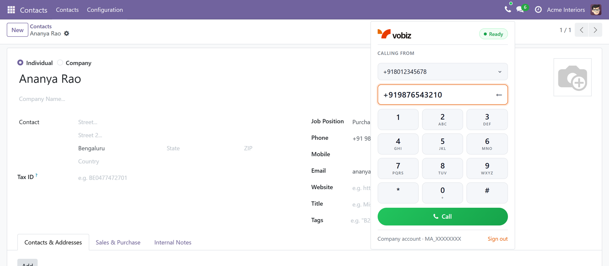
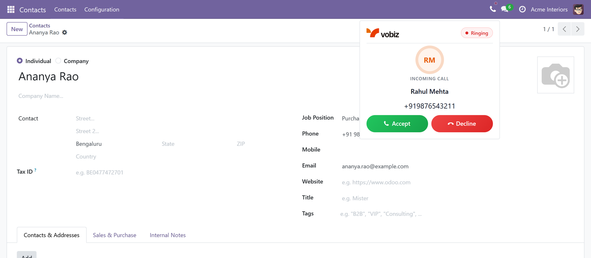
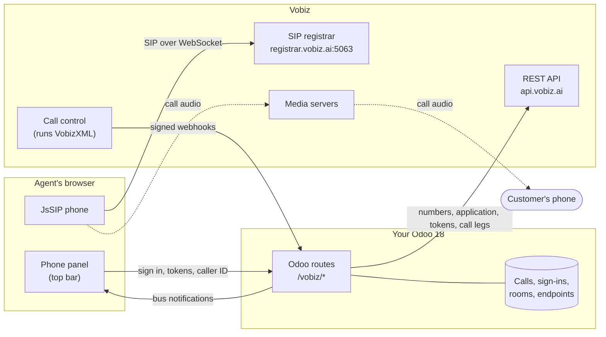
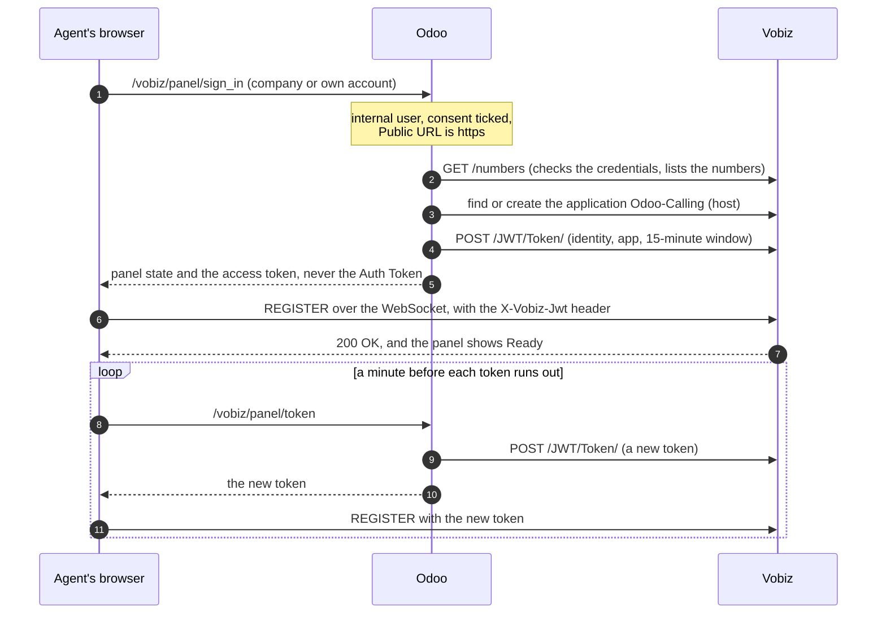
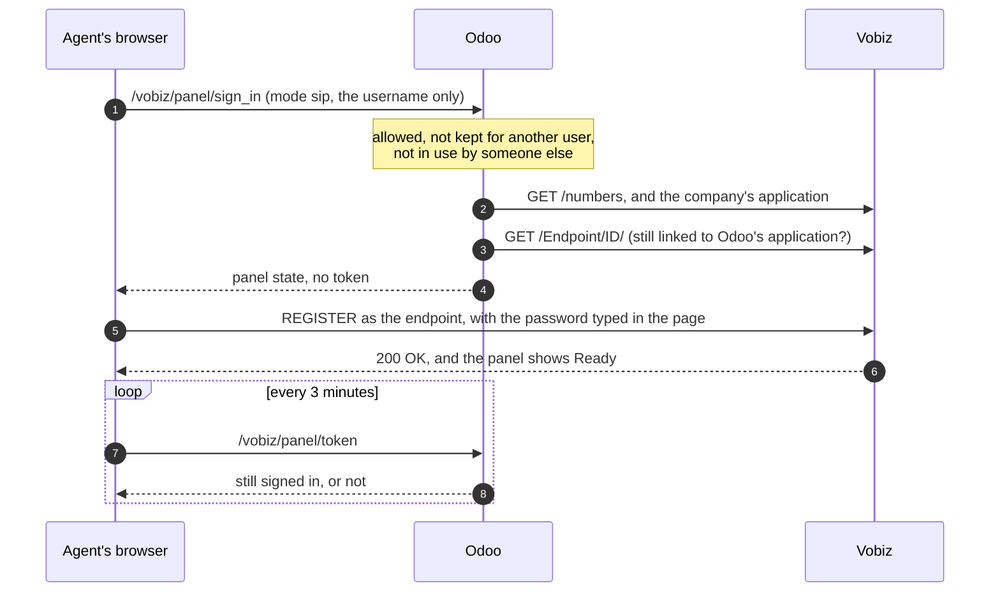
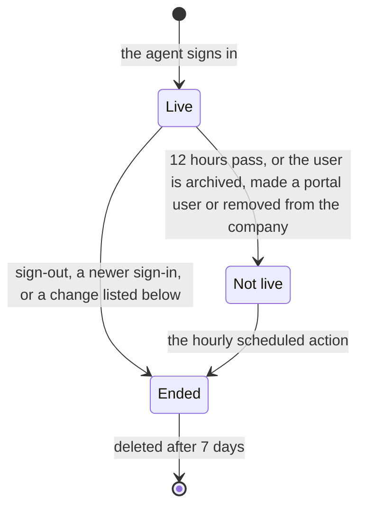
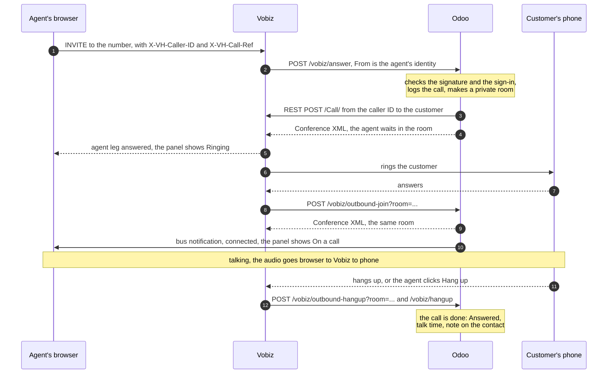
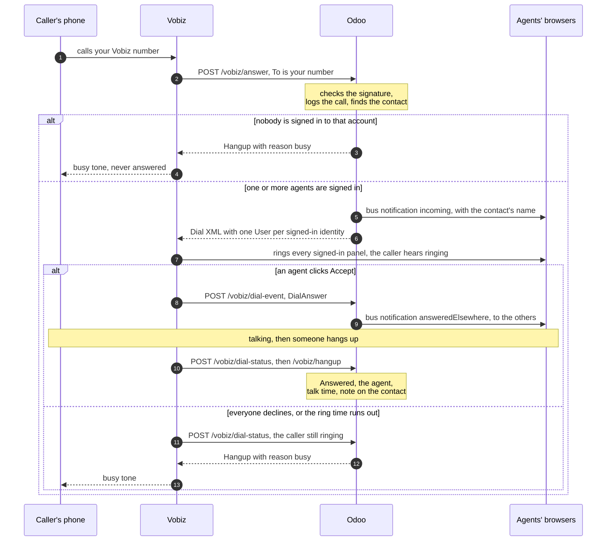

# Vobiz Calling for Odoo

Make and take [Vobiz](https://www.vobiz.ai) phone calls inside Odoo 18. Agents get a phone in Odoo's top bar, every phone number in Odoo becomes click-to-call, incoming calls ring in the browser with **Accept** and **Decline**, and every call is logged under **Vobiz → Calls** and on the contact.

This repository holds one Odoo module, [`vobiz_calling`](vobiz_calling), version `18.0.1.0.2`, published free on the Odoo Apps Store at <https://apps.odoo.com/apps/modules/18.0/vobiz_calling>. This branch, `18.0`, is for Odoo 18.

This README is the complete guide: what the module does, how to set it up from start to finish, how each part works, its security model, and how to test it and fix problems. A short guide for administrators and agents also ships inside the module: [`vobiz_calling/README.md`](vobiz_calling/README.md).

**Tested with** Odoo 18.0 (Docker image `odoo:18`, build 18.0-20261015, Python 3.12) and PostgreSQL 16.

## Contents

1. [Overview](#overview): [what it does](#what-it-does), [what it does not do](#what-it-does-not-do), [who it is for](#who-it-is-for), [words used in this guide](#words-used-in-this-guide)
2. [Requirements](#requirements)
3. [Setup](#setup), in eight steps
   1. [Install the module](#step-1-install-the-module)
   2. [Give Odoo a public HTTPS address](#step-2-give-odoo-a-public-https-address)
   3. [Prepare the Vobiz account](#step-3-prepare-the-vobiz-account)
   4. [Connect Odoo to Vobiz](#step-4-connect-odoo-to-vobiz)
   5. [Choose the caller ID and send incoming calls to Odoo](#step-5-choose-the-caller-id-and-send-incoming-calls-to-odoo)
   6. [Give users access](#step-6-give-users-access)
   7. [Optional: allow SIP endpoints](#step-7-optional-allow-sip-endpoints)
   8. [Sign in and make the first calls](#step-8-sign-in-and-make-the-first-calls)
4. [Using the phone](#using-the-phone) (for agents)
5. [How it works](#how-it-works)
   - [Architecture](#architecture)
   - [The application and the Public URL](#the-application-and-the-public-url)
   - [Signing in with an access token](#signing-in-with-an-access-token)
   - [Signing in with a SIP endpoint](#signing-in-with-a-sip-endpoint)
   - [Session lifecycle](#session-lifecycle)
   - [Outgoing calls](#outgoing-calls)
   - [Incoming calls](#incoming-calls)
   - [Call outcomes and the call log](#call-outcomes-and-the-call-log)
   - [Click-to-call](#click-to-call)
   - [Live updates in the panel](#live-updates-in-the-panel)
   - [Scheduled actions](#scheduled-actions)
6. [Security model](#security-model)
7. [Data model](#data-model)
8. [HTTP routes](#http-routes)
9. [What the module changes in your Vobiz account](#what-the-module-changes-in-your-vobiz-account)
10. [Files](#files)
11. [Testing](#testing)
12. [Troubleshooting](#troubleshooting)
13. [Running it in production](#running-it-in-production)
14. [Upgrading](#upgrading)
15. [Uninstalling](#uninstalling)
16. [Development guide](#development-guide)
17. [Limitations](#limitations)
18. [Support and license](#support-and-license)

## Overview

### What it does

| Feature | What people see |
|---|---|
| **A phone in the top bar** | The phone icon opens the Vobiz panel: **Calling from** (which of the account's numbers the call shows), a number box with a keypad, and **Call**. During a call: **Mute**, **Hold**, **Keypad** (tones for phone menus) and **Hang up**. A dot on the icon shows the state: grey when signed out or connecting, green when ready, orange during a call, red and pulsing while a call rings. |
| **Click-to-call** | While the agent is signed in to the phone, clicking a phone number in Odoo dials it: the **Call** link next to a phone field on a form, or the number itself where it's shown read-only, as in lists. Signed out, the link does what it always did (the browser's `tel:` handler). |
| **Incoming calls** | A call to one of the account's numbers rings every agent signed in to that account. The panel opens and rings, showing the caller's number and, when it belongs to a contact, the contact's name. The first agent to click **Accept** takes the call. If everyone declines, or nobody answers within the ring time, the caller hears a busy tone. |
| **A log of every call** | Each call, in or out, is a record under **Vobiz → Calls**: direction, outcome, number, contact, agent, times and talk time. When the number belongs to a contact, the call is also noted in the contact's chatter. |
| **Two ways to sign in** | **Access token (JWT)**, with the company's Vobiz account or the agent's own: the browser gets short-lived access tokens and never sees an Auth Token. **SIP endpoint**: an endpoint's username and password; the password stays in the browser and never reaches Odoo. |
| **Set up in Settings** | **Settings → Vobiz**: the account's credentials (the Auth Token is stored encrypted), an explicit data opt-in, a connection check that also tests whether Vobiz can reach this Odoo, the default caller ID, one button that sends a number's incoming calls to Odoo, and the SIP endpoints agents may use. |

<p align="center">
  
</p>

### What it does not do

- **No call transfer, call recording, voicemail, call queues or phone menus (IVR).**
- **No ringing without an open Odoo tab.** There are no push notifications: a call rings only in a browser tab where the agent is signed in to the phone.
- **No SMS, WhatsApp or video.**
- **No new contacts.** A call from an unknown number is logged without a contact.
- **Nothing in the Vobiz account beyond what it lists.** It doesn't buy numbers or create SIP endpoints, and it never deletes applications, numbers or endpoints. [What the module changes in your Vobiz account](#what-the-module-changes-in-your-vobiz-account) lists every request it makes.
- **No Odoo Online.** See [Requirements](#requirements).

### Who it is for

- **Odoo administrators**, who install and set it up: [Requirements](#requirements) and [Setup](#setup).
- **Agents**, the employees who make and take calls: [Using the phone](#using-the-phone).
- **Developers**, who maintain or extend it: [How it works](#how-it-works) through [Development guide](#development-guide).
- **Vobiz solutions engineers**, who help a customer set it up: [Setup](#setup), [How it works](#how-it-works), [What the module changes in your Vobiz account](#what-the-module-changes-in-your-vobiz-account) and [Troubleshooting](#troubleshooting).

### Words used in this guide

| Word | Meaning |
|---|---|
| **agent** | An Odoo internal user who uses the phone |
| **administrator** | An Odoo user with the access right *Administration: Settings* |
| **the panel** | The Vobiz phone panel that opens from the phone icon in Odoo's top bar |
| **company account** | The Vobiz account saved in **Settings → Vobiz** for the current company |
| **own account** | A Vobiz account an agent signs in with by typing its Auth ID and Auth Token in the panel |
| **sign-in** | One agent signed in to the phone. Stored as a `vobiz.session` record. |
| **identity** | The SIP user the agent's browser registers as with Vobiz |
| **Public URL** | The setting **Public URL for Vobiz**: the `https://` address where Vobiz reaches this Odoo |
| **the application** | The Vobiz application this Odoo sets up in the account, named `Odoo-Calling (<host>)`, whose answer and hang-up URLs point at the Public URL |
| **webhook** | An HTTPS request Vobiz sends to Odoo about a call |
| **leg** | One side of a call: the caller's leg, the agent's leg, the customer's leg |
| **room** | The private conference an outgoing call runs through |

## Requirements

### Odoo

- **Odoo 18.0**, Community or Enterprise, self-hosted or on Odoo.sh. **Not Odoo Online**, which doesn't allow modules that contain Python code.
- The module depends on `base_setup`, `mail` and `bus`. Odoo installs them with it.
- It needs the Python libraries `cryptography` (to encrypt the Auth Token) and `requests` (to call Vobiz). Both are Odoo 18 requirements, and both are in the official Docker image.
- Odoo must be reachable from the internet at an `https://` address (see [below](#a-public-https-address)). It must also pick its database without a login, because Vobiz's webhooks arrive without an Odoo session: run one database per server, or set `dbfilter`.
- Odoo's bus must reach the agents' browsers (the `/websocket` route), so the panel gets live updates.
- Scheduled actions must run. Odoo's default `max_cron_threads` is enough.

### A Vobiz account

| You need | Why | Where |
|---|---|---|
| A Vobiz account | It provides the numbers, the SIP registrar, the call control and the REST API | Sign up at <https://console.vobiz.ai/auth/signup> |
| KYC, where it applies | Vobiz requires KYC before renting Indian numbers ([India calling regulations](https://www.vobiz.ai/docs/compliance/india/calling-regulations)) | The Vobiz Console. The documents are listed in [What documents are required for verification?](https://www.vobiz.ai/docs/faq/verification-docs) |
| Balance | Numbers and calls are billed by Vobiz | The Vobiz Console |
| At least one active, voice-enabled number | It's the caller ID of outgoing calls, and the number that rings Odoo for incoming calls. Odoo lists only numbers that are active and voice-enabled. | Vobiz Console → **Setup → Numbers** → **+ Buy New Number** ([step 3](#step-3-prepare-the-vobiz-account)) |
| The **Auth ID** and **Auth Token** | Odoo uses them, on the server only, to set up the account, mint access tokens, place calls and check webhook signatures | Vobiz Console → **Dashboard** → **API Credentials** |
| Optional: SIP endpoints, one per agent | Only for signing in with a SIP endpoint | Vobiz Console → **Voice** → **Endpoints** |

A Vobiz sub-account works the same way: enter the sub-account's own Auth ID and Auth Token. Vobiz signs a sub-account's webhooks with the sub-account's token ([Validating callbacks](https://www.vobiz.ai/docs/concepts/validating-callbacks)).

> [!IMPORTANT]
> Try it on a test account or a spare number first. Setting up creates an application in the account, and **Ring Odoo for calls to this number** moves that number's incoming calls to it, away from whatever it was linked to before.

### A public HTTPS address

Vobiz runs every call by asking this Odoo what to do. When a call starts, Vobiz requests the application's answer URL, `<Public URL>/vobiz/answer`, and Odoo answers with VobizXML, Vobiz's call instructions. While the call goes on, Vobiz sends more webhooks to `<Public URL>/vobiz/…`: who answered, and how the call ended. So Vobiz must be able to open the Public URL from the internet.

The module accepts only an `https://` Public URL. The webhooks carry phone numbers, and Vobiz's docs warn that over plain HTTP the signature and its nonce can be read and replayed ([Validating callbacks](https://www.vobiz.ai/docs/concepts/validating-callbacks)). Browsers also allow the microphone only on `https://` pages and on `http://localhost`.

- **In production:** the server's own address, behind a reverse proxy with a certificate. See [step 2, option A](#option-a-a-real-address-production).
- **For testing on your computer:** a tunnel. See [step 2, option B](#option-b-a-tunnel-testing-only).

### Network and browsers

| From | To | Port | For |
|---|---|---|---|
| The Odoo server | `api.vobiz.ai` | 443 (HTTPS) | The REST API |
| Vobiz | Odoo's Public URL | 443 (HTTPS) | Webhooks |
| The Odoo server | Its own Public URL | 443 (HTTPS) | The connection self-check |
| Agents' browsers | `registrar.vobiz.ai` | 5063 (WSS) | SIP signalling |
| Agents' browsers | `stun.l.google.com` | 19302 (UDP) | Finding the browser's public address (STUN) |
| Agents' browsers | Vobiz's media servers | UDP | The call's audio (WebRTC) |

A network that blocks port 5063 stops the phone from connecting. One that blocks UDP leaves calls without audio.

Agents need a browser with a microphone, and a headset is best. The module's Apps Store page names Google Chrome and Microsoft Edge.

## Setup

Eight steps. An administrator does steps 1, 2 and 4 to 7, step 3 happens in the Vobiz Console, and step 8 is the first test call.

1. [Install the module](#step-1-install-the-module).
2. [Give Odoo a public HTTPS address](#step-2-give-odoo-a-public-https-address).
3. [Prepare the Vobiz account](#step-3-prepare-the-vobiz-account): a number and the API credentials.
4. [Connect Odoo to Vobiz](#step-4-connect-odoo-to-vobiz) in **Settings → Vobiz**.
5. [Choose the caller ID and send incoming calls to Odoo](#step-5-choose-the-caller-id-and-send-incoming-calls-to-odoo).
6. [Give users access](#step-6-give-users-access).
7. [Optional: allow SIP endpoints](#step-7-optional-allow-sip-endpoints).
8. [Sign in and make the first calls](#step-8-sign-in-and-make-the-first-calls).

### Step 1: Install the module

Pick the option that matches your Odoo.

#### Option A: an existing self-hosted Odoo

**A.1 Get the module.** Download the zip from the [Apps Store page](https://apps.odoo.com/apps/modules/18.0/vobiz_calling) (**Download for v 18.0**) and unzip it, which gives you a `vobiz_calling/` folder. Or clone this branch:

```bash
git clone --branch 18.0 https://github.com/vobiz-ai/odoo-vobiz-calling.git
```

*Why:* Odoo loads modules from folders on its add-ons path.

**A.2 Put it on the add-ons path.** Add the folder that *contains* `vobiz_calling/` to `addons_path` in `odoo.conf`, separated by commas, for example `addons_path = /opt/odoo/odoo/addons,/opt/odoo/custom-addons`. Then restart Odoo.
*Why:* Odoo only finds modules in the folders listed there, and reads the list when it starts.

**A.3 Update the apps list.** Turn on developer mode: **Settings** → *Developer Tools* → **Activate the developer mode**, or add `?debug=1` to the address. Then **Apps** → **Update Apps List** → **Update**.
*Why:* Odoo shows a new module in Apps only after it has scanned the add-ons path.

**A.4 Activate it.** In **Apps**, search for **Vobiz Calling** and click **Activate**.
*Why:* this installs it, with `base_setup`, `mail` and `bus`. The phone icon appears in the top bar, and the **Vobiz** app in the main menu.

From the command line, instead of A.3 and A.4:

```bash
odoo -c <your-odoo.conf> -d <your-database> -i vobiz_calling --stop-after-init
```

Then start Odoo as usual.

#### Option B: Odoo.sh

**B.1 Add the module to your project's repository.** Copy `vobiz_calling/` into it, or add this repository as a git submodule on branch `18.0`. Push.
*Why:* Odoo.sh builds from your repository and puts its modules on the add-ons path.

**B.2 Install it.** When the build is ready, open it, then **Apps** → search for **Vobiz Calling** → **Activate**. If it isn't listed, run **Update Apps List** in developer mode first.

Odoo.sh serves `https://` already, so step 2 is done: use the build's address, or its custom domain, as the Public URL. Staging and development builds are neutralized, so they start without the Vobiz Auth Token (see [Test copies of the database](#test-copies-of-the-database)).

#### Option C: a local Odoo for testing, with Docker

For developers and testers. It runs Odoo 18 and PostgreSQL in containers, with this repository mounted as an add-ons folder. The first run takes a while, most of it downloading the images: the `odoo:18` image is about 3 GB. Every command below works the same in PowerShell, macOS and Linux terminals and Git Bash, unless it says otherwise.

**C.1 Install Docker and git.** Install [Docker Desktop](https://www.docker.com/products/docker-desktop/) (Windows, macOS), or Docker Engine with the Compose plugin (Linux), and [git](https://git-scm.com/downloads). Start Docker Desktop and wait until it says the engine is running.
*Why:* Odoo and PostgreSQL run in containers, so you don't install either of them.

```bash
docker --version
docker compose version
```

**C.2 Make a working folder and clone the repository into it.**
*Why:* the compose file goes in `vobiz-odoo-local/`, next to the clone, and mounts the clone into Odoo. Keeping the compose file outside the clone keeps `git status` clean.

```bash
mkdir vobiz-odoo-local
cd vobiz-odoo-local
git clone https://github.com/vobiz-ai/odoo-vobiz-calling.git
```

**C.3 Create `docker-compose.yml` in `vobiz-odoo-local/`** with exactly this content:

```yaml
# A local Odoo 18 with the Vobiz Calling module, for development and testing.
# Lives next to the clone:  ./docker-compose.yml  and  ./odoo-vobiz-calling/
services:
  db:
    image: postgres:16
    environment:
      POSTGRES_DB: postgres
      POSTGRES_USER: odoo
      POSTGRES_PASSWORD: odoo
    volumes:
      - db-data:/var/lib/postgresql/data

  odoo:
    image: odoo:18
    depends_on:
      - db
    environment:
      HOST: db
      USER: odoo
      PASSWORD: odoo
    ports:
      # Only this computer can open it; the tunnel reaches it from here.
      - "127.0.0.1:${ODOO_PORT:-8069}:8069"
    volumes:
      # The repository root holds the module folder vobiz_calling/.
      - ./odoo-vobiz-calling:/mnt/extra-addons:ro
      - odoo-data:/var/lib/odoo
    # One database, no database manager, and trust the tunnel's https headers.
    command: ["--db-filter=^vobiz_dev$$", "--no-database-list", "--proxy-mode"]

volumes:
  db-data:
  odoo-data:
```

| Part | What it does, and why |
|---|---|
| `image: odoo:18` | The official Odoo 18 image, with Python 3.12, `cryptography` and `requests`. To stop it changing under you, pin a dated tag such as `odoo:18.0-20261015`. |
| `127.0.0.1:${ODOO_PORT:-8069}:8069` | Opens Odoo at `http://localhost:8069`, for this computer only. If port 8069 is taken, create a file named `.env` next to `docker-compose.yml` containing `ODOO_PORT=8070`. Compose reads it on every command. |
| `./odoo-vobiz-calling:/mnt/extra-addons:ro` | Puts the repository on Odoo's add-ons path (`/mnt/extra-addons` in this image), so Odoo finds `vobiz_calling/`. Files you edit on your computer change in the container too. |
| `--db-filter=^vobiz_dev$$` | Odoo serves only the `vobiz_dev` database. Vobiz's webhooks arrive without an Odoo login, so Odoo must be able to tell which database they're for. With several databases and no filter, they get `404`. (`$$` is how a compose file writes a single `$`.) |
| `--no-database-list` | Turns off the database manager (create, copy, drop, back up), which the tunnel would otherwise expose to the internet. |
| `--proxy-mode` | Trusts the tunnel's `X-Forwarded-*` headers, so Odoo knows it's being reached over `https://`. |
| `db-data`, `odoo-data` | Named volumes that keep the database and Odoo's file store between restarts. |

**C.4 Start PostgreSQL.**
*Why:* the database server has to be running before Odoo can create a database in it.

```bash
docker compose up -d db
```

**C.5 Create the `vobiz_dev` database and install the module.**
*Why:* this runs Odoo once, in a container that's removed afterwards, to create the database and install the module before the web server starts.

```bash
docker compose run --rm odoo odoo -d vobiz_dev -i vobiz_calling,contacts --without-demo=all --stop-after-init
```

| Part | Meaning |
|---|---|
| `-d vobiz_dev` | The database. It's created because it doesn't exist yet. Its name must match the `--db-filter`. |
| `-i vobiz_calling,contacts` | Install the module, which brings in `base_setup`, `mail` and `bus`. Also install **Contacts**, so you have contact forms to click-to-call from. |
| `--without-demo=all` | No demo data. Demo contacts have real-looking phone numbers you shouldn't call, and demo users have well-known passwords. |
| `--stop-after-init` | Exit when done, instead of serving web pages. |

It takes about a minute, and the log ends with `Modules loaded.`. Two `docutils` notices ("Unexpected indentation", "Block quote ends without a blank line") come from a core module's description and are harmless.

**C.6 Start Odoo.**

```bash
docker compose up -d
docker compose ps
```

Both `db` and `odoo` should be `running`. Open <http://localhost:8069> and log in with email **admin** and password **admin**. A database created from the command line always starts with these.

**C.7 Change the admin password now.** Click your avatar (top right) → **Preferences** → **Account Security** tab → **Change Password**.
*Why:* step 2 makes this Odoo reachable from the internet, and `admin` / `admin` must not be.

**C.8 Optional: add a second agent.** To test ringing more than one person: **Settings → Users & Companies → Users → New**. Enter a name and an email address (the login), save, then use the gear menu → **Change Password** to give the user a password. Sign that user in from a second browser or a private window, because a browser profile holds one Odoo login at a time.

Everyday commands, run in `vobiz-odoo-local/`:

| To | Run |
|---|---|
| Follow Odoo's log | `docker compose logs -f odoo` |
| Stop, keeping everything | `docker compose stop` |
| Start again | `docker compose up -d`, then restart the tunnel if it stopped ([step 2](#option-b-a-tunnel-testing-only)) |
| Load a Python change | `docker compose restart odoo` |
| Load a change to views, data, security or the manifest, or after `git pull` | `docker compose run --rm odoo odoo -d vobiz_dev -u vobiz_calling --stop-after-init`, then `docker compose restart odoo` |
| Open an Odoo shell on the database | `docker compose run --rm odoo odoo shell -d vobiz_dev` |
| Open `psql` on the database | `docker compose exec db psql -U odoo vobiz_dev` |
| Delete everything: database, files and containers | `docker compose down -v` (this can't be undone) |

### Step 2: Give Odoo a public HTTPS address

Vobiz must reach this Odoo at an `https://` address ([why](#a-public-https-address)). On Odoo.sh this is already done. Otherwise, pick one option.

#### Option A: a real address (production)

**P.1 A name and a certificate.** Point a DNS name such as `odoo.example.com` at the server, and put a reverse proxy with a TLS certificate in front of Odoo.
*Why:* Vobiz and the browsers need `https://`.

**P.2 Configure Odoo for the proxy.** In `odoo.conf`:

```ini
[options]
proxy_mode = True
dbfilter = ^<your-database>$
list_db = False
workers = 4
gevent_port = 8072
```

| Option | Why |
|---|---|
| `proxy_mode = True` | Odoo trusts the proxy's `X-Forwarded-*` headers, so it knows it's served over `https://` |
| `dbfilter` | Webhooks arrive without a login, so Odoo must pick the database by itself. Use the exact name, or `^%h$` to match the host name. With several databases and no filter, webhooks get `404`. |
| `list_db = False` | Closes the database manager to the internet |
| `workers`, `gevent_port` | With `workers` above 0, Odoo's bus runs on `gevent_port` (8072 by default), and the proxy must send `/websocket` there. With `workers = 0`, the bus is on the main port. |

**P.3 Route the bus.** A [Caddy](https://caddyserver.com) site, which gets its certificate by itself:

```caddyfile
odoo.example.com {
    reverse_proxy /websocket* 127.0.0.1:8072
    reverse_proxy 127.0.0.1:8069
}
```

For nginx, use the configuration in Odoo's [deployment guide](https://www.odoo.com/documentation/18.0/administration/on_premise/deploy.html), which already forwards `/websocket`.
*Why:* without the bus, the panel can't tell when an outgoing call's customer answers (see [Live updates in the panel](#live-updates-in-the-panel)).

**P.4 Check the address from outside your network**, once the module is installed:

```bash
curl "https://odoo.example.com/vobiz/ping?nonce=0123456789abcdef0123456789abcdef"
```

A 64-character hexadecimal answer means the address reaches this Odoo, its database and the module. In Windows PowerShell, type `curl.exe`, because `curl` there means something else.

#### Option B: a tunnel (testing only)

**T.1 Install cloudflared.**
*Why:* its "quick tunnel" gives a local Odoo an `https://` address and needs no account. ngrok works too (`ngrok http 8069`).

| System | Command |
|---|---|
| Windows | `winget install --id Cloudflare.cloudflared` |
| macOS | `brew install cloudflared` |
| Linux | The package from <https://developers.cloudflare.com/cloudflare-one/connections/connect-networks/downloads/> |

**T.2 Start the tunnel and copy its address.**
*Why:* it forwards `https://<random-words>.trycloudflare.com` to your Odoo.

```bash
cloudflared tunnel --url http://127.0.0.1:8069
```

Among its output is a box with an address like `https://<random-words>.trycloudflare.com`. Copy it, and **leave this window open**: closing it closes the tunnel. On Windows, if the terminal doesn't find `cloudflared` yet, open a new terminal, or run it by its full path:

```powershell
& "C:\Program Files (x86)\cloudflared\cloudflared.exe" tunnel --url http://127.0.0.1:8069
```

**T.3 Check that the tunnel reaches this Odoo.**
*Why:* this is the address Vobiz will use, so it should work before you go further.

```bash
curl "https://<random-words>.trycloudflare.com/vobiz/ping?nonce=0123456789abcdef0123456789abcdef"
```

A 64-character hexadecimal answer means the tunnel, Odoo and the module are all reachable.

> [!WARNING]
> Quick tunnels are for testing only. The address changes every time cloudflared restarts, and an address can stop working while cloudflared still looks fine. Whenever that happens, put the new address in **Public URL for Vobiz** and click **Save and check connection** again ([step 4](#step-4-connect-odoo-to-vobiz)). Until you do, calls fail: outgoing calls end at once ("The call failed: Busy" or similar), and incoming calls don't reach Odoo.

### Step 3: Prepare the Vobiz account

Do this in the [Vobiz Console](https://console.vobiz.ai).

**3.1 The account, KYC and balance.** Sign in, or sign up at <https://console.vobiz.ai/auth/signup>. Complete KYC if it applies to you, and make sure there is some balance.
*Why:* numbers and calls are billed, and Vobiz requires KYC before renting Indian numbers.

**3.2 A voice number.** Console → **Setup → Numbers** → **+ Buy New Number**. Pick the country and type, click **Buy**, then **Confirm & Buy**. In the next dialog, under **Link to Voice App**, choose **No app — link later** and click **Skip for now**: Odoo links the number in [step 5](#step-5-choose-the-caller-id-and-send-incoming-calls-to-odoo).
*Why:* incoming calls ring this number, and outgoing calls show it as the caller ID. Wait about two minutes after buying before calling from it. Until then, Vobiz answers "From number not owned by account" ([Vobiz FAQ](https://www.vobiz.ai/docs/faq/from-number-not-owned)).

**3.3 The API credentials.** Console → **Dashboard** → **API Credentials**. Copy the **Auth ID** (it looks like `MA_XXXXXXXX`), then the **Auth Token** (the eye icon shows it, the copy icon copies it).
*Why:* Odoo uses them, only on the server. Treat the Auth Token like a password. It is not your Console password.

**3.4 Optional: a SIP endpoint for each agent who will sign in that way.** Console → **Voice** → **Endpoints** → **+ Create New Endpoint**. Fill in:

- **Alias**: a name for the list;
- **Username**: letters and digits only;
- **Password**: Vobiz won't show it again after you save, so give it to the agent now;
- **Application**: leave it on **None**. Odoo links the endpoint to its application in [step 7](#step-7-optional-allow-sip-endpoints).

Click **Create Endpoint**. Use the username shown in the endpoint's details.
*Why:* only needed for the **SIP endpoint** way of signing in. Make one endpoint per agent: Vobiz keeps one active registration per endpoint, so the newest sign-in replaces the older one ([SIP endpoints](https://www.vobiz.ai/docs/platform/voice/endpoints)).

### Step 4: Connect Odoo to Vobiz

**4.1 Open Settings → Vobiz.** That's Odoo's **Settings** app, then **Vobiz** in the left column, or the **Vobiz** app → **Settings**. Only administrators see it.

<p align="center">
  
</p>

**4.2 Fill in both sections of the page.**

| Section | Field | Enter | What it does |
|---|---|---|---|
| **Vobiz account** | **Auth ID** | `<your-auth-id>` | The company's Vobiz account. It isn't a secret: agents see it in the panel's footer. |
| **Vobiz account** | **Auth Token** | `<your-auth-token>` | Encrypted onto the company when the form is saved. The box never shows a saved token; it says "A token is saved. Leave the box empty to keep it." |
| **Vobiz account** | **Allow calls through Vobiz** | Tick it | The administrator's opt-in. Its text: "To make and take calls, this Odoo sends Vobiz (vobiz.ai) the phone numbers dialled and calling in, and receives each call's times and result.", with a link to Vobiz's privacy policy. Until it's ticked, the connection check, **Ring Odoo for calls to this number**, **Use with Odoo** and every sign-in to the phone are refused. |
| **Connection** | **Public URL for Vobiz** | Your address from step 2, for example `https://odoo.example.com` | Where Vobiz sends the webhooks. Enter the address only: no path such as `/odoo` copied from the browser's address bar. Left empty, Odoo uses its web base URL, which Odoo rewrites to whatever address an administrator last logged in from, so set it explicitly. |
| **Connection** | **Ring time** | `25` (the default) | How many seconds an incoming call rings the panels before the caller hears busy. Values under 5 count as 5, and over 120 as 120. The page notes that callers' networks often give up at about 30 seconds. |

**4.3 Click Save and check connection.** That's the button under the consent box, **not** **Save** at the top of the page.
*Why:* only this button checks the account and sets it up. In order, it:

1. saves the form, like **Save**;
2. stops if **Allow calls through Vobiz** isn't ticked;
3. if **Public URL for Vobiz** is empty and the web base URL starts with `https://`, saves that address as the Public URL, so it no longer follows administrators' logins; then stops if the Public URL doesn't start with `https://`;
4. checks the Auth ID and Auth Token by listing the account's active voice numbers (`GET /numbers`);
5. sets up the application. If Odoo already knows its application, it writes the name `Odoo-Calling (<host of the Public URL>)`, the answer URL `<Public URL>/vobiz/answer` and the hang-up URL `<Public URL>/vobiz/hangup` (both POST) again, which also repairs an application edited in the Console. Otherwise it looks for an application in the account whose answer URL is `<Public URL>/vobiz/answer` and uses it, or creates one;
6. calls this Odoo at `<Public URL>/vobiz/ping`, the way Vobiz will, to prove the address reaches this very database;
7. saves what it found: the numbers (for the **Default caller ID** list), the time, the address it checked, and whether Odoo answered there;
8. if no **Default caller ID** is set yet, sets it to the first number.

It doesn't link any number or endpoint: that's step 5 and step 7.

**4.4 Read the result.** A notification sums it up, for example "Connected to MA_XXXXXXXX: 2 numbers, application 12345678901234567. Default caller ID set to +91XXXXXXXXXX. Vobiz will reach this Odoo at https://odoo.example.com." A warning stays on screen until you close it. The page then reloads, and the line under the button says what the last check found:

| The line says | Meaning |
|---|---|
| "Not connected yet: enter the Auth ID and Auth Token, then click Save and check connection." | No credentials are saved |
| "Not checked for this address yet: click Save and check connection." | No check yet, or the Public URL changed since, or the application isn't set up for this address |
| "At the last check, this Odoo did not answer at https://…, so Vobiz cannot reach it and calls will fail. …" | The self-check failed. See [Troubleshooting](#settings). |
| "Connected: 2 numbers. At the last check, this Odoo answered at https://…." | Ready |

Below it: **Last check** (the date and time) and **Vobiz application** (the application's id). The line isn't live: check again whenever the address, the proxy or the tunnel changes.

### Step 5: Choose the caller ID and send incoming calls to Odoo

**5.1 Choose the Default caller ID.** Pick a number from the list, which holds the account's numbers as of the last check. Only numbers on the account can be chosen, so an agent's own mobile can't become the caller ID.
*Why:* a new sign-in starts with this number in **Calling from**, and **Ring Odoo for calls to this number** works on it. An agent who signs in again while still signed in keeps the number they picked.

**5.2 Click Ring Odoo for calls to this number**, and confirm. The confirmation reads: "Calls to this number will ring the agents signed in to Odoo. This moves the number off any other Vobiz application it is on now. Continue?"
*Why:* Vobiz sends a number's incoming calls to the application the number is linked to. This button saves the form, then links the **Default caller ID** number to Odoo's application (`POST /numbers/%2B<digits>/application`), moving it off any other. The result says "Calls to +91XXXXXXXXXX now ring Odoo.", with the application the number was on before if there was one, or "Calls to +91XXXXXXXXXX already ring Odoo."

To send several numbers to Odoo, repeat 5.1 and 5.2 for each, then set the **Default caller ID** back to the number calls should go out from.

### Step 6: Give users access

- **Agents.** Every active internal user can use the phone: no extra access right is needed. Create users under **Settings → Users & Companies → Users**, with the user type *Internal User*.
- **Portal and public users** can never use it. The panel isn't part of the portal, and every phone route refuses them.
- **Administrators**, users with *Administration: Settings*, also get **Settings → Vobiz**, **Vobiz → SIP endpoints** and **Vobiz → Settings**.
- **The call log.** Every internal user sees **Vobiz → Calls**: all calls of the companies they're allowed in, not only their own. The **My calls** filter shows their own.
- **Several companies.** The Vobiz account fields belong to each company: **Settings → Vobiz** shows the current company's. **Public URL for Vobiz** and **Ring time** are shared by the whole database. An agent signs in on the company currently selected in Odoo's company switcher, and the sign-in stops counting if they're removed from that company.

### Step 7 (optional): Allow SIP endpoints

With a SIP endpoint, an agent signs in with the endpoint's username and password instead of an access token. Vobiz sends a call placed from an endpoint to the application linked to that endpoint, so the endpoint must be linked to Odoo's application. (Vobiz's [Flutter SDK guide](https://www.vobiz.ai/docs/integrations/flutter-sdk/create-sip-endpoint) describes that routing; the Console's endpoint page describes the **Application** field only for calls *to* the endpoint.)

**7.1 Open the list.** **Settings → Vobiz** → **Manage SIP endpoints**, or **Vobiz → SIP endpoints**.

**7.2 Click Load from Vobiz.**
*Why:* it reads the company account's endpoints (`GET /Endpoint/`) with their aliases and linked applications. Rows of endpoints that are gone from the account are removed, and anyone signed in with one is signed out. It says "N SIP endpoints loaded from Vobiz."

**7.3 Click Use with Odoo on each endpoint agents may use**, and confirm ("Calls placed from this endpoint will go through Odoo, and agents can sign in with it. This moves it off any other Vobiz application it is linked to now. Continue?").
*Why:* it links the endpoint to Odoo's application in Vobiz (`POST /Endpoint/<endpoint-id>/`) when it isn't yet, and lets agents sign in with it. **Calls go to Odoo** and **Used in Odoo** turn on.

**7.4 Set Agent** on each endpoint, in the list.
*Why:* only that user can then sign in with it. Odoo can't check an endpoint's password (the browser sends it to Vobiz, never to Odoo), so without **Agent** any internal user of the company can claim a free endpoint. See [Known limitations](#known-limitations).

**Stop using** (with a confirmation) blocks the endpoint in Odoo and signs out whoever is using it. Vobiz keeps sending the endpoint's calls to Odoo's application until you link it elsewhere in the Vobiz Console.

The list's columns:

| Column | Meaning |
|---|---|
| **SIP username**, **Alias** | As in the Vobiz Console |
| **Calls go to Odoo** | The endpoint is linked to Odoo's application, as of the last load or link |
| **Used in Odoo** | Agents may sign in with it. Rows that aren't used are greyed. |
| **Agent** | The only user who may sign in with it. Empty: any internal user of the company. |
| **Signed in now** | Who is signed in with it at the moment |
| **Vobiz application** (optional column) | The application the endpoint is linked to |

Only administrators can see the list and use its buttons. The buttons also refuse anyone else who calls them directly over RPC.

### Step 8: Sign in and make the first calls

**8.1 Sign in to the phone.** Click the **phone icon** in the top bar → **Access token (JWT)** tab → **Sign in**. The pill at the top of the panel goes from *Connecting* to *Ready*, and the dot on the icon turns green.

<p align="center">
  
</p>

Open Odoo at its `https://` address, or at `http://localhost:8069` for the Docker setup. Browsers allow the microphone only on `https://` pages and on `localhost`, so a LAN address such as `http://192.168.1.20:8069` won't work. The browser asks for the microphone at your first call: allow it.

**8.2 Call your own mobile.** In the panel, check **Calling from**, type your mobile number as `+91XXXXXXXXXX`, and click **Call** (or press Enter).

What to expect:

- The panel shows *Calling…*, then *Ringing…*. You hear silence while your mobile rings, which is normal.
- Your mobile shows the **Calling from** number. Answer it.
- The panel shows *On a call* with a timer, and **Mute**, **Hold**, **Keypad** and **Hang up**.
- Hang up from either side.

Then open **Vobiz → Calls**: *Call to +91XXXXXXXXXX*, Outgoing, **Answered**, with the talk time.

**8.3 Click-to-call.** **Contacts → New** (install the **Contacts** app if you don't have it): a name, and your mobile in **Phone**. Save, then click **Call** next to the number. The panel opens and dials. After the call, the contact's chatter has a *Vobiz call* note.

**8.4 An incoming call.** From your mobile, call the Vobiz number from step 5. The panel opens and rings, with **Accept** and **Decline**, and your contact's name (your mobile is a contact now). Accept, talk, and hang up. **Vobiz → Calls** shows *Call from …*, Incoming, **Answered**, with you as the agent.

<p align="center">
  
</p>

That's the whole loop. The [manual test plan](#manual-test-plan) covers everything else.

## Using the phone

This part is for agents.

### The icon and the panel

The **phone icon** in Odoo's top bar opens the panel. The dot on the icon, and the pill at the top of the panel, show the state:

| Dot | Pill | Meaning |
|---|---|---|
| Grey | *Signed out* | Not signed in to the phone |
| Grey | *Connecting* | Signed in, connecting to Vobiz |
| Green | *Ready* | Calls can be made and taken |
| Red, pulsing | *Ringing* | A call is ringing |
| Orange | *On a call* | A call is being placed or is in progress |

The line under the pill shows news: what just happened, or what went wrong.

### Signing in to the phone

- **Access token (JWT)** tab → **Sign in** uses the company's Vobiz account. **Use my own Auth ID and Auth Token** signs in with another Vobiz account instead: type its **Auth ID** and **Auth Token**, then **Sign in**. **Use the company account** goes back. If the company has no Vobiz account set, the tab asks for an Auth ID and Auth Token straight away.
- **SIP endpoint** tab: type the **SIP username** and **Password** of an endpoint your administrator allowed, then **Connect** (or press Enter). The password stays in this page: Odoo never receives it.
- The footer says how you're signed in ("Company account · MA_…", "Your account · MA_…" or "SIP endpoint · …") and has **Sign out**.
- A sign-in lasts 12 hours. Signing in again, in another tab or browser, ends the previous sign-in.
- After a page reload, an access-token sign-in picks up again by itself. A SIP endpoint asks for its password again: "Enter the SIP endpoint's password to use the phone in this tab."

### Making a call

- **Calling from** picks which of the account's numbers the other side sees. The list holds the account's numbers as of your sign-in.
- Type the number, or use the keypad, then click **Call** or press Enter. Type numbers with their country code (`+91XXXXXXXXXX`). A 10-digit number, or 11 digits starting with `0`, is read as an Indian number, and one starting with `00` as international.
- Or click any phone number in Odoo while you're signed in.
- The panel shows *Calling…*, then *Ringing…* while the other phone rings (you hear silence), then *On a call* with a timer.
- During the call: **Mute** / **Unmute**, **Hold** / **Resume**, **Keypad** (tones for phone menus) and **Hang up**.
- One call at a time: while on a call, **Call** says "Finish the current call first."

### Taking a call

- The panel opens and rings, with the caller's number, and the contact's name when the number belongs to a contact.
- **Accept** takes the call. **Decline** turns it down for you; it keeps ringing the other agents, and if nobody takes it the caller hears a busy tone.
- When someone else takes it, your panel says "Another agent answered the call." When the caller gives up or the ring time runs out, "Missed call."
- While you're on a call, new calls aren't offered to you. They ring the other agents.

### Good to know

- Moving between Odoo screens keeps the phone and the call going. Reloading or closing the tab ends a call in progress.
- Keep one Odoo tab for the phone. Every Odoo tab you open while signed in connects its own phone with your identity, and Vobiz decides which of them rings (see [Limitations](#limitations)).
- Your calls are under **Vobiz → Calls** (filter **My calls**), and on the contact's chatter.

## How it works

### Architecture



- **The agent's browser runs the phone.** The panel is an OWL component in Odoo's top bar (`static/src/softphone_systray.*`). The phone itself is a service (`static/src/softphone_service.js`) that drives [JsSIP](https://jssip.net) 3.10.1, bundled in `static/lib/jssip/` and loaded when the phone starts. It registers with Vobiz over SIP over WebSocket at `wss://registrar.vobiz.ai:5063/`, and the call's audio (WebRTC) goes straight between the browser and Vobiz.
- **Your Odoo server is the calling backend.** There is no other server. Vobiz sends each call's webhooks to `/vobiz/*` on this Odoo, which answers with VobizXML, places and ends call legs over Vobiz's REST API, writes the call log, and tells the browser what happened over Odoo's bus.
- **Vobiz** provides the numbers, the SIP registrar, call control, the media servers and the REST API (`https://api.vobiz.ai`).

What travels where:

| From → to | What | How |
|---|---|---|
| Browser → Odoo | Sign in and out, a fresh access token, the caller ID, "can Vobiz reach this Odoo?" | JSON-RPC to `/vobiz/panel/*`, with the agent's Odoo session |
| Odoo → Vobiz | Check the credentials, list the numbers, set up the application, link numbers and endpoints, mint access tokens, place and end call legs | REST to `https://api.vobiz.ai/api/v1/Account/<auth-id>/…`, with the `X-Auth-ID` and `X-Auth-Token` headers |
| Browser ⇄ Vobiz | SIP signalling (REGISTER, INVITE, BYE) and the call's audio | SIP over WebSocket (WSS), and WebRTC media |
| Vobiz → Odoo | Call events: answer, hang-up, dial status, conference events | HTTPS POST, form-encoded, signed |
| Odoo → browser | The caller's name, "the customer answered", "another agent answered", "you were signed out" | Odoo bus notifications of type `vobiz/event`, sent to that user |

Audio never passes through Odoo.

### The application and the Public URL

Vobiz runs a call by fetching the answer URL of the application the call belongs to. This Odoo keeps one application in each Vobiz account it uses:

- named `Odoo-Calling (<host of the Public URL>)`, with answer URL `<Public URL>/vobiz/answer` and hang-up URL `<Public URL>/vobiz/hangup`, both POST;
- found again by its answer URL, so one Odoo address never creates a second one, and an application made for another address is never changed;
- for the company account, its id is saved on the company (`vobiz_app_id`), with the address it points at (`vobiz_app_url`).

Calls reach the application in three ways: a number linked to it ([step 5](#step-5-choose-the-caller-id-and-send-incoming-calls-to-odoo)), an access token whose `app` claim names it, and an endpoint linked to it ([step 7](#step-7-optional-allow-sip-endpoints)).

When the Public URL changes, saved with either **Save** or **Save and check connection**:

- each company's application gets the new URLs and name, keeping its id, so the numbers and endpoints linked to it, and the agents signed in on the company account or a SIP endpoint, keep working;
- agents signed in with their own account are signed out. Their applications live in their own accounts and point at the old address; signing in again creates a new one at the new address, and the old one stays in their account until someone deletes it.

When an administrator enters a new Auth Token or Auth ID, Odoo forgets the application's id, and finds or creates it again at the next check or sign-in. If someone deletes the application in the Console, **Save and check connection** creates a new one (so does the next change of Public URL). A new application has no numbers or endpoints linked to it: click **Ring Odoo for calls to this number** and **Use with Odoo** again.

### Signing in with an access token

Mode `company` uses the account saved in Settings. Mode `own` uses an Auth ID and Auth Token the agent types in the panel.



1. Odoo refuses anyone who isn't an active internal user, and refuses everyone while **Allow calls through Vobiz** isn't ticked or the Public URL doesn't start with `https://`.
2. It checks the credentials and lists the account's active voice numbers (`GET /numbers`). For the company account, it also saves that list for the **Default caller ID**.
3. It gets the application: the company's, moved to the current Public URL if it moved; or, for an own account, the one in that account whose answer URL is this Odoo's, created if needed.
4. It ends the user's previous sign-in, if any.
5. It makes a new identity, `odoo-<12 hex>-<6 hex>_<Auth ID>`. The 12 characters come from a SHA-256 of the database name and user id, and the 6 are random for each sign-in, so an older browser's registration can never take the new sign-in's calls.
6. It has Vobiz mint an access token (`POST /JWT/Token/`) with `iss` = the Auth ID, `sub` = the identity's first part, `nbf` = now minus 60 seconds, `exp` = `nbf` plus 900 seconds, `app` = the application's id, and `per.voice` allowing incoming and outgoing calls. The minute in the past is there because Vobiz's registrar refuses a token whose `nbf` is still in its future (error `10005`, see [Vobiz's access-token errors](https://www.vobiz.ai/docs/integrations/flutter-sdk/errors)). The `app` claim is what makes Vobiz send this identity's outgoing calls to Odoo.
7. It returns the panel state: the identity, the numbers, the caller ID, the registrar's address and the access token. Never an Auth Token.
8. The browser registers `sip:<identity>@registrar.vobiz.ai` with the token in an `X-Vobiz-Jwt` header, and sends the same header with every call it places.

Renewing the token:

- The token is valid from a minute before it was minted to 14 minutes after. A minute before it runs out (about 13 minutes after minting), the browser asks `/vobiz/panel/token`. Odoo hands back the token it holds while that has more than 2 minutes left, and otherwise mints a new one. The browser registers again with it at once. A call in progress isn't touched.
- If Odoo can't be reached, the browser tries again after 5, 10, 20 and then every 40 seconds, while the current token is still valid.
- If the registrar refuses a token, the code in its `X-vobiz-Jwt-Error-Code` header decides: `10005` (not valid yet) is retried with the same token after 3 seconds, up to three times; any other code gets one forced renewal, a freshly minted token. If that fails too, the panel names the error, for example "The phone could not connect: ACCESS_TOKEN_EXPIRED (10006)".
- If Odoo answers that the sign-in has ended, the panel stops: "Signed out: you signed in again somewhere else, or the sign-in expired."

An own-account sign-in keeps the agent's Auth Token, encrypted, on the sign-in record, because Odoo needs it to mint tokens, place the customer's leg of each outgoing call, and check that account's webhooks. It's dropped when the sign-in ends. Incoming calls to the own account's numbers reach Odoo only if those numbers are linked to that account's `Odoo-Calling (…)` application in its own Console: **Ring Odoo for calls to this number** works on the company account only.

### Signing in with a SIP endpoint

Mode `sip`. The agent types an endpoint's username and password. Only the username goes to Odoo.



1. The same checks as above: an active internal user, consent, an `https://` Public URL.
2. The username must be an endpoint an administrator allowed for this company (**Use with Odoo**), not kept for another user (**Agent**), and not in use by someone else's live sign-in.
3. Odoo lists the numbers, gets the company's application, and asks Vobiz which application the endpoint is linked to now (`GET /Endpoint/<endpoint-id>/`). If that's no longer Odoo's, the sign-in is refused, because the endpoint's calls wouldn't reach Odoo.
4. The identity is the endpoint's username. No access token is minted.
5. The browser registers as the endpoint, answering the registrar's challenge with the password typed in the page (SIP digest authentication). Odoo never sees or checks the password: Vobiz checks it.
6. Every 3 minutes the browser asks Odoo whether the sign-in still stands. If not, and no call is in progress, it stops: "Signed out: you signed in again somewhere else, or the sign-in ended."
7. If Vobiz refuses the username or password, the panel signs out and says "Vobiz refused this SIP endpoint's username or password." Other failures, such as a lost network, are retried by JsSIP.
8. The endpoint's calls are placed, and their webhooks checked, with the company account's credentials.

The password is kept only in the page's memory while signed in, so after a reload the panel asks for it again.

### Session lifecycle

Rules for every sign-in:

- Only active internal users can sign in, and only while **Allow calls through Vobiz** is ticked and the Public URL starts with `https://`.
- One sign-in per Odoo user. Signing in again, in any mode, ends the previous one.
- A sign-in belongs to the company selected in Odoo's company switcher when it was made.
- It lasts 12 hours.



A **live** sign-in is rung by incoming calls, can place calls, and (for an own account) its Auth Token verifies that account's webhooks. A sign-in stops being live the moment it expires or its user may no longer use the phone: it isn't rung, Odoo hangs up its calls, and its token verifies nothing. The hourly scheduled action then ends it, which forgets its tokens. Ended sign-ins are deleted 7 days after their last change.

What ends a sign-in, and what the panel does:

| Event | Sign-ins it ends | The agent's panel |
|---|---|---|
| The agent clicks **Sign out** | That one | Stops at once: "Signed out." |
| The agent signs in again (another tab, browser or mode) | The user's previous one | The new panel works. The old one isn't rung any more, and Odoo hangs up calls it places. See test [S5](#manual-test-plan) for what it shows. |
| 12 hours pass | That one | An access-token panel stops at its next token renewal ("Signed out: you signed in again somewhere else, or the sign-in expired."), a SIP-endpoint panel within 3 minutes ("Signed out: you signed in again somewhere else, or the sign-in ended.") |
| The user is archived, made a portal user, or removed from the sign-in's company | All of theirs | As for 12 hours |
| An administrator changes the company's **Auth ID** | The company's access-token sign-ins on the company account (mode `company`) | Stops at once: "Signed out: the company's Vobiz account changed. Sign in again." |
| The **Public URL for Vobiz** changes | Every own-account sign-in (mode `own`) | Stops at once: "Signed out: this Odoo's address for Vobiz changed. Sign in again." |
| An administrator clicks **Stop using** on an endpoint | Sign-ins with that endpoint | Stops at once: "Signed out: an administrator stopped this SIP endpoint's use in Odoo." |
| **Load from Vobiz** finds an endpoint gone from the account | Sign-ins with that endpoint | Stops at once: "Signed out: this SIP endpoint is no longer on the company's Vobiz account." |
| Vobiz refuses a SIP endpoint's username or password | That one (the panel signs out) | "Vobiz refused this SIP endpoint's username or password." |
| Odoo neutralizes the database (a test copy) | All of them, deleted | Nothing: the copy is another database |

"Stops at once" comes over Odoo's bus. A panel that's on a call finishes the call first, and stops at its next token renewal or check.

### Outgoing calls



1. The agent clicks **Call**, or a phone number. The browser sends an INVITE to `sip:<number>@registrar.vobiz.ai` with three headers: `X-Vobiz-Jwt` (the access token, for access-token sign-ins), `X-VH-Call-Ref` (24 random hexadecimal characters that name this call in the panel), and `X-VH-Caller-ID` (the **Calling from** number). The panel shows *Calling…*.
2. Vobiz sends the call to the identity's application, which is Odoo's: the token's `app` claim, or the application linked to the SIP endpoint. Vobiz posts to `/vobiz/answer`, and Odoo treats the call as outgoing because `From` is a `sip:` address.
3. Odoo checks, in order: the signature, made with the token of the sign-in's account; that the identity belongs to a live sign-in (otherwise it answers `<Hangup/>`); that the call's `CallUUID` isn't another account's; that the number is a valid E.164 number (otherwise the agent hears "That number cannot be dialled."); and the caller ID, which is `X-VH-Caller-ID` when that's one of the sign-in's numbers, and otherwise the sign-in's own caller ID (if neither is on the account, the agent hears "This account has no phone number to call from.").
4. It logs the call (Outgoing, the agent, the contact found by the number) and creates a room named `odoo` followed by 24 random hexadecimal characters.
5. It places the customer's leg over the REST API (`POST /Call/`) from the caller ID to the number, with answer URL `<Public URL>/vobiz/outbound-join?room=<room>` and hang-up URL `<Public URL>/vobiz/outbound-hangup?room=<room>`. If Vobiz refuses, the call is logged **Failed** and the agent hears "The call could not be placed."
6. It answers the agent's leg with `<Conference>`: the agent waits in the room (`startConferenceOnEnter="false"`, `stayAlone="true"`), hearing the room's wait sound from `/vobiz/outbound-wait`, which is `<Wait length="10"/>`: silence. Vobiz answers the agent's leg at this point, so the panel shows *Ringing…* while the customer's phone rings.
7. The customer answers. Vobiz posts `/vobiz/outbound-join`, and Odoo joins them to the same room, records the answer time, and sends the panel a `connected` notification: *On a call*, the timer, and the in-call buttons.
8. Either side hangs up. Both legs join with `endConferenceOnExit="true"`, so the room ends for both. The hang-up webhooks (`/vobiz/hangup` for the agent's leg, `/vobiz/outbound-hangup` for the customer's) settle the log: **Answered**, the talk time from the customer's answer to the end, and a note on the contact.

When it doesn't go that way:

| What happens | What Odoo does | Logged as |
|---|---|---|
| The agent hangs up while the customer's phone rings | `/vobiz/hangup` for the agent's leg arrives before the customer joined: Odoo cancels the customer's leg (`DELETE /Call/<customer-leg>/`), so their phone stops ringing | **Caller hung up** |
| The customer declines, is busy or doesn't answer | `/vobiz/outbound-hangup` arrives before the customer joined: Odoo ends the agent's leg (`DELETE /Call/<agent-leg>/`) and notifies the panel | **Busy** (`USER_BUSY`, `CALL_REJECTED`) or **Not answered** (`NO_ANSWER`) |
| The customer's leg ends unanswered for another reason | The same | **Failed** |
| The customer answers just as the agent hung up | `/vobiz/outbound-join` finds the agent gone and answers `<Hangup/>` | **Caller hung up** |
| Vobiz refuses the customer's leg (balance, destination, caller ID not owned) | The agent hears "The call could not be placed." | **Failed** |
| Vobiz can't reach Odoo at all | Vobiz refuses the call before it starts (the panel says "The call failed: …", for example "Busy"). The panel then asks Odoo to call itself at its Public URL (`/vobiz/panel/check_reach`), and when that fails says "Vobiz could not reach this Odoo at …, so the call could not start." | Nothing |

Why a room: the agent's browser leg and the customer's phone leg are two calls joined in a private conference, not one `<Dial><Number>` from the browser's leg. That lets Odoo place the customer's leg from the chosen caller ID, cancel it if the agent hangs up first, and know exactly when the customer answered. In the module's own tests, a `<Dial><Number>` straight from a WebRTC leg lost the phone side's audio on three calls in five, while a REST leg joined to a conference was clean every time.

The room's name is the only value Odoo takes from a webhook's query string (the query string isn't covered by Vobiz's signature). Everything else about the call is looked up on the server. Rooms are deleted after a day. A call lasts 4 hours at most (`timeLimit="14400"`).

### Incoming calls



1. Vobiz posts `/vobiz/answer` with the caller in `From` and your number in `To`.
2. Odoo finds the account: from the webhook's `ParentAuthID` or, failing that, from the number called. It checks the signature with that account's token, and refuses (`403`) a `CallUUID` that another account's call already uses.
3. It logs the call (Incoming, ringing) and looks for the contact.
4. If nobody is signed in to that account, it logs **Missed** and answers `<Hangup reason="busy"/>`: the caller hears busy.
5. Otherwise it sends each signed-in agent an `incoming` notification with the contact's name, and answers with `<Dial>` holding one `<User>sip:<identity>@registrar.vobiz.ai</User>` per live sign-in on that account: company, own-account and SIP-endpoint agents alike. The `<Dial>` sets `callerId` to your number, `callerName` to the caller's number (what the panel shows), `timeout` to the **Ring time**, `timeLimit` to 4 hours, `action` to `/vobiz/dial-status` with `redirect="true"`, and `callbackUrl` to `/vobiz/dial-event`.
6. Every panel rings. A panel already on a call turns the new one away (`486 Busy Here`) while the others keep ringing.
7. An agent clicks **Accept**. Vobiz posts `/vobiz/dial-event` with `DialAnswer` and the identity that answered (`DialBLegTo`). Odoo credits the call to that agent, but only if their sign-in is on the call's own account, and tells the other ringing agents `answeredElsewhere`.
8. When the call ends, `/vobiz/dial-status` (answered `<Hangup/>`) and `/vobiz/hangup` settle the log: **Answered**, the agent, the talk time, and a note on the contact.
9. If every panel declines, or the ring time runs out, `/vobiz/dial-status` arrives with the caller still ringing (`CallStatus=ringing`). Odoo logs **Declined** (`DialStatus` `busy` or `completed`, which is how a panel's **Decline** arrives) or **Not answered** (`no-answer` or `timeout`), and answers `<Hangup reason="busy"/>`.
10. If the caller hangs up while it rings, the call is logged **Caller hung up**.

The caller's leg isn't answered while the panels ring: Odoo sees it still ringing when nobody took the call. Vobiz's docs say a `<Hangup>` with a reason on an unanswered call rejects it without answering or billing it ([Hangup](https://www.vobiz.ai/docs/xml/hangup)).

### Call outcomes and the call log

Each call is one `vobiz.call` record, written by the server from the webhooks, so the log doesn't depend on any browser staying open. Its state goes from **Ringing** to **In progress** (answered) to **Done**, and when it's done it gets an outcome:

| Outcome (`vobiz.call.outcome`) | Shown as | When |
|---|---|---|
| `answered` | Answered | Someone answered. Talk time runs from the answer to the end. |
| `missed` | Missed | Incoming, with nobody signed in, or a call that ended without a clearer reason |
| `declined` | Declined | Incoming, and every panel it rang turned it down (a panel already on a call counts) |
| `no_answer` | Not answered | Incoming, and the ring time ran out. Outgoing, and the customer didn't answer (`NO_ANSWER`). |
| `busy` | Busy | Outgoing, and the customer declined or was busy (`USER_BUSY`, `CALL_REJECTED`) |
| `failed` | Failed | Outgoing, and Vobiz refused the customer's leg, or it ended for another reason before anyone answered |
| `canceled` | Caller hung up | Incoming, and the caller hung up while it rang (`ORIGINATOR_CANCEL`). Outgoing, and the agent hung up before the customer answered. |

**Vobiz → Calls** lists them newest first, with the start time, direction, number, contact, agent, outcome and talk time (and, as optional columns, the Vobiz number and the company). Missed, declined, not answered and caller-hung-up calls are greyed, busy and failed ones red. The search has the filters **My calls**, **Incoming**, **Outgoing**, **Missed** (incoming calls nobody took) and **Today**, and groups by **Agent**, **Outcome** and **Day**. The list and form are read-only. A call's form also shows the answer and end times, and, in developer mode, its **Vobiz call UUID**.

**Finding the contact.** The contact is found by the other party's number in its **Phone** or **Mobile** field, among contacts that are active and either shared or of the call's company:

1. If contacts have the stored E.164 field `phone_sanitized` (it comes from Odoo's `sms` module, which Odoo installs automatically along with this module's dependencies), an exact match there is used first.
2. Otherwise Odoo searches **Phone** and **Mobile** for the last six digits, and normalises up to 50 candidates the way the module does, so a number stored as `+91 XXXXX XXXXX` or as `0XXXXX XXXXX` matches the same call.

**The note on the contact.** When a call ends and has a contact, a *Vobiz call* note is posted once in the contact's chatter, listing the direction, outcome, number, Vobiz number, agent and talk time. It's an internal note, so followers aren't notified. Its author is the agent. A call no agent took has no agent, and the webhook has no logged-in user, so Odoo records its public user as the author.

### Click-to-call

`static/src/phone_field_patch.*` patches Odoo's phone field (`web.PhoneField` and `web.FormPhoneField`). A click on the number shown read-only, or on the **Call** link next to an editable phone field, then goes to the Vobiz phone:

- signed in to the phone: the browser's `tel:` link is stopped, and the panel opens and dials the number, showing the record's name;
- signed in but not yet *Ready*: the panel opens and says "Sign in to the phone first.";
- signed out: the link does what it always did.

It works on every phone field in Odoo, including the **Number** on a call's form under **Vobiz → Calls**, so you can call back from the log.

### Live updates in the panel

The server sends these as Odoo bus notifications of type `vobiz/event`, to the agent's user:

| Notification | Sent when | The panel |
|---|---|---|
| `incoming` | An incoming call starts ringing | Shows the contact's name next to the number |
| `answeredElsewhere` | Another agent accepted the call | Ends with "Another agent answered the call." |
| `outbound`, state `connected` | The customer answered | Shows *On a call*, starts the timer, and shows **Mute**, **Hold** and **Keypad** |
| `outbound`, state `ended` | The customer's leg ended before anyone answered | Says "No answer.", "Busy." or "The call could not be connected." while the agent's leg is still up. Odoo also ends the agent's leg, and the panel then says "Call ended." |
| `signedOut` | The company account or the Public URL changed, or an administrator stopped the agent's SIP endpoint, or **Load from Vobiz** found it gone | Stops the phone and says why, unless a call is in progress |

The `outbound` notifications are matched to the call by its `X-VH-Call-Ref`. If the bus doesn't reach the browser (for example behind a proxy that doesn't forward `/websocket`), calls still ring and connect. But an outgoing call's panel stays on *Ringing…* after the customer answers, without **Mute**, **Hold** and **Keypad**, caller names don't show, and sign-outs arrive only at the next token renewal or check.

### Scheduled actions

| Scheduled action | Runs | Does |
|---|---|---|
| Vobiz: end expired softphone sign-ins | Every hour | Ends sign-ins that are no longer live (expired, or their user may no longer use the phone for that company), which forgets their tokens. Deletes ended sign-ins last changed more than 7 days ago. |
| Vobiz: remove old call rooms | Every day | Deletes outgoing-call rooms older than a day |

Find them under **Settings → Technical → Automation → Scheduled Actions**, in developer mode. They're installed with `noupdate="1"`, so an upgrade doesn't overwrite changes you make to them.

## Security model

### Who can use the phone

- Only active internal users (employees). Every `/vobiz/panel/*` route refuses anyone else first, with "Only internal users can use the Vobiz phone.", and signing in checks it again. This matters because Odoo's `auth="user"` routes also let portal users in.
- A sign-in stops counting the moment its user is archived, made a portal user, or removed from the sign-in's company: it isn't rung, its calls are hung up, its token verifies nothing, and the hourly scheduled action ends it.

### What only administrators can do

- See and change **Settings → Vobiz**. The company's Vobiz fields, except **Default caller ID**, are readable only by administrators, and the stored Auth Token only in its encrypted form.
- Manage SIP endpoints: the menu, the list, and the buttons **Load from Vobiz**, **Use with Odoo** and **Stop using**. Odoo lets any logged-in user call a model's public methods over RPC, and these buttons act with `sudo()`, so each one first checks that the user may write SIP endpoints, which only administrators can.
- Change or delete call records, and read or delete sign-ins and rooms (there is no menu for those two).

### The data opt-in

Until an administrator ticks **Allow calls through Vobiz**, the connection check, **Ring Odoo for calls to this number**, **Use with Odoo** and every sign-in to the phone are refused, so no calls go through Vobiz. For calls, what's sent to Vobiz is the numbers dialled and calling in, and what comes back is each call's times and result.

What the opt-in doesn't cover: **Load from Vobiz** works without it (it reads the endpoint list), saving a new Public URL updates an application that already exists, and unticking it later stops new sign-ins but leaves agents who are already signed in working until they sign out or the sign-in expires.

### Webhook signatures

Every webhook except the room's wait sound (`/vobiz/outbound-wait`, which reads nothing and changes nothing) must be signed by Vobiz with the Auth Token of the account the call belongs to:

```text
X-Vobiz-Signature-V3 = base64( HMAC-SHA256( Auth Token, URL + "." + nonce ) )
X-Vobiz-Signature-V2 = base64( HMAC-SHA256( Auth Token, URL + nonce ) )
```

The URL is the one Vobiz called, without its query string, and the nonce comes in `X-Vobiz-Signature-V3-Nonce` (or `-V2-Nonce`). This is Vobiz's documented scheme ([Validating callbacks](https://www.vobiz.ai/docs/concepts/validating-callbacks)).

- Odoo rebuilds the URL from its **Public URL for Vobiz**, not from the request it received, so the Public URL must be exactly the address Vobiz calls.
- It checks V3 when present, else V2, against every Auth Token it holds for that account: the company's, and those of agents signed in with it as their own account. The comparison is constant-time.
- An unsigned or wrongly signed webhook gets `403` and changes nothing, and so does one for an account this Odoo holds no token for, since nothing could vouch for it. Odoo logs which of the three it was.

### One account's webhooks touch only that account's calls

An agent signed in with their own account holds that account's token, so they could sign webhooks for that account themselves. The handlers make sure such a webhook can only act on that account's calls:

- `/vobiz/dial-event` credits a call only to a sign-in on the call's own account;
- `/vobiz/hangup` acts on an outgoing call's room only when the room belongs to the call whose account signed the webhook;
- `/vobiz/answer` refuses (`403`) a `CallUUID` that a call of another account already uses, so Vobiz's own webhooks for the real call keep working.

### Secrets at rest

- Auth Tokens are encrypted with [Fernet](https://cryptography.io/en/latest/fernet/) (AES-128 in CBC mode with an HMAC-SHA256), using a key derived from the database's own secret: `urlsafe_base64( SHA-256( "vobiz_calling:" + database.secret ) )`.
- The company's token is stored on the company (`vobiz_auth_token_enc`), readable, still encrypted, by administrators only. An agent's own token is stored on their sign-in, and dropped when the sign-in ends.
- In **Settings → Vobiz**, the token box is write-only: what's typed is encrypted onto the company and the box is cleared on save, so the token never reads back into a browser.
- A database restored with a new `database.secret` can't decrypt the tokens. Odoo's **Duplicate**, and a restore made as a copy, both make a new secret: enter the Auth Token again there. A `pg_dump` and restore keeps the secret.
- The key lives in the same database. This protects a token that leaks on its own (a table export, a log), not one taken together with the whole database, or by an administrator, who can read `database.secret`.

### What the browser holds

- **Never an Auth Token.** The company's stays on the server. An agent's own Auth Token is sent once, at sign-in, and the panel clears its box.
- **Access tokens**, which Vobiz can't revoke (its docs say a token stays valid until it expires), so the module keeps them short: 15 minutes, starting a minute in the past.
- **A SIP endpoint's password**, which the agent typed: it stays in that page's memory while signed in, and is never sent to Odoo.

### Logs and error messages

- `VobizClient` sends the Auth Token only in the `X-Auth-Token` header: never in a URL, its `repr`, a log line or an error message.
- Vobiz's own error text is cut to 200 characters on one line, and any echo of the token in it is replaced by `***`.
- Log lines name Auth IDs, identities and Odoo user ids, which aren't secrets.

### Test copies of the database

When Odoo neutralizes a copy of the database (Odoo.sh staging and development builds, a duplicate or restore made with **Neutralize**, or `odoo neutralize`), it runs `data/neutralize.sql`, which:

- clears the company's Auth Token, the consent, the application's id and address, and the last check's time, address and result;
- deletes the system parameter `vobiz_calling.public_url`, so the copy uses its own address;
- deletes every sign-in and room, with the agents' own Auth Tokens and access tokens.

The copy keeps the Auth ID, the numbers, the default caller ID, the SIP endpoint rows and the call history, but can't act for the live account, and refuses the live account's webhooks. To try calls in a copy, enter credentials there on purpose, ideally from a separate Vobiz test account: **Ring Odoo for calls to this number** in the copy moves that number to the copy.

### Known limitations

- **Keep every hop `https://`.** Vobiz signs each webhook with the account's Auth Token over the URL and a random nonce ([Validating callbacks](https://www.vobiz.ai/docs/concepts/validating-callbacks)). Serve Odoo only over `https://` end to end, and don't let proxies or tunnels log request headers.
- **The webhook body isn't signed.** Fields such as `From`, `To` and `CallUUID` are as sent. The module takes as little from them as it can and checks each against its own records.
- **Tie each SIP endpoint to one user.** Odoo never sees an endpoint's password (Vobiz checks it when the browser registers), so set **Agent** on each endpoint under **Vobiz → SIP endpoints** to let only that user sign in with it.
- **A copied access token works until it expires.** Anyone who copies an agent's token out of the browser can register with it at Vobiz's registrar for up to about 14 minutes. Odoo stops ringing that identity and hangs up its calls as soon as the sign-in ends.
- **Signatures depend on Vobiz sending them.** Vobiz's docs say signature headers depend on the callback URL's configuration and vary by callback type. The module refuses unsigned webhooks, as those docs recommend.
- **Every employee can read the call log** of their companies: numbers, agents, outcomes and times.

## Data model

### `res.company`

The module adds the company's Vobiz account. None of these fields is copied when a company is duplicated.

| Field | Label | Readable by | Meaning |
|---|---|---|---|
| `vobiz_auth_id` | Vobiz Auth ID | Administrators | The company's Vobiz account |
| `vobiz_auth_token_enc` | Vobiz Auth Token (encrypted) | Administrators, encrypted | The Auth Token, encrypted |
| `vobiz_data_consent` | Allow calls through Vobiz | Administrators | The opt-in |
| `vobiz_app_id` | Vobiz application | Administrators | Odoo's application in the account (ids are 17 digits, kept as text) |
| `vobiz_app_url` | Vobiz application address | Administrators | The Public URL the application points at. When the Public URL moves, Odoo updates the application. |
| `vobiz_numbers` | Vobiz numbers | Administrators | The account's active voice numbers (a JSON list, E.164), as of the last check, **Ring Odoo for calls to this number**, or company or SIP-endpoint sign-in |
| `vobiz_checked_on` | Vobiz connection checked on | Administrators | When **Save and check connection** last ran |
| `vobiz_checked_url` | Vobiz address checked | Administrators | The Public URL that check used |
| `vobiz_reach_ok` | Vobiz address answered | Administrators | Whether this Odoo answered there |
| `vobiz_default_number` | Default caller ID | Everyone | The number calls go out from by default |

### `res.config.settings`

The fields behind **Settings → Vobiz**:

| Field | Shown as | Stored in | Notes |
|---|---|---|---|
| `vobiz_auth_id` | **Auth ID** | `res.company.vobiz_auth_id` | Changing it clears the number list, makes Odoo find its application again, and signs out the company's access-token sign-ins on the company account |
| `vobiz_auth_token` | **Auth Token** | Encrypted into `res.company.vobiz_auth_token_enc` | Write-only, cleared on save. A new token makes Odoo find its application again. |
| `vobiz_data_consent` | **Allow calls through Vobiz** | `res.company.vobiz_data_consent` | See [The data opt-in](#the-data-opt-in) |
| `vobiz_caller_id` | **Default caller ID** | `res.company.vobiz_default_number` | A choice among `vobiz_numbers`. Empty when the saved number isn't on the account any more. |
| `vobiz_public_url` | **Public URL for Vobiz** | System parameter `vobiz_calling.public_url` | Changing it moves the application and signs out own-account agents |
| `vobiz_ring_seconds` | **Ring time** | System parameter `vobiz_calling.ring_seconds` | 25 by default, used between 5 and 120 |
| `vobiz_status`, `vobiz_status_kind` | The line under the button | Computed | What the last check found ([step 4.4](#step-4-connect-odoo-to-vobiz)) |
| `vobiz_checked_on`, `vobiz_app_id` | **Last check**, **Vobiz application** | From the company | Read-only |

Buttons: **Save and check connection** (`action_vobiz_check`), **Ring Odoo for calls to this number** (`action_vobiz_enable_inbound`) and **Manage SIP endpoints** (opens the SIP endpoints list).

### `vobiz.call`

One call.

| Field | Label | Meaning |
|---|---|---|
| `direction` | Direction | `inbound` (Incoming) or `outbound` (Outgoing) |
| `state` | State | `ringing`, `in_progress` or `done` |
| `outcome` | Outcome | See [Call outcomes and the call log](#call-outcomes-and-the-call-log) |
| `partner_number` | Number | The other party's number, E.164 |
| `our_number` | Vobiz number | Your number: the one called, or the caller ID used |
| `partner_id` | Contact | The contact matched by number |
| `user_id` | Agent | Who made or took the call |
| `company_id` | Company | The company the call belongs to |
| `start_date`, `answer_date`, `end_date` | Started, Answered, Ended | The call's times |
| `talk_seconds`, `talk_time` | Talk time (s), Talk time | Seconds from the answer to the end, and a readable version such as `2 min 5 s` |
| `call_uuid` | Vobiz call UUID | Vobiz's id for the call: the caller's leg, or the agent's leg of an outgoing call |
| `auth_id` | Vobiz account | The account, readable by administrators only |
| `posted` | Posted | Whether the note on the contact was posted |

Its name reads *Call from …* or *Call to …*, followed by the contact's name or, without a contact, the number.

### `vobiz.session`

One sign-in. The module reaches it only through its own routes, with `sudo()`.

| Field | Meaning |
|---|---|
| `user_id`, `company_id` | Who signed in, and for which company |
| `mode` | `company` (Company account), `own` (Own Vobiz account) or `sip` (SIP endpoint) |
| `auth_id` | The Vobiz account |
| `auth_token_enc` | The agent's own Auth Token, encrypted. Mode `own` only, dropped when the sign-in ends. |
| `app_id` | The application this identity's calls go to |
| `sub`, `identity` | The token's subject, and the SIP user the browser registers as: `<sub>_<auth_id>`, or the endpoint's username. `identity` is unique; an ended SIP sign-in's becomes `<username>~<id>`, which frees the name for the next one. |
| `numbers`, `caller_id` | The account's numbers at sign-in (a JSON list), and the one chosen in **Calling from** |
| `access_token`, `access_token_exp` | The current access token and its expiry (not for `sip`) |
| `expires_at`, `active` | 12 hours after sign-in. An ended sign-in is inactive. |

### `vobiz.room`

The private conference behind one outgoing call. Deleted after a day.

| Field | Meaning |
|---|---|
| `name` | `odoo` followed by 24 random hexadecimal characters. Unique. |
| `session_id`, `call_id`, `auth_id` | The sign-in, the call and the account |
| `agent_call_uuid`, `customer_call_uuid` | Both legs' Vobiz ids, used to end one when the other goes |
| `call_ref` | The browser's `X-VH-Call-Ref`, used to match bus notifications to the panel's call |
| `joined`, `agent_gone`, `customer_gone` | Whether the customer joined, and which legs have ended |

### `vobiz.endpoint`

A SIP endpoint of the company account that agents may sign in with. Rows are created only by **Load from Vobiz**.

| Field | Label | Meaning |
|---|---|---|
| `company_id` | Company | The company whose account it belongs to |
| `endpoint_id`, `username`, `alias` | Endpoint ID, SIP username, Alias | As in the Vobiz Console. A username appears once per company. |
| `app_id` | Vobiz application | The application its calls go to, as of the last load or link |
| `linked` | Calls go to Odoo | Whether that's Odoo's application |
| `allowed` | Used in Odoo | Set by **Use with Odoo**, cleared by **Stop using** |
| `user_id` | Agent | Only this internal user may sign in with it |
| `in_use_by` | Signed in now | Who is signed in with it now |

### Access rights and record rules

| Model | Internal users | Administrators (*Administration: Settings*) |
|---|---|---|
| `vobiz.call` | Read | Read, write, create, delete |
| `vobiz.session` | None | Read, delete |
| `vobiz.room` | None | Read, delete |
| `vobiz.endpoint` | None | Read, write, delete |

Portal and public users have no rights on any of them. Two record rules, which apply to everyone, keep calls and SIP endpoints to the user's companies: `[('company_id', 'in', company_ids)]`.

Menus: **Vobiz** (every internal user) holds **Calls** (every internal user), **SIP endpoints** and **Settings** (administrators).

### System parameters

| Key | Set by | Meaning |
|---|---|---|
| `vobiz_calling.public_url` | **Public URL for Vobiz**, and **Save and check connection** when it's empty | The address Vobiz reaches this Odoo at |
| `vobiz_calling.ring_seconds` | **Ring time** | Seconds an incoming call rings the panels |
| `web.base.url` | Odoo | Used when `vobiz_calling.public_url` is empty |
| `database.secret` | Odoo | The key for encrypting Auth Tokens, and for the self-check's answer |

## HTTP routes

| Route | Type and access | Called by | What it does |
|---|---|---|---|
| `/vobiz/panel/state` | JSON-RPC, internal users only | The panel, when the page loads | Returns the sign-in state, with the access token, minted if needed |
| `/vobiz/panel/sign_in` | JSON-RPC, internal users only | The panel | `mode` is `company`, `own` (with `auth_id` and `auth_token`) or `sip` (with `sip_username`) |
| `/vobiz/panel/sign_out` | JSON-RPC, internal users only | The panel | Ends the sign-in |
| `/vobiz/panel/token` | JSON-RPC, internal users only | The panel: before each token runs out (`force` for a fresh one), or every 3 minutes for a SIP endpoint | A token, or `signedIn: false` when the sign-in has ended |
| `/vobiz/panel/caller_id` | JSON-RPC, internal users only | The panel's **Calling from** | Sets the sign-in's caller ID, which must be one of its numbers |
| `/vobiz/panel/check_reach` | JSON-RPC, internal users only | The panel, after Vobiz refused a call before it started | For a signed-in agent, runs the Public URL self-check |
| `/vobiz/ping?nonce=<32 hex>` | HTTP GET, public | Odoo itself, through its Public URL | Answers an HMAC of the nonce, in a scope used for nothing else, that only this database can compute. `400` for a malformed nonce. |
| `/vobiz/answer` | POST, signed webhook | Vobiz: the application's answer URL | From a browser identity: a room, the customer's leg and `<Conference>`. From a phone: `<Dial>` to every signed-in agent, or busy. Also settles a call when Vobiz posts a hang-up event (`Event=Hangup`) here. |
| `/vobiz/hangup` | POST, signed webhook | Vobiz: the application's hang-up URL | Settles the call, and cancels the customer's leg if the agent left early |
| `/vobiz/dial-status` | POST, signed webhook | Vobiz: the incoming `<Dial>`'s `action` | Unanswered: sets the outcome and returns `<Hangup reason="busy"/>`. Answered: `<Hangup/>`. |
| `/vobiz/dial-event` | POST, signed webhook | Vobiz: the incoming `<Dial>`'s `callbackUrl` | On `DialAnswer`, records which agent took the call and tells the others |
| `/vobiz/outbound-join?room=<room>` | POST, signed webhook | Vobiz: the customer leg's answer URL | The customer answered: joins them to the room |
| `/vobiz/outbound-hangup?room=<room>` | POST, signed webhook | Vobiz: the customer leg's hang-up URL | The customer's leg ended: sets the outcome and releases the agent |
| `/vobiz/outbound-wait` | POST, not checked | Vobiz: the room's `waitSound` | `<Wait length="10"/>`, silence while the customer's phone rings. Reads nothing from the request. |
| `/vobiz/conf-event?room=<room>` | POST, signed webhook | Vobiz: the room's `callbackUrl` | Acknowledged, nothing else |

"Internal users only" means the route refuses anyone who isn't an active internal user, even though Odoo's `auth="user"` would let portal users in. "Signed webhook" means `403` unless the request carries a valid signature made with the Auth Token of the call's account ([Webhook signatures](#webhook-signatures)). Webhooks are public routes without CSRF tokens or sessions, and their bodies are form-encoded.

## What the module changes in your Vobiz account

Every request goes to `https://api.vobiz.ai/api/v1/Account/<auth-id>/…` with the `X-Auth-ID` and `X-Auth-Token` headers, and waits 10 seconds at most.

| Request | When | What it does |
|---|---|---|
| `GET /numbers?page=<n>&per_page=100` | **Save and check connection**, **Ring Odoo for calls to this number**, every sign-in | Lists the active voice numbers, and checks the credentials |
| `GET /Application/?limit=20&offset=<n>` | Every own-account sign-in. For the company account, only when Odoo doesn't know its application: the first check or sign-in, after a new token or Auth ID, or after the application was deleted. | Looks for the application whose answer URL is `<Public URL>/vobiz/answer` |
| `POST /Application/` | The same, when none matches | Creates `Odoo-Calling (<host>)` with the answer and hang-up URLs |
| `POST /Application/<app-id>/` | Every **Save and check connection**, and whenever the Public URL moved | Writes the name, answer URL and hang-up URL again |
| `POST /numbers/%2B<digits>/application` | **Ring Odoo for calls to this number** | Links the number to the application |
| `GET /Endpoint/?limit=20&offset=<n>` | **Load from Vobiz** | Lists the endpoints |
| `POST /Endpoint/<endpoint-id>/` | **Use with Odoo**, when the endpoint isn't linked to Odoo's application yet | Links the endpoint to the application |
| `GET /Endpoint/<endpoint-id>/` | Every SIP-endpoint sign-in | Checks which application the endpoint is linked to |
| `POST /JWT/Token/` | Every access-token sign-in and renewal | Mints an access token |
| `POST /Call/` | Every outgoing call | Places the customer's leg |
| `DELETE /Call/<call-uuid>/` | The agent hangs up before the customer answers, or the customer's leg ends unanswered | Hangs up the other leg |

The module never deletes an application, number or endpoint. To stop using it with an account: in the Vobiz Console, link the numbers and endpoints to another application (or none), then delete the `Odoo-Calling (…)` application, and any that agents' own accounts got.

## Files

| File | What it holds, and why |
|---|---|
| [`README.md`](README.md) | This guide |
| [`LICENSE`](LICENSE) | The GNU LGPL v3 text, for the repository |
| [`.gitattributes`](.gitattributes) | LF line endings for text files, PNG files as binary, and the vendored JsSIP bundle kept byte for byte (`-text`), so its SHA-256 stays checkable |
| [`.gitignore`](.gitignore) | Ignores Python caches |
| [`vobiz_calling/__init__.py`](vobiz_calling/__init__.py) | Imports the `controllers` and `models` packages |
| [`vobiz_calling/__manifest__.py`](vobiz_calling/__manifest__.py) | Module metadata: name, version `18.0.1.0.2`, summary and description, category *Productivity/VoIP*, author and support address, LGPL-3, the dependencies (`base_setup`, `mail`, `bus`; Python `cryptography`, `requests`), the data files in load order, the backend assets (`static/src/**/*`), and `application: True` |
| [`vobiz_calling/README.md`](vobiz_calling/README.md) | The short guide for administrators and agents that ships with the module |
| [`vobiz_calling/LICENSE`](vobiz_calling/LICENSE) | The same LGPL v3 text, inside the module folder that the Apps Store distributes |
| [`controllers/__init__.py`](vobiz_calling/controllers/__init__.py) | Imports `main` |
| [`controllers/main.py`](vobiz_calling/controllers/main.py) | Every HTTP route: the panel's six JSON-RPC routes, the `/vobiz/ping` self-check, and the eight webhook routes that answer Vobiz with VobizXML, with their helpers for signatures, outcomes and bus notifications |
| [`data/ir_cron.xml`](vobiz_calling/data/ir_cron.xml) | The two [scheduled actions](#scheduled-actions) |
| [`data/neutralize.sql`](vobiz_calling/data/neutralize.sql) | What a neutralized test copy drops ([Test copies of the database](#test-copies-of-the-database)) |
| [`models/__init__.py`](vobiz_calling/models/__init__.py) | Imports the six model files |
| [`models/res_company.py`](vobiz_calling/models/res_company.py) | The company's Vobiz account fields; encrypting and reading its Auth Token; the consent check; the REST client; finding, creating and moving the application |
| [`models/res_config_settings.py`](vobiz_calling/models/res_config_settings.py) | **Settings → Vobiz**: its fields, the status line, **Save and check connection** and **Ring Odoo for calls to this number**; signs agents out when the account or the Public URL changes |
| [`models/vobiz_session.py`](vobiz_calling/models/vobiz_session.py) | `vobiz.session`: signing in and out, identities, access tokens, the Public URL and its self-check, the messages people see for Vobiz errors, which tokens verify an account's webhooks, which sign-ins to ring, and the hourly clean-up |
| [`models/vobiz_call.py`](vobiz_calling/models/vobiz_call.py) | `vobiz.call`: the call log, outcomes, talk time, contact matching and the note on the contact |
| [`models/vobiz_room.py`](vobiz_calling/models/vobiz_room.py) | `vobiz.room`: the private conference behind each outgoing call, and its daily clean-up |
| [`models/vobiz_endpoint.py`](vobiz_calling/models/vobiz_endpoint.py) | `vobiz.endpoint`: the account's SIP endpoints, and the **Load from Vobiz**, **Use with Odoo** and **Stop using** buttons |
| [`security/ir.model.access.csv`](vobiz_calling/security/ir.model.access.csv) | Model access rights ([Access rights and record rules](#access-rights-and-record-rules)) |
| [`security/vobiz_security.xml`](vobiz_calling/security/vobiz_security.xml) | The two multi-company record rules, for calls and SIP endpoints |
| [`static/description/index.html`](vobiz_calling/static/description/index.html) | The Apps Store page |
| `static/description/icon.png` | The app icon, also used for the **Vobiz** menu |
| `static/description/banner.png` | The Apps Store banner (`images` in the manifest) |
| `static/description/screenshot_*.png` | Seven screenshots for the Apps Store page and this README |
| `static/img/vobiz_logo.png` | The logo at the top of the panel |
| `static/lib/jssip/jssip.min.js` | JsSIP 3.10.1 as one browser file that defines the global `JsSIP` (see [The bundled JsSIP](#the-bundled-jssip)). Loaded when an agent signs in, not part of the asset bundle. |
| [`static/lib/jssip/LICENSE`](vobiz_calling/static/lib/jssip/LICENSE) | JsSIP's MIT licence |
| [`static/src/softphone_service.js`](vobiz_calling/static/src/softphone_service.js) | The `vobiz_softphone` service, the phone itself: signing in and out through `/vobiz/panel/*`, JsSIP registration, token renewal, placing and answering calls, mute, hold, keypad tones, the ringtone, audio and ICE handling, and the bus notifications |
| [`static/src/softphone_systray.js`](vobiz_calling/static/src/softphone_systray.js) | The panel component in the top bar (OWL): the sign-in forms, the dialler, the call card and timer, and opening the panel when a call rings or is placed |
| [`static/src/softphone_systray.xml`](vobiz_calling/static/src/softphone_systray.xml) | The panel's templates: `vobiz_calling.Softphone` and the 12-key `vobiz_calling.Keypad` |
| [`static/src/softphone.scss`](vobiz_calling/static/src/softphone.scss) | The panel's look, in Vobiz's colours, with less motion when the system asks for it |
| [`static/src/phone_field_patch.js`](vobiz_calling/static/src/phone_field_patch.js) | Click-to-call: patches Odoo's `PhoneField` to dial through the phone when signed in |
| [`static/src/phone_field_patch.xml`](vobiz_calling/static/src/phone_field_patch.xml) | Hooks that click into the `web.PhoneField` and `web.FormPhoneField` templates |
| [`tests/__init__.py`](vobiz_calling/tests/__init__.py) | Imports both test files |
| [`tests/test_tools.py`](vobiz_calling/tests/test_tools.py) | 9 unit tests of `tools/vobiz.py` |
| [`tests/test_webhooks.py`](vobiz_calling/tests/test_webhooks.py) | 41 tests of the routes, sign-in, setup and endpoints, over HTTP, against a fake Vobiz |
| [`tools/__init__.py`](vobiz_calling/tools/__init__.py) | Imports `vobiz` |
| [`tools/vobiz.py`](vobiz_calling/tools/vobiz.py) | Everything that talks to Vobiz, without touching the database: the REST client and its paging, webhook signatures, E.164 numbers, SIP addresses, XML helpers, and the encryption of Auth Tokens |
| [`views/res_config_settings_views.xml`](vobiz_calling/views/res_config_settings_views.xml) | The **Vobiz** page in Settings, and the action behind **Vobiz → Settings** |
| [`views/vobiz_call_views.xml`](vobiz_calling/views/vobiz_call_views.xml) | The calls list, form and search, the **Calls** action, and the **Vobiz** menu |
| [`views/vobiz_endpoint_views.xml`](vobiz_calling/views/vobiz_endpoint_views.xml) | The SIP endpoints list with its buttons, and its action |

The paths without a link are binary files.

## Testing

Three levels:

1. **Automated tests.** 50 tests that need no Vobiz account and no network. Run them before every change.
2. **Signed test webhooks.** A script sends this Odoo webhooks signed the way Vobiz signs them, to exercise the call handling without a real call.
3. **Live calls.** The manual test plan, on a real account through a tunnel.

### Automated tests

With the Docker setup from [step 1, option C](#option-c-a-local-odoo-for-testing-with-docker), run them on a throwaway database, `vobiz_test`, so the data in `vobiz_dev` is never touched:

```bash
docker compose run --rm odoo odoo -d vobiz_test -i vobiz_calling --test-enable --test-tags /vobiz_calling --stop-after-init --without-demo=all
```

On any other Odoo, it's the same `odoo` command with your configuration file (`-c <your-odoo.conf>`) and a database you can throw away.

> [!NOTE]
> In **Git Bash on Windows**, put `MSYS_NO_PATHCONV=1 ` in front of that command. Otherwise Git Bash rewrites `/vobiz_calling` into a Windows path (`C:/Program Files/Git/vobiz_calling`) and no test runs. PowerShell, Command Prompt, macOS and Linux don't need it.

It takes about a minute. The result is in the last lines (the times vary):

```text
... odoo.service.server: 50 post-tests in 43.01s, 11110 queries
... odoo.tests.result: 0 failed, 0 error(s) of 50 tests when loading database 'vobiz_test'
```

| To | Change the command like this |
|---|---|
| Run the tests again (faster) | `-u vobiz_calling` instead of `-i vobiz_calling` |
| Start from a fresh test database | Run `docker compose exec db dropdb -U odoo vobiz_test` first |
| Run one test class | `--test-tags /vobiz_calling:TestVobizWebhooks` |
| Run one test | `--test-tags /vobiz_calling:TestVobizWebhooks.test_outbound_runs_through_a_room_and_logs_the_call` |

**How they work.**

- `tests/test_tools.py` (9 tests, `TransactionCase`) checks `tools/vobiz.py` directly.
- `tests/test_webhooks.py` (41 tests, `HttpCase`) sends real HTTP requests to the module's routes on a test server, signs webhooks with `vobiz.sign()` exactly as Vobiz does, and signs test users in through `/vobiz/panel/sign_in`.
- Vobiz itself is faked. `FakeVobiz` replaces `VobizClient.request` and answers like the real API, including lists of 20 per page and a `request_uuid` for each placed call. It records every request, so a test can check what Odoo asked Vobiz for, and any request it doesn't know fails the test. Nothing leaves the computer. Where a test needs it, the self-check that calls the Public URL is patched too.
- All the data is made up: Auth IDs `MA_TEST0001` and `MA_TEST0002`, numbers from `+910000000001`, Public URL `https://odoo.test`.
- Each test runs in a transaction that's rolled back. Both files are tagged `post_install` and `-at_install`, so they run once every module is installed.

**What they cover.**

| Area | Tests | What is checked |
|---|---|---|
| Helpers | 9 | E.164 normalisation (`+91` with spaces and dashes, `0091…`, `0XXXXXXXXXX`, 10 digits, foreign numbers); SIP user parsing; V3 and V2 signatures, including that another URL or token fails; the encryption round trip, and that another database's secret can't decrypt it; XML escaping; a malformed Auth ID is refused; the token never appears in `repr` or an error message; an endpoint's application id, whether Vobiz sends a URI or an object |
| Webhook security | 4 | Unsigned webhooks, wrongly signed ones, and ones for an unknown account get `403` and log nothing. A webhook signed for one account (by an agent signed in with their own account) can't credit a call to an agent of another account, end another account's call, or reuse another account's call ID. |
| Incoming calls | 3 | Nobody signed in gives busy, **Missed** and a note on the contact. Signed-in agents are rung with the right `<Dial>`, then answer, then hang-up gives **Answered** with the agent. Decline gives **Declined**, and running out of ring time gives **Not answered**, both with busy for the caller. |
| Outgoing calls | 6 | The room and the REST leg from the chosen caller ID, then join, give **Answered**. No answer releases the agent's leg. Hanging up while it rings cancels the customer's leg, once. A customer who answers after the agent left is hung up. A decline releases the agent and logs **Busy**. A caller ID not on the account falls back to the sign-in's number. |
| Signing in | 6 | The browser never receives the Auth Token, and the token's `app` claim is a string. Signing in again ends the previous sign-in. An own account is stored encrypted and forgotten at sign-out, and its webhooks verify with its own token. Refused credentials are explained without echoing them. Only administrators can read the stored token. Contacts match however the number was typed. |
| Who can use the phone | 2 | A portal user is refused by every `/vobiz/panel/*` route and by the sign-in itself, and Vobiz is never contacted for them. An agent who is archived, made a portal user, or removed from the company stops being rung at once, their calls are hung up, and the hourly clean-up ends the sign-in and forgets its token. |
| Setup safeguards | 9 | Consent comes before Vobiz is contacted at all. The Public URL must be `https://`. Vobiz refusing the address is explained. A new Public URL moves and renames the application and signs out own-account agents. A deleted application is made again. The caller ID is picked from the account's numbers. "Connected" shows only after a real check. The panel's reachability check works, and so does `/vobiz/ping`. |
| Paged lists | 1 | Applications are read page by page, 20 at a time |
| SIP endpoints | 9 | Only administrators can run the list's buttons, even by calling them directly over RPC: an employee or a portal user is refused before Vobiz is contacted. **Load from Vobiz** works the way the list button calls it. Endpoints load, then link. A SIP sign-in takes no access token. The endpoint must still be linked to Odoo. One person at a time can use an endpoint, and **Agent** keeps it for one user. A SIP agent makes and takes calls. Signing in again frees the endpoint's name. **Stop using** signs its agent out. |
| Test copies | 1 | `data/neutralize.sql` drops the token, the consent, the application link, the Public URL and every sign-in. It keeps the call history, and the copy refuses the live account's webhooks. |

**What they don't cover:** the browser side (the panel, JsSIP, audio) and Vobiz's real behaviour. That's what the next two levels are for.

### Signed test webhooks

Odoo acts only on webhooks signed with the account's Auth Token. A script can sign requests the same way, so you can drive the call handling without placing a call. Nothing is billed.

Save this as `send_webhook.py` next to `docker-compose.yml`. It needs only Python 3.

```python
"""Send Odoo a webhook signed the way Vobiz signs it (V3), to test without a real call.

    python send_webhook.py vobiz/answer From=+910000000101 To=+910000000001 CallUUID=sim-1 ParentAuthID=MA_XXXXXXXX

The route is written without its leading slash: Git Bash on Windows rewrites an
argument that starts with "/" into a Windows path.

Environment: VOBIZ_AUTH_TOKEN (the Auth Token saved in Odoo), VOBIZ_PUBLIC_URL (Odoo's
Public URL for Vobiz, which the signature covers), and optionally ODOO_URL (where to send
it; default http://localhost:8069).
"""
import base64
import hashlib
import hmac
import os
import secrets
import sys
import urllib.error
import urllib.parse
import urllib.request

odoo = os.environ.get("ODOO_URL", "http://localhost:8069").rstrip("/")
public = os.environ["VOBIZ_PUBLIC_URL"].rstrip("/")
token = os.environ["VOBIZ_AUTH_TOKEN"]
path = "/" + sys.argv[1].lstrip("/")
fields = dict(arg.split("=", 1) for arg in sys.argv[2:])

# Vobiz signs the URL it calls without its query string, plus a nonce: never the body.
nonce = secrets.token_hex(8)
signed = f"{public}{path.split('?')[0]}.{nonce}"
signature = base64.b64encode(hmac.new(token.encode(), signed.encode(), hashlib.sha256).digest()).decode()

request = urllib.request.Request(
    odoo + path,
    data=urllib.parse.urlencode(fields).encode(),
    headers={"X-Vobiz-Signature-V3": signature, "X-Vobiz-Signature-V3-Nonce": nonce},
)
try:
    with urllib.request.urlopen(request) as response:
        print(response.status, response.read().decode())
except urllib.error.HTTPError as error:
    print(error.code, error.read().decode())
```

Set three values, then send events. Write the route without its leading slash (`vobiz/answer`).

PowerShell:

```powershell
$env:VOBIZ_AUTH_TOKEN = "<the Auth Token saved in Odoo>"
$env:VOBIZ_PUBLIC_URL = "<exactly the Public URL for Vobiz in Odoo>"
$env:ODOO_URL = "http://localhost:8069"
python send_webhook.py vobiz/answer From=+910000000101 To=+91XXXXXXXXXX CallUUID=sim-1 ParentAuthID=<your-auth-id>
```

macOS, Linux or Git Bash:

```bash
export VOBIZ_AUTH_TOKEN='<the Auth Token saved in Odoo>'
export VOBIZ_PUBLIC_URL='<exactly the Public URL for Vobiz in Odoo>'
export ODOO_URL='http://localhost:8069'
python3 send_webhook.py vobiz/answer From=+910000000101 To=+91XXXXXXXXXX CallUUID=sim-1 ParentAuthID=<your-auth-id>
```

What to expect:

| You send | Odoo answers | And |
|---|---|---|
| `vobiz/answer From=<caller> To=<your number> CallUUID=sim-1 ParentAuthID=<your-auth-id>`, with nobody signed in to the phone | `200` and `<Hangup reason="busy"/>` | **Vobiz → Calls** shows *Call from …*, Incoming, **Missed** |
| The same with a new `CallUUID`, while an agent is signed in | `200` and `<Dial callerId="<your number>" timeout="25" …><User>sip:<identity>@registrar.vobiz.ai</User></Dial>` | The call is logged as ringing. The panel doesn't ring: real ringing comes over SIP, from Vobiz. |
| `vobiz/dial-status CallUUID=<that one> DialStatus=no-answer CallStatus=ringing` | `200` and `<Hangup reason="busy"/>` | That call becomes **Not answered** |
| `vobiz/hangup CallUUID=<a ringing call> HangupCause=ORIGINATOR_CANCEL` | `200` and an empty `<Response>` | That call becomes **Caller hung up** |
| Any of these with a wrong token, or a different `VOBIZ_PUBLIC_URL` | `403` | Odoo's log says `Vobiz webhook /vobiz/answer rejected: signature mismatch` |

**Without a Vobiz account:** in **Settings → Vobiz**, enter a made-up Auth ID such as `MA_TEST0001` and Auth Token such as `dev-test-token`, tick **Allow calls through Vobiz**, set **Public URL for Vobiz** to `https://odoo.example.test`, and click **Save** at the top, *not* **Save and check connection** (which would ask Vobiz). Then simulate with those same values. This exercises incoming calls. The phone can't sign in this way, because a sign-in asks Vobiz for the numbers and a token, so outgoing calls can't be simulated.

**Why the script signs one address and sends to another.** Vobiz computes the signature over the URL it called, without the query string ([Webhook signatures](#webhook-signatures)), and Odoo rebuilds that URL from its **Public URL for Vobiz**, not from the request it received. So the script signs with the Public URL and sends to `localhost`.

### Manual test plan

> [!CAUTION]
> These are real calls on a real account, and they're billed. Use your own phones, and never call numbers you don't own.

Before you start, steps 1 to 8 should be done: Settings shows *Connected*, and the panel shows *Ready*. To test with more than one agent, use one browser profile, or a private window, per agent.

**Incoming calls**

| # | Scenario | Do | Expect in the panel | Expect in Vobiz → Calls |
|---|---|---|---|---|
| I1 | Nobody signed in | Sign out of the phone in every tab. Call the Vobiz number from your mobile. | Nothing | The caller hears busy at once. **Missed**. |
| I2 | Accept | Sign in. Call the number. Click **Accept**, talk, then hang up on the mobile. | Rings, with the number (and the contact's name). **Accept** leads to *On a call* with a timer, then "Call ended." | **Answered**, you as the agent, a talk time close to the call's length |
| I3 | Decline | Call. Click **Decline**. | "Declined." | The caller hears busy. **Declined**. |
| I4 | Nobody answers | Call. Leave the panel alone. | Rings for the ring time, then "Missed call." | The caller hears busy after the ring time. **Not answered**. |
| I5 | The caller gives up | Call, then hang up the mobile while it rings. | "Missed call." | **Caller hung up** |
| I6 | Two agents | Sign agent B in from a private window. Call. Agent A clicks **Accept**. | A shows *On a call*. B shows "Another agent answered the call." | **Answered**, agent A |
| I7 | Busy agent | While A is on a call and B is signed in, call again from a second phone. | A's panel doesn't ring. B's does. | The second call is logged separately |
| I8 | Unknown caller | Call from a number that isn't on any contact. | The number, with no name | Logged without a contact, and no note |

**Outgoing calls**

| # | Scenario | Do | Expect in the panel | Expect in Vobiz → Calls |
|---|---|---|---|---|
| O1 | Answered | Call your mobile. Answer, talk, then click **Hang up**. | *Calling…*, then *Ringing…* (silence), then *On a call* with a timer, then "Call ended." | **Answered**, with the talk time |
| O2 | The customer declines | Call your mobile and reject the call on it. | *Ringing…* until the mobile network reports the rejection (often 20 to 30 seconds), then the call ends ("Call ended.", possibly after a moment of "Busy.") | **Busy** |
| O3 | No answer | Call, and let it ring out. | The call ends ("Call ended.", possibly after a moment of "No answer.") | **Not answered** |
| O4 | The agent hangs up first | Call, and click **Hang up** while the mobile rings. | "Call ended." | The mobile stops ringing within about a second. **Caller hung up**. |
| O5 | Caller ID | Pick another number in **Calling from**, then call. | | The mobile shows that number, and the call's **Vobiz number** is that number |
| O6 | Click-to-call | On a contact, click **Call** next to the phone number. | Opens and dials, with the contact's name | Linked to the contact, with a note |
| O7 | In-call controls | During a call: **Mute** (the other side hears nothing), **Hold** (the button becomes **Resume**), **Keypad** (send tones to a phone menu you own). | Each button toggles | |
| O8 | Not a number | Type `12` and call. | "Call ended." | You hear "That number cannot be dialled." Nothing is logged. |
| O9 | Odoo unreachable | Open Odoo at `http://localhost:8069`, stop the tunnel (Ctrl+C in its window), then call. | "The call failed: …", then "Vobiz could not reach this Odoo at https://… (no answer: … or it answered HTTP 530), so the call could not start. …" | Nothing. Restart the tunnel, then update the Public URL and click **Save and check connection**. |

**Signing in**

| # | Scenario | Do | Expect |
|---|---|---|---|
| S1 | Own account | Panel → **Use my own Auth ID and Auth Token**, enter them, then **Sign in**. | The footer says "Your account · MA_…". **Calling from** lists that account's numbers. |
| S2 | SIP endpoint | After step 7: panel → **SIP endpoint** tab → username and password → **Connect**. Make a call and take one. | *Ready*. The footer says "SIP endpoint · " and the endpoint's username. |
| S3 | Wrong SIP password | Connect with a wrong password. | "Vobiz refused this SIP endpoint's username or password." You stay signed out. |
| S4 | Reload | Reload the page while signed in and not on a call. | Access token: back to *Ready* by itself. SIP endpoint: "Enter the SIP endpoint's password to use the phone in this tab." |
| S5 | A second tab | Sign in again in another tab. | The new tab works. With an access token, the old tab is no longer rung and Odoo hangs up any call it places, but it may not say so: at its next token renewal (within about 13 minutes) it can show "The phone could not connect: …". With a different SIP endpoint, the old tab stops within 3 minutes, saying "Signed out: you signed in again somewhere else…". With the same SIP endpoint in both tabs, Odoo can't tell them apart, and Vobiz rings the one that registered last. Close the old tab. |
| S6 | Endpoint stopped | An administrator clicks **Stop using** on the endpoint an agent is using. | The agent's panel says at once: "Signed out: an administrator stopped this SIP endpoint's use in Odoo." |
| S7 | Public URL changed | Restart the tunnel, put the new address in **Public URL for Vobiz**, and click **Save and check connection**. | Company and SIP-endpoint agents stay signed in. Own-account agents are signed out ("Signed out: this Odoo's address for Vobiz changed. Sign in again."). The Console shows the application renamed `Odoo-Calling (<new host>)`. |
| S8 | Consent removed | Untick **Allow calls through Vobiz**, **Save**, then try to sign in. | "Calls through Vobiz are not allowed yet for &lt;company&gt;…". Agents already signed in stay signed in until they sign out or the sign-in expires. |

**Settings**

| # | Scenario | Do | Expect |
|---|---|---|---|
| C1 | Wrong credentials | Enter a wrong Auth Token, then **Save and check connection**. | "Vobiz did not accept that Auth ID and Auth Token." |
| C2 | Not https | Set the Public URL to an `http://` address, then **Save and check connection**. | "Vobiz must reach this Odoo over HTTPS, and the Public URL for Vobiz is http://…" |
| C3 | Address doesn't reach Odoo | Stop the tunnel, then **Save and check connection**. | A warning, "…But this Odoo did not answer at https://… (no answer: …, or it answered HTTP 530)…", and the status line says "At the last check, this Odoo did not answer at…" |
| C4 | A neutralized copy | Run the commands below. | The copy has no token, no consent, no application link and no Public URL. The Auth ID and the calls are kept. `vobiz_dev` is unchanged. |

C4, step by step: copy the database, neutralize the copy the way Odoo.sh does for staging, and look inside.

```bash
docker compose stop odoo
docker compose exec db createdb -U odoo -T vobiz_dev vobiz_copy
docker compose start odoo
docker compose run --rm odoo odoo neutralize -d vobiz_copy
docker compose exec db psql -U odoo vobiz_copy -c "select vobiz_auth_id, vobiz_auth_token_enc is null as token_dropped, vobiz_data_consent from res_company"
docker compose exec db dropdb -U odoo vobiz_copy
```

### Where to look while testing

- **Odoo's log**, with `docker compose logs -f odoo`. The module's lines come from `odoo.addons.vobiz_calling…`:

  | Log line | Meaning |
  |---|---|
  | `Vobiz sign-in: user <id> on MA_XXXXXXXX (company), identity odoo-…` | An agent signed in |
  | `Vobiz sign-in refused for user <id> on MA_XXXXXXXX: …` | Why a sign-in failed |
  | `Vobiz application <id> now points at https://…` | The application was moved to a new Public URL |
  | `Vobiz application <id> is gone; making another` | The application was deleted in the Console |
  | `Could not move the Vobiz application of company <id>: …` | A Public URL change couldn't update the application |
  | `Vobiz webhook /vobiz/answer rejected: no signature` | Something other than Vobiz called the route |
  | `… rejected: signature mismatch` | The Public URL doesn't match the address Vobiz calls, or the token changed |
  | `… rejected: no account to check it against` | A webhook for an account this Odoo holds no token for |
  | `Vobiz outbound from <identity>, which no signed-in agent holds: hung up` | A browser that's no longer signed in placed a call |
  | `Vobiz refused the customer leg of odoo…: <reason>` | Vobiz wouldn't place the call to the customer |
  | `Vobiz outbound odoo…: the agent hung up first, so the customer's leg was cancelled` | Test O4 working |
  | `Could not cancel the customer leg of …` or `Could not release the agent leg of …` | Ending the other leg failed |
  | `Vobiz endpoint <username> linked to application <id> (was …)` | **Use with Odoo** linked an endpoint |

  Each webhook's arrival also shows as a request line, such as `"POST /vobiz/answer HTTP/1.1" 200`.
- **The browser's console** (F12). The panel logs warnings that start with `[Vobiz]`. To see every SIP message, run `localStorage.debug = 'JsSIP:*'` in the console and reload; to stop, run `localStorage.removeItem('debug')`. That log includes the agent's access token in every REGISTER and INVITE (the `X-Vobiz-Jwt` header), and the token can be used for about 15 minutes. Don't paste the log anywhere, and turn logging off when you're done.
- **Vobiz → Calls** in Odoo. With developer mode on, each call's form also shows its **Vobiz call UUID**.
- **The Vobiz Console** → **Voice** → **Logs** → **Call Logs**: every call leg with its hang-up cause. Search there by the call UUID.
- **The contact's chatter**, for the *Vobiz call* notes.

## Troubleshooting

### Settings

| Message or symptom | Likely cause | Fix |
|---|---|---|
| "Calls through Vobiz are not allowed yet for &lt;company&gt;…" | **Allow calls through Vobiz** isn't ticked | Tick it, then **Save and check connection** |
| "Vobiz is not set up for &lt;company&gt;. An administrator can add the Auth ID and Auth Token in Settings." | No Auth ID or Auth Token saved | Enter both, then **Save and check connection** |
| "Vobiz must reach this Odoo over HTTPS, and the Public URL for Vobiz is …" | The Public URL is empty, or starts with `http://` | Set it to the server's or the tunnel's `https://` address |
| "Vobiz did not accept that Auth ID and Auth Token." | A wrong value (the Auth Token is not your Console password), an Auth ID that isn't one, or a token saved in another database that can't be decrypted here (after **Duplicate** or a restore as a copy) | Copy both again from Console → **Dashboard** → **API Credentials**, and enter the Auth Token again |
| "Could not reach Vobiz. Check this server's internet access and try again." | The Odoo server or container can't reach `api.vobiz.ai` | Check its internet access, DNS and any outbound proxy |
| "Vobiz cannot use this Odoo's address, …: answer_url is not a valid URL…" | Vobiz refused the Public URL, often a quick-tunnel address that has stopped working | Start the tunnel again and use its new address |
| "Vobiz refused the request: …" | Vobiz refused something else; its reason follows | Act on the reason |
| "…this Odoo did not answer at https://… (no answer: ConnectTimeout)" or "(it answered HTTP 530)" | The tunnel is down, or its address stopped working (`530` is Cloudflare failing to reach your computer). It also happens when the server can't reach its own public address, even though Vobiz can. | Restart the tunnel, update the Public URL, then **Save and check connection**. For the server's own address, let it reach itself, or test with a call. |
| "…(it answered HTTP 301)" or another `3xx` | The Public URL redirects: it has a path such as `/odoo`, or misses the right host name | Enter the final address, without a path |
| "…(another server answered)" | The Public URL leads to a different Odoo, or to another database on the same server | Fix the URL, or the `dbfilter` |
| "Connected, but this Vobiz account has no active voice numbers to call from." | No active, voice-enabled number on the account | Buy or activate one, then check again |
| "The default caller ID, +91…, is not on this account: pick another." | The saved number isn't on this account any more | Pick one from the list |
| **Default caller ID** list is empty | No successful check yet | Click **Save and check connection** |
| "Choose a number in Default caller ID first." or "… is not an active voice number on this Vobiz account." | No number chosen, or the number is inactive | Pick an active number |
| The status line says "Not checked for this address yet" after a save | The Public URL was saved with the top **Save** | Click **Save and check connection** |

### Webhooks

| Symptom | Likely cause | Fix |
|---|---|---|
| The log shows `"POST /vobiz/answer HTTP/1.1" 404` | Odoo can't tell which database the webhook is for: several databases and no `dbfilter` | Run one database, or set `dbfilter` (`--db-filter` on the command line) |
| `rejected: signature mismatch` | The Public URL isn't exactly the address Vobiz calls (`http` or `https`, `www`, a path, an old tunnel), or the Auth Token was changed in the Console | Set the Public URL exactly. After a token change, enter the new token. Then **Save and check connection**. |
| `rejected: no account to check it against` | A webhook for an account Odoo holds no token for: an own-account agent who signed out, or a neutralized copy | Expected after sign-out. In a copy, enter credentials on purpose. |
| `rejected: no signature` from a scanner or health check | Not Vobiz | Nothing to do |
| `rejected: no signature` for every real call | Vobiz isn't signing the callbacks to this URL. Its docs say signature headers depend on the callback URL's configuration. | Contact Vobiz support, with the application's id |

### The phone panel

| Message or symptom | Likely cause | Fix |
|---|---|---|
| Stays on *Connecting*, or "The phone could not connect: …" | Port 5063 to `registrar.vobiz.ai` is blocked (a corporate network, a VPN), or the registrar refused the token | Try another network. The panel names the token errors `10001` INVALID_ACCESS_TOKEN (sign out and in again), `10005` ACCESS_TOKEN_NOT_VALID_YET (retried by itself; check the server's clock), `10006` ACCESS_TOKEN_EXPIRED (sign in again), `10007` INVALID_ACCESS_TOKEN_SIGNATURE and `10010` MAX_ALLOWED_LOGIN_REACHED (too many sign-ins for this identity: close other Odoo tabs and sign in again), and shows other codes as, for example, "Unauthorised (10009)". Their meanings: [Vobiz's access-token errors](https://www.vobiz.ai/docs/integrations/flutter-sdk/errors). |
| "Lost the connection to Vobiz. Reconnecting…" or "Not connected. Reconnecting…" | The WebSocket to the registrar dropped | JsSIP reconnects by itself. If it doesn't, check the network. |
| "The browser refused the microphone." or "Could not answer: the browser refused the microphone." | Microphone blocked, or not a secure page | Allow it in the address bar's site settings, then reload. Open Odoo on `https://` or `localhost`. |
| Connected, but no audio | Microphone or speakers, or UDP blocked on the network | Check the devices, and allow UDP. Vobiz's call log shows `MEDIA_TIMEOUT` when no audio arrived. |
| "The call failed: Busy" right after **Call** | Vobiz couldn't get the call's instructions from Odoo: the tunnel is down, the Public URL is old, or the application points elsewhere | The panel adds "Vobiz could not reach this Odoo at …" when it can tell. Fix the address, then **Save and check connection**. |
| Stays on *Ringing…* after the customer answers, with no **Mute**, **Hold** or **Keypad** | Odoo's bus doesn't reach the browser | Behind a proxy, forward `/websocket` ([step 2](#option-a-a-real-address-production)) |
| Shows *Ringing…* for 20 to 30 seconds after the customer rejected the call | Mobile networks can report a rejection late | Expected |
| Incoming calls don't ring | The number isn't linked to Odoo's application, nobody is signed in and *Ready*, the tab is closed, the agent is on another call, or the Public URL is old | **Ring Odoo for calls to this number**, then sign in. Keep the tab open. |
| Several Odoo tabs are open, and calls don't ring in the one you're looking at | Each Odoo tab connects its own phone with the same identity, and Vobiz decides which of them rings | Keep one Odoo tab for the phone |
| "Sign in to the phone first." | Click-to-call while signed out, or not yet *Ready* | Sign in and wait for *Ready* |
| "Only internal users can use the Vobiz phone." | The user is a portal or public user, or has been archived | Use an employee's login, or make the user an internal user under **Settings → Users & Companies → Users** |
| "Finish the current call first." | One call at a time | Hang up first |
| "Enter both the Auth ID and the Auth Token." | An own-account sign-in with a box left empty | Fill in both |
| "No Vobiz Auth Token is set" or "That is not a Vobiz Auth ID" | Signing in on the company account, when the saved token can't be decrypted in this database (after **Duplicate** or a restore as a copy) or the saved Auth ID isn't valid | An administrator enters the Auth ID and Auth Token again, and clicks **Save and check connection** |
| "&lt;number&gt; is not a number on this Vobiz account." | **Calling from** was given a number the sign-in doesn't have | Sign out and in again to refresh the list |
| "Could not change the hold now. Try again in a moment." | The previous hold or resume hasn't finished | Try again |
| "Enter the SIP endpoint's password to use the phone in this tab." | A SIP sign-in after a reload, or from another tab | Expected: the password isn't stored |
| "Enter the SIP endpoint's username, as shown in the Vobiz Console under Endpoints." | The username has characters an endpoint username can't have | Copy it from the endpoint's details in the Console |
| "Vobiz refused this SIP endpoint's username or password." | A wrong password, or the endpoint changed in the Console | Check them in Console → **Voice** → **Endpoints**. The password can't be shown again there: use **Change password** if it's lost. |
| "… is not a SIP endpoint this Odoo may use. An administrator can allow it under Vobiz > SIP endpoints." | The endpoint isn't allowed | Administrator: **Load from Vobiz**, then **Use with Odoo** |
| "The SIP endpoint … is kept for another Odoo user." | The endpoint's **Agent** is someone else | Clear or change **Agent** |
| "&lt;name&gt; is signed in with the SIP endpoint …. One person at a time can use an endpoint." | Someone else is using it | One person at a time |
| "Calls from the SIP endpoint … don't go to Odoo's Vobiz application any more. …" | Its application was changed in the Console | **Use with Odoo** again |
| "Signed out: you signed in again somewhere else, or the sign-in expired." (or "…ended.") | One sign-in per user, and 12 hours at most | Sign in again in the tab you use |
| "Signed out: the company's Vobiz account changed. Sign in again." | An administrator changed the company's Auth ID | Sign in again |
| "Could not load the phone. Reload the page and try again." | The JsSIP file didn't load | Reload. Check that `/vobiz_calling/static/lib/jssip/jssip.min.js` opens. |

### What the agent hears

| The agent hears | Likely cause | Fix |
|---|---|---|
| "That number cannot be dialled." | The number isn't a valid E.164 number (8 to 15 digits with the country code) | Type it with its country code |
| "This account has no phone number to call from." | None of the sign-in's numbers can be the caller ID | **Save and check connection**, then sign in again |
| "The call could not be placed." | Vobiz refused the call to the customer: balance, destination, KYC, or a number bought less than two minutes ago | Odoo's log line `Vobiz refused the customer leg of …` gives Vobiz's reason |

### The local Docker setup

| Symptom | Likely cause | Fix |
|---|---|---|
| `port is already allocated` | Port 8069 is taken | Put `ODOO_PORT=8070` in `.env`, and tunnel to that port |
| `-i vobiz_calling` says the module isn't found | The clone isn't where the volume expects it | `docker compose exec odoo ls /mnt/extra-addons` must list `vobiz_calling`. Fix the path in `docker-compose.yml`. |
| The login page asks for a database, or says it can't find one | The database name doesn't match `--db-filter` | Create `vobiz_dev` ([C.5](#option-c-a-local-odoo-for-testing-with-docker)), or change the filter |
| In Git Bash, tests don't run, or the script posts to a strange path | Git Bash rewrites arguments that start with `/` | `MSYS_NO_PATHCONV=1` in front of the command. Give the script `vobiz/answer`, without the slash. |
| `curl` in PowerShell behaves oddly | In Windows PowerShell, `curl` is another command | Type `curl.exe` |

## Running it in production

- **A stable `https://` address**, not a quick tunnel. Set **Public URL for Vobiz** to exactly that address ([step 2](#option-a-a-real-address-production)).
- **A reverse proxy** in front of Odoo, with `proxy_mode = True`, that forwards `/websocket` to Odoo's bus.
- **Odoo picks the database on its own**: one database per server, or a `dbfilter`. Webhooks arrive without a login.
- **`list_db = False`**, so the database manager is closed.
- **The firewall** allows what the [network table](#network-and-browsers) lists.
- **Scheduled actions** run.
- **The server's clock is right.** Access tokens start a minute in the past by the server's clock, so a clock more than a minute fast makes Vobiz refuse them (`10005`). Keep it synchronised.
- **One Odoo per Public URL.** Two databases must not share an address, because the application is found by its answer URL.
- **Moving or restoring the database.** A `pg_dump` and restore keeps `database.secret`, so the saved token still decrypts. Odoo's **Duplicate**, or a restore made as a copy, makes a new secret: enter the Auth Token again. A neutralized copy drops it on purpose.

## Upgrading

1. **Get the new version.** `git pull` on branch `18.0`, or replace the `vobiz_calling/` folder with the one from a new Apps Store download. On Odoo.sh, update the module in your repository and push.
2. **Upgrade the module.** **Apps** → find **Vobiz Calling** → its menu → **Upgrade**, or from the command line: `odoo -c <your-odoo.conf> -d <your-database> -u vobiz_calling --stop-after-init`, then restart Odoo.
   *Why:* Odoo loads new Python code at restart, and new views, data and access rights only on upgrade.
3. **Reload the agents' Odoo tabs** between calls, so they load the new panel. A reload ends a call in progress.

Settings, the encrypted token, the call log, the SIP endpoints and the sign-ins are kept. The scheduled actions are `noupdate`, so an upgrade keeps your changes to them, and doesn't apply changes a new version makes to them.

## Uninstalling

1. **Export the call log** if you want to keep it: **Vobiz → Calls**, select the calls, then **Export**. Uninstalling deletes the module's records, the call log among them. The *Vobiz call* notes on contacts stay.
2. **Free the numbers and endpoints in Vobiz.** In the Vobiz Console, link the numbers and endpoints to another application (or none), then delete the `Odoo-Calling (…)` application, and any that agents' own accounts got. Until you do, calls to those numbers still go to this Odoo's address, and fail once the module is gone.
3. **Uninstall it.** **Apps** → find **Vobiz Calling** → its menu → **Uninstall**. This removes the company's Vobiz fields, the encrypted token with them.

Odoo keeps the two system parameters `vobiz_calling.public_url` and `vobiz_calling.ring_seconds`. Delete them under **Settings → Technical → Parameters → System Parameters** (in developer mode) if you like.

## Development guide

### Where to change what

| To change | Edit | Then |
|---|---|---|
| Call handling: XML, webhooks | `controllers/main.py` | Restart Odoo |
| Calls to the Vobiz API | `tools/vobiz.py` | Restart Odoo |
| Sign-in, tokens, the Public URL | `models/vobiz_session.py` | Restart Odoo |
| Settings logic | `models/res_config_settings.py` | Restart Odoo |
| The Settings page's layout | `views/res_config_settings_views.xml` | Upgrade the module (`-u vobiz_calling`) |
| The call log, outcomes, the note on the contact | `models/vobiz_call.py` | Restart Odoo |
| How the phone behaves | `static/src/softphone_service.js` | Reload the page |
| How the panel looks | `static/src/softphone_systray.xml`, `softphone_systray.js`, `softphone.scss` | Reload the page |
| Click-to-call | `static/src/phone_field_patch.*` | Reload the page |
| Menus, views, access rights, scheduled actions | `views/`, `security/`, `data/` | Upgrade the module |
| New fields or models | `models/` | Upgrade the module (it adds the columns), then restart |

- The files in `static/src/` are bundled into `web.assets_backend`, and Odoo rebuilds the bundle when one of them changes. Open Odoo with `?debug=assets` for readable code and stack traces.
- For view work, you can add `"--dev=xml"` to `command:` in `docker-compose.yml`. Odoo then reads views from disk without an upgrade. Python changes still need a restart.

### Conventions in this code

- `tools/vobiz.py` holds everything that talks to Vobiz, and never touches the database. The models call it.
- Secrets stay out of logs, URLs, `repr` and error messages (see `VobizClient` and `error_reason`).
- Every Vobiz failure is a `VobizError` with a `status` (the HTTP status, or 0 when Vobiz couldn't be reached) and a `reason` (Vobiz's own text). `vobiz.session._error_text()` turns it into a message for people.
- Vobiz ids stay strings from end to end. Application ids are 17 digits.
- Inside Odoo, numbers are E.164 (`to_e164`). The REST API takes them without the `+`. National formats are read as Indian (`91`).
- Vobiz's paths: `/numbers` is lowercase; `/Application/`, `/Endpoint/`, `/Call/` and `/JWT/Token/` are capitalised. Applications and endpoints are read 20 at a time by `limit` and `offset` (`_list`), numbers by `page` and `per_page`.
- Webhooks are verified first (`_verified`), before anything else. Nothing is taken from the query string except the room's name. Answers are built with `vobiz.xml_doc()`, and every value goes through `xml_escape`.
- The panel only calls `/vobiz/panel/*`, and the browser never receives an Auth Token.
- Messages are written for the person who reads them: what happened, and what to do.
- Files use LF line endings (`.gitattributes`).

### Constants worth knowing

| Value | Where | What it's for |
|---|---|---|
| `JWT_TTL_SECONDS = 900` | `tools/vobiz.py` | The access token's validity window. Its start (`nbf`) is set 60 seconds in the past, to allow for clock differences. |
| `REGISTRAR_URL`, `SIP_DOMAIN` | `tools/vobiz.py` | `wss://registrar.vobiz.ai:5063/` and `registrar.vobiz.ai` |
| `PAGE_SIZE = 20` | `tools/vobiz.py` | Page size for applications and endpoints |
| `REASON_MAX = 200` | `tools/vobiz.py` | Vobiz's error text is cut to this many characters |
| `SESSION_HOURS = 12` | `models/vobiz_session.py` | How long a sign-in lasts |
| `TOKEN_REUSE_MIN_SECONDS = 120` | `models/vobiz_session.py` | A token is handed out again while it has 2 minutes left |
| Ring time between 5 and 120 | `models/vobiz_session.py` | `_ring_seconds()` keeps the setting in this range |
| `timeLimit="14400"` | `controllers/main.py` | Calls end after 4 hours |
| `<Wait length="10"/>` | `controllers/main.py` | The room's wait sound: silence |
| `USER_AGENT = "VobizOdooCalling/1.0.0"` | `softphone_service.js` | No space, on purpose. Vobiz copies the registration's User-Agent into the address `<Dial><User>` rings, and JsSIP's default (`JsSIP 3.10.1`) made that address unparseable: the caller heard ringing and the browser never rang. |
| `session_timers: false` | `softphone_service.js` | Vobiz's media server refuses JsSIP's session-timer proposal with `422 Session Interval Too Small`, which leaves no call record at all |
| `ICE_CAP_MS = 2500` | `softphone_service.js` | Send the call's SDP as soon as STUN answers, or after 2.5 seconds at most. On machines with several network interfaces, waiting for ICE gathering to finish took longer than an incoming call's ring time. |
| `stun:stun.l.google.com:19302` | `softphone_service.js` | The STUN server, the same as Vobiz's own browser SDK uses |
| `TOKEN_RETRY_DELAYS_MS` | `softphone_service.js` | 5, 10, 20 and 40 seconds between attempts to renew a token |
| `SIP_CHECK_MS`, 3 minutes | `softphone_service.js` | How often a SIP sign-in asks Odoo whether it still stands |

### Adding a test

Add a method to `TestVobizWebhooks` for anything that goes through HTTP, or to `TestVobizTools` for a pure helper.

- `self.post(path, data)` sends a signed webhook.
- `self.sign_in(...)` signs a test user in.
- `self.fake.requests` shows what Odoo asked Vobiz for.

When the code calls a Vobiz endpoint the fake doesn't know, extend `FakeVobiz.request`: any unexpected call fails the test on purpose. Use made-up data only (`MA_TEST…`, `+9100000000…`).

### The bundled JsSIP

`static/lib/jssip/jssip.min.js` is a single-file browser bundle of JsSIP 3.10.1 that defines the global `JsSIP`, under the MIT licence. It was bundled with esbuild, and isn't the file from JsSIP's own `dist/` folder. Its SHA-256 is `d3950b027ecb7fb565aa056539047aa60b2f61e26177927ba2ef58618594aa70`:

```bash
sha256sum vobiz_calling/static/lib/jssip/jssip.min.js
```

In PowerShell: `Get-FileHash vobiz_calling\static\lib\jssip\jssip.min.js -Algorithm SHA256`.

`.gitattributes` keeps the file byte for byte (`-text`). It's bundled so the browser never loads code from a third-party server. To upgrade it:

1. Bundle the new JsSIP version the same way, into one file that defines the global `JsSIP`.
2. Put the new hash in this README, and keep its `LICENSE`.
3. Test signing in, both call directions, hold and tones on live calls.

### Releasing a new version

1. Bump `version` in `vobiz_calling/__manifest__.py`. The format is `18.0.<major>.<minor>.<patch>`; it's `18.0.1.0.2` now.
2. Run the automated tests, and the rows of the manual test plan that the change touches.
3. Open a pull request against `18.0`, and squash-merge it.
4. The Odoo Apps Store builds from this branch. The publisher re-scans the repository (apps.odoo.com → **My Repos** → **Scan**) and checks that the store page shows the new version.
5. Existing installations get it as described in [Upgrading](#upgrading).

## Limitations

- Calls ring, and can be placed, only in an open Odoo tab where the agent is signed in to the phone. There are no push notifications.
- Every Odoo tab an agent opens while signed in connects its own phone with the same identity. Which of them Vobiz rings is Vobiz's choice: for a SIP endpoint its docs say the newest registration wins, and for access tokens it limits the sign-ins per identity (`10010`). Keep one Odoo tab for the phone.
- Reloading or closing the tab ends a call in progress.
- One call at a time per agent. A call to an agent who is already on a call is turned away for that agent.
- A sign-in lasts 12 hours, and a SIP endpoint's password must be typed again after each reload.
- No call transfer, recording, voicemail, queues or phone menus.
- Contacts are matched on **Phone** and **Mobile**. Calls from unknown numbers are logged without creating a contact.
- National-format numbers are read as Indian (+91). Type foreign numbers with their country code.
- A customer's mobile network can take 20 to 30 seconds to report a rejected call, and the panel shows *Ringing…* until then.
- The interface is in English: the module ships no translations.
- It can't be installed on Odoo Online.

## Support and license

- Support: <support@vobiz.ai>
- Vobiz documentation: <https://www.vobiz.ai/docs>
- License: [LGPL-3](LICENSE). The bundled JsSIP is MIT-licensed ([`vobiz_calling/static/lib/jssip/LICENSE`](vobiz_calling/static/lib/jssip/LICENSE)).
